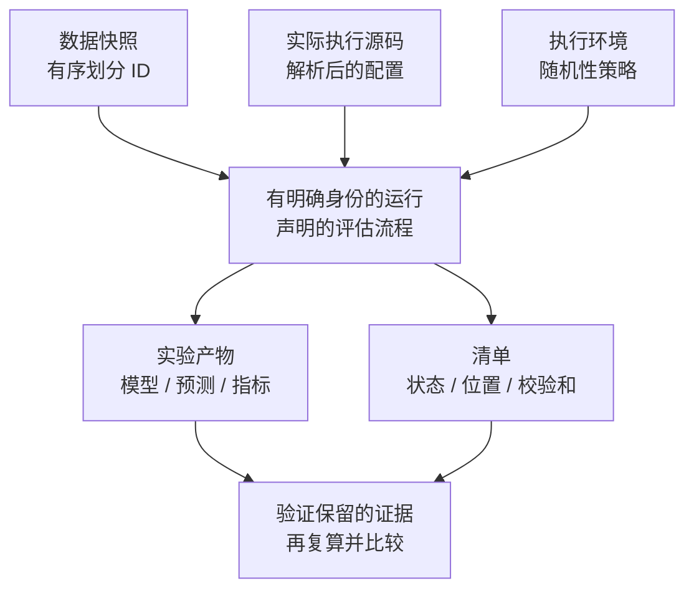

一位同事报告，构建耗时预测器的验证误差为零分钟。一周后，你运行同一个 notebook，却得到不同的分数。文件名没有变，但单元格改过，数据集被替换，也没有人保存哪些行属于验证集。仅凭一个分数，无法知道当时究竟做了什么实验。

本节接续[随机性、重复实验与结果波动](/ai/randomness-repeated-experiments-and-variation/)，假设你已了解训练与验证数据、平均绝对误差（MAE），以及常数模型和直线模型的拟合。学完后，你应当能够：

- 说明重建一次实验运行需要哪些证据。
- 将代码版本、数据身份和配置与保存的输出关联起来。
- 验证实验产物并重新运行小型实验，同时保留原记录。
- 排查复算差异，区分计算结果一致与科学证据。

## 为每个结果建立明确的运行身份

一次**实验**规定研究问题与比较流程；一次**运行**是对某个具体过程的一次执行。**产物**是保存的输入或输出，例如预测结果、模型检查点、配置文件或数据快照。**来源记录**说明这些产物如何生成，以及它们依赖哪些输入。

执行前分配唯一的运行 ID。记录问题、参考方法、评估人群、指标与单位、选择规则，以及允许的数据使用范围，再保存执行细节。“试一个更好的模型”没有说明足够的信息，无法重建或解释结果。

要分别描述三类检查。完整性验证检查保留的字节是否符合记录的身份；计算复算重新执行保存的过程，并在声明的条件下比较输出；独立验证则使用额外证据检验实质性结论，可能采用不同数据或独立实现。文件或分数相同，并不能证明模型能够泛化。

## 保存相互关联的记录

<div class="table-scroll" role="region" aria-label="实验运行的最小记录及其用途" tabindex="0">

| 记录 | 保存内容 | 能解释什么 |
| --- | --- | --- |
| 问题与流程 | 参考方法、指标、单位、选择和失败规则 | 结果能够支持哪些判断 |
| 数据与划分 | 不可变数据身份、模式、各划分按顺序排列的行 ID | 拟合和评估分别使用了哪些案例 |
| 代码 | 提交标识与实际执行源码，包括本地修改 | 执行了哪些转换与拟合步骤 |
| 配置 | 解析后的取值、预处理选择、随机流说明 | 哪些默认值和随机选择影响了执行 |
| 环境 | 解释器、依赖、数值后端、相关硬件和设置 | 哪些执行差异可能改变输出 |
| 输出 | 模型状态、逐案例预测、指标、日志与状态 | 发生了什么，运行是否完成 |
| 产物位置 | 校验和、存储引用、保留与访问规则 | 证据能否继续获取和检查 |

</div>

**清单（manifest）**是一份机器可读的目录，将某次运行与这些记录关联起来。应保存应用默认值和覆盖参数之后的完整配置。如果命令行只是指定一个配置文件，而该文件后来发生变化，仅保留命令行参数并不够。需要精确重现数据归属时，应直接保存划分成员；只保存划分随机种子，还会依赖数据顺序与采样实现。



*图 1：结果与输入及执行条件相互关联。复算既需要保留产物，也需要解释这些产物的过程。*

## 管理代码、数据和执行环境的版本

Git 记录已跟踪文件经过暂存后的快照。一次提交不会自动包含未跟踪数据、尚未暂存的修改，或 notebook 内存里残留的变量。[Git 关于记录变更的文档](https://git-scm.com/book/en/v2/Git-Basics-Recording-Changes-to-the-Repository)说明了工作区、暂存区与已提交快照之间的区别。

正式运行前，先检查工作区，尽量执行干净且已提交的版本。如果允许本地修改，应归档实际执行的源码及相关补丁，并明确标注。重启 notebook，从说明好的入口顺序执行。某个单元格早先执行后留下的内存状态，可能已与保存的 notebook 不同；提交 ID 无法描述那次执行。

在已有的 Git 工作目录中，下面两个只读命令分别显示当前提交，以及包含未跟踪文件在内的工作区变更。状态输出区分已暂存变更和其他修改。先准备要执行的版本，再记录提交；只有处理或归档所有相关修改之后，才能声称该提交完整确定了源码。

```bash
git rev-parse HEAD
git status --short --untracked-files=all
```

小型源码与配置适合放在版本管理中。大数据集与模型检查点通常更适合放在有访问控制的产物存储里，并在清单中记录不可变对象版本与校验和。校验和在所假设的哈希性质下标识字节，但不会保存这些字节。必须保留实际对象，以及访问它的方法。两个 CSV 即使包含等价的数据行，也可能因为换行符不同而具有不同的字节身份。

本例通过 [Python 的 `hashlib`](https://docs.python.org/3/library/hashlib.html) 使用 SHA-256。校验和能发现相对于可信清单发生的变更。如果某人可以同时替换产物和清单，也可以一起替换校验和。敏感或可能遭到攻击的流程，需要独立的访问控制，并在适当情况下使用经过认证的记录。

记录实际使用的解释器与软件包版本。固定依赖版本并保存软件包哈希，可以减少安装时的不确定性；[pip 的可重复安装指南](https://pip.pypa.io/en/stable/topics/repeatable-installs/)还讨论了保留安装产物和平台限制。软件包列表无法覆盖所有驱动、编译库、环境变量或远程服务。应记录与结论有关的因素，并如实标明无法获得的信息。

## 完成一个完整的合成示例

四条训练构建的规模为 `1、2、3、4`，耗时为 `2、4、6、8` 分钟。三条验证构建的规模为 `5、6、7`，耗时为 `10、12、14` 分钟。规模采用任意工作量单位。所有数值都是专门构造的教学数据。

参考模型预测训练耗时的均值，即 `(2 + 4 + 6 + 8) / 4 = 5`。它在验证集上的绝对误差为 `5、7、9`，MAE 为 `7` 分钟。拟合直线的截距为零、斜率为二，预测值为 `10、12、14`，MAE 为零。这个例子演示记录与复算，不提供关于真实构建负载的证据。

两次运行使用完全相同的数据和有序划分 ID，只改变声明的模型选项。验证标签只用于报告，不进入拟合。本例没有随机性，也没有最终测试集。关于模型选择或未来效果的结论，需要另外制定评估计划。

将下面程序保存为 `recorded_experiment.py`，运行 `python recorded_experiment.py`。程序要求 Python 3.9+，只使用标准库，不需要下载数据、凭证或隐藏输入。两个拟合系数组成长为二的向量；预测结果为每条验证记录保留一个带 ID 的标量。拟合代码保持简短，便于看清记录机制。

```python
import csv
import hashlib
import io
import json
import math
import platform
import sys
from datetime import datetime, timezone
from pathlib import Path
from tempfile import TemporaryDirectory


def evaluate(data, split, config):
    reader = csv.DictReader(io.StringIO(data.decode("utf-8")))
    if reader.fieldnames != ["id", "size", "minutes"]:
        raise ValueError("Unexpected data schema")
    rows = {}
    for row in reader:
        if (None in row or any(value is None for value in row.values())
                or not row["id"] or row["id"] in rows):
            raise ValueError("Invalid or duplicate row")
        pair = (float(row["size"]), float(row["minutes"]))
        if not all(math.isfinite(value) for value in pair):
            raise ValueError("Data must be finite")
        rows[row["id"]] = pair
    if (set(split) != {"train", "validation"}
            or any(not isinstance(part, list) or not part for part in split.values())):
        raise ValueError("Provide nonempty train and validation ID lists")
    ids = split["train"] + split["validation"]
    if (any(not isinstance(item, str) or item not in rows for item in ids)
            or len(set(ids)) != len(ids)):
        raise ValueError("Split IDs must exist, be unique, and not overlap")
    if set(config) != {"model"} or config["model"] not in ("mean", "line"):
        raise ValueError("Choose the mean or line model")

    # Fit using only the declared training rows, in their recorded order.
    train = [rows[item] for item in split["train"]]
    mx = sum(x for x, _ in train) / len(train)
    my = sum(y for _, y in train) / len(train)
    slope = 0.0
    if config["model"] == "line":
        denominator = sum((x - mx) ** 2 for x, _ in train)
        if denominator == 0:
            raise ValueError("Line fitting requires varied training sizes")
        slope = sum((x - mx) * (y - my) for x, y in train) / denominator
    intercept = my - slope * mx
    predictions = [{"id": item, "prediction": intercept + slope * rows[item][0]}
                   for item in split["validation"]]
    mae = sum(abs(row["prediction"] - rows[row["id"]][1])
              for row in predictions) / len(predictions)
    if not all(math.isfinite(v) for v in
               [intercept, slope, mae] + [row["prediction"] for row in predictions]):
        raise ValueError("Nonfinite fitted result")
    return {"coefficients": [intercept, slope], "predictions": predictions,
            "mae_minutes": mae, "validation_count": len(predictions)}


def record_run(directory, data, split, config):
    directory = Path(directory)
    directory.mkdir(parents=True, exist_ok=False)
    started = datetime.now(timezone.utc).isoformat()
    encode = lambda value: (json.dumps(value, sort_keys=True, allow_nan=False)
                            + "\n").encode("utf-8")
    artifacts = {"data.csv": data, "split.json": encode(split),
                 "config.json": encode(config),
                 "source.py": Path(__file__).read_bytes(),
                 "environment.json": encode({"python": sys.version,
                     "implementation": platform.python_implementation(),
                     "platform": platform.platform(), "randomness": "none"})}
    failure = None
    try:
        artifacts["result.json"] = encode(evaluate(data, split, config))
    except Exception as error:
        failure = error
        artifacts["failure.json"] = encode({"error_type": type(error).__name__,
                                             "message": str(error)})
    for name, payload in artifacts.items():
        with (directory / name).open("xb") as stream:
            stream.write(payload)
    manifest = {"schema_version": 1, "protocol": "build-duration-mae-v1",
                "status": "failed" if failure is not None else "complete",
                "started_at": started,
                "finished_at": datetime.now(timezone.utc).isoformat(),
                "files": {name: hashlib.sha256(payload).hexdigest()
                          for name, payload in artifacts.items()}}
    # Publish completion only after the listed artifacts have been written.
    with (directory / "manifest.json").open("xb") as stream:
        stream.write(encode(manifest))
    if failure is not None:
        raise failure
    return directory


def replay_run(directory):
    directory = Path(directory)
    manifest = json.loads((directory / "manifest.json").read_bytes())
    required = {"data.csv", "split.json", "config.json", "source.py",
                "environment.json", "result.json"}
    if (manifest.get("schema_version") != 1
            or manifest.get("protocol") != "build-duration-mae-v1"
            or manifest.get("status") != "complete"
            or set(manifest.get("files", {})) != required):
        raise ValueError("Unsupported or incomplete run record")
    artifacts = {name: (directory / name).read_bytes() for name in required}
    for name, payload in artifacts.items():
        if hashlib.sha256(payload).hexdigest() != manifest["files"][name]:
            raise ValueError("Artifact checksum mismatch: " + name)
    if artifacts["source.py"] != Path(__file__).read_bytes():
        raise ValueError("Replay runner differs from recorded source")
    actual = evaluate(artifacts["data.csv"], json.loads(artifacts["split.json"]),
                      json.loads(artifacts["config.json"]))
    if actual != json.loads(artifacts["result.json"]):
        raise ValueError("Replayed result differs from recorded result")
    return actual


def main():
    data = (b"id,size,minutes\nt1,1,2\nt2,2,4\nt3,3,6\nt4,4,8\n"
            b"v1,5,10\nv2,6,12\nv3,7,14\n")
    split = {"train": ["t1", "t2", "t3", "t4"],
             "validation": ["v1", "v2", "v3"]}
    # Private temporary storage keeps this teaching example self-contained.
    with TemporaryDirectory() as temporary:
        root = Path(temporary)
        reference = record_run(root / "reference", data, split, {"model": "mean"})
        candidate = record_run(root / "candidate", data, split, {"model": "line"})
        print(f"reference MAE: {replay_run(reference)['mae_minutes']:.3f} minutes")
        print(f"candidate MAE: {replay_run(candidate)['mae_minutes']:.3f} minutes")
        print("replay matches recorded result:", replay_run(candidate)["mae_minutes"] == 0)

        # A changed retained input must fail verification before fitting.
        (candidate / "data.csv").write_bytes(data.replace(b"t1,1,2", b"t1,1,3"))
        try:
            replay_run(candidate)
        except ValueError as error:
            print("changed data rejected:", "checksum mismatch" in str(error))


if __name__ == "__main__":
    main()
```

以下输出已经使用 Python 3.11.4 实际运行验证：

```text
reference MAE: 7.000 minutes
candidate MAE: 0.000 minutes
replay matches recorded result: True
changed data rejected: True
```

`record_run` 拒绝复用已有目录。评估失败时，它记录异常类型，把清单标为失败，然后抛出异常。复算只接受状态为完成、产物目录符合预期的记录。写入中断可能留下不完整目录；正式产物存储还需要合适的持久化、原子发布、保留和恢复规则。

JSON 键经过排序，以保持序列化规则一致；`allow_nan=False` 拒绝非有限输出，参见 [Python JSON 文档](https://docs.python.org/3/library/json.html)。这种编码只是本例的本地格式约定，不能当作通用的 JSON 规范化标准。验证器先检查保留字节，再要求当前源码与保存版本相同，最后比较完整的解析结果，包括带 ID 的预测。它不会执行下载来的源文件。

本例保存环境信息，但不会重建该环境。复算使用当前解释器，既不逐项比较全部环境细节，也不证明原硬件已经被重建。程序结束时临时目录会被删除；如需长期保存，可把保留且具有访问控制的存储中的新目录传给 `record_run`。这里只处理你自己控制的小型记录包。

## 解释一致与不一致

按依赖顺序排查差异：数据字节与模式、划分成员和顺序、解析后的配置、实际执行代码、环境，最后是输出。一个汇总分数相同，可能掩盖逐案例预测不同或 ID 对调。应保留足够的中间证据来定位分歧，同时避免记录秘密或不必要的个人数据。

这个小型确定性例子适合要求数值精确相等。更大的数值程序可能需要在查看复算结果之前就定义容差：

```math
|E_{\mathrm{replay}}-E_{\mathrm{recorded}}|
\leq \epsilon_{\mathrm{abs}}+\epsilon_{\mathrm{rel}}|E_{\mathrm{recorded}}|.
```

两个 `E` 都是以分钟为单位的有限标量误差。非负的绝对容差单位也是分钟；非负的相对容差没有单位。记录误差为 `0.25` 时，容差 `0.000001` 与 `0.00001` 允许的差值为 `0.0000035` 分钟。复算误差 `0.2500002` 与原值相差 `0.0000002`，因此通过检查。记录误差为零时，允许差异由绝对容差决定。每条按 ID 对齐的预测也应接受适当检查。

[PyTorch 的复现指南](https://docs.pytorch.org/docs/2.15/notes/randomness.html)讨论了不同版本、平台和非确定性操作的限制。容差内的数值一致、检查点逐字节相同，以及重复训练的统计结果一致，是不同的主张。复算应保存成新的尝试，拥有自己的环境记录与比较结果，同时保留原证据。

<div class="table-scroll" role="region" aria-label="复算差异与合适的解释" tabindex="0">

| 观察结果 | 下一步调查 |
| --- | --- |
| 知道校验和，却找不到对象 | 恢复保留的字节与权限；校验和不能重建内容 |
| 数据或划分发生变化 | 确定每次运行使用的评估人群与顺序 |
| 提交相同，预测不同 | 检查本地修改、预处理、配置、随机性与环境 |
| MAE 相同，预测不同 | 按行 ID 比较，并检查误差分组，再判断是否等价 |
| 失败运行没有分数 | 保留失败状态，并执行预先声明的报告规则 |
| 复算准确，未来效果却差 | 检查评估设计、数据泄漏与人群变化 |

</div>

能复现的数据泄漏依然是泄漏。不能根据最终测试结果选择随机种子或配置，不能悄悄替换数据集，也不能从比较中移除失败尝试。对高风险决策，保留的运行记录可以支持审查，但还需要外部验证、相关群体检查，以及具备资格的人员监督。运行记录本身无法证明安全，也不能单独作为上线授权。

## 参考资料

- [Git：记录变更](https://git-scm.com/book/en/v2/Git-Basics-Recording-Changes-to-the-Repository)——暂存、已跟踪与尚未提交的状态。
- [Python：hashlib](https://docs.python.org/3/library/hashlib.html)——字节摘要与 SHA-256。
- [Python：JSON](https://docs.python.org/3/library/json.html)——序列化设置与非有限数值。
- [pip：可重复安装](https://pip.pypa.io/en/stable/topics/repeatable-installs/)——固定版本、软件包哈希与保留安装产物。
- [PyTorch：复现](https://docs.pytorch.org/docs/2.15/notes/randomness.html)——受环境影响的数值行为与重复执行的限制。

## 要点

- 将每个分数关联到具体运行、研究问题、解析后的输入，以及保存的逐案例输出。
- 同时保留代码和数据的实际内容及其身份；提交或校验和无法补回缺失产物。
- 复算前先验证完整性，并明确要检查哪一种数值或统计一致性。
- 失败尝试和复算记录与原记录分别保存；复算成功不代表能够泛化。

## 练习

1. 一份清单记录了 Git 提交和数据集校验和，但训练脚本使用了未跟踪的预处理文件，对象存储也已删除原数据。指出缺失的证据，并说明目前还能验证什么。
2. 运行程序后，把候选模型保存的 `v1` 验证预测从 `10` 改成 `11`，保持原清单不变。预测最先失败的检查。再考虑有人有意更新这个结果文件的校验和，说明接下来应当在哪一步失败。
3. 一次实验只报告表现最好的已完成运行，另外两次尝试失败；复算得到相同 MAE，却产生不同的逐案例预测。描述应如何修正运行记录和比较策略，并解释这些复算结果能否证明模型在未来数据上的效果。

## 答案提示

1. 提交不包含未跟踪的预处理源码，校验和也无法重建已经删除的数据。应保留实际预处理版本、可访问的不可变数据快照、有序划分、配置、环境和输出。仍在手里的文件可以与记录的身份核对，但仅凭那两个标识，无法重建完整计算。
2. 结果文件的校验和在拟合之前就会失败。如果同时修改校验和，重新计算出的 `v1` 预测仍为 `10`，因此完整解析结果的比较会失败。协调替换所有相关证据，可以绕过未经认证的清单；可信存储和经过认证的来源记录处理的是另一类威胁。
3. 保留每次预先声明的尝试的身份、状态和失败信息，并在挑选有利结果之前确定报告规则。比较按 ID 对齐的预测与指定指标，必要时采用有理由支持的容差。即使 MAE 相同，也应调查预测差异。关于未来数据的主张，需要有效的独立评估，超出任何一次复算能够证明的范围。
