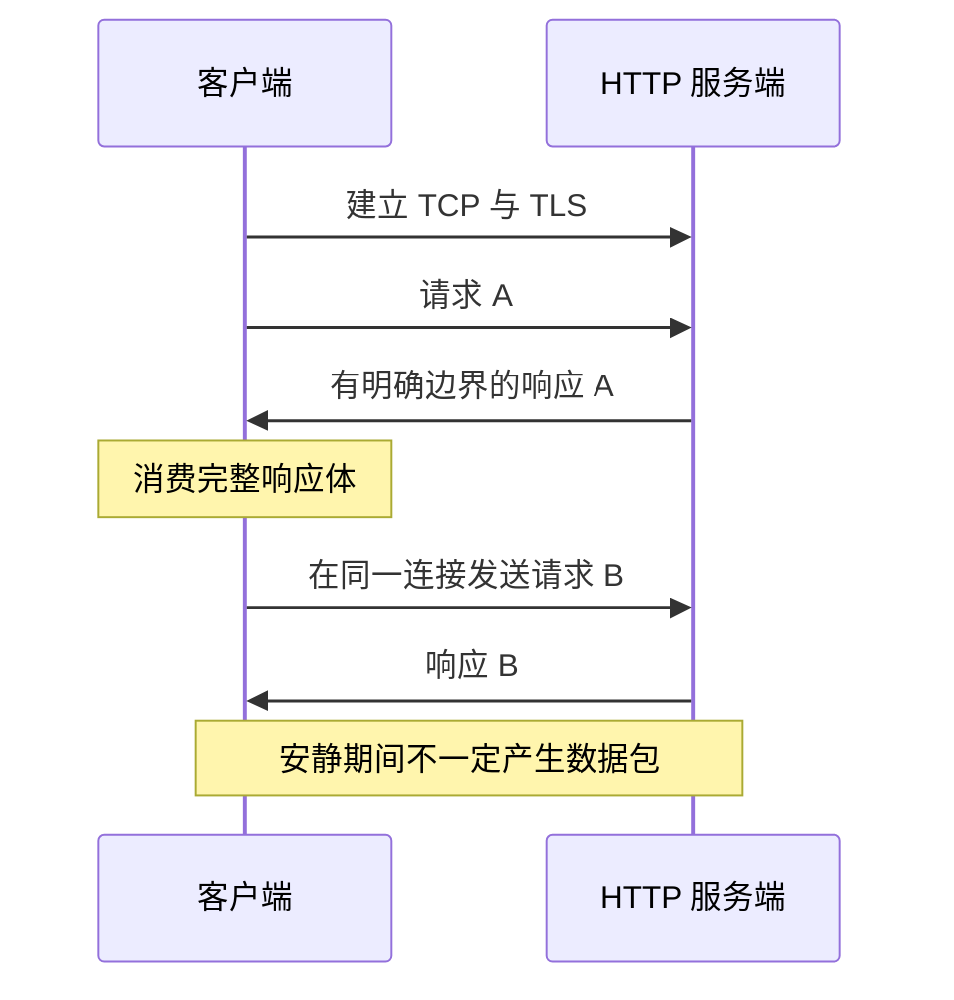
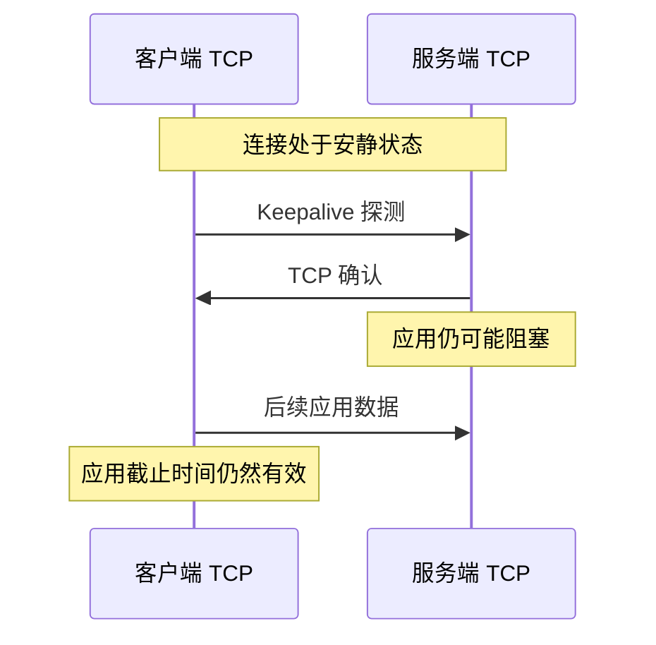
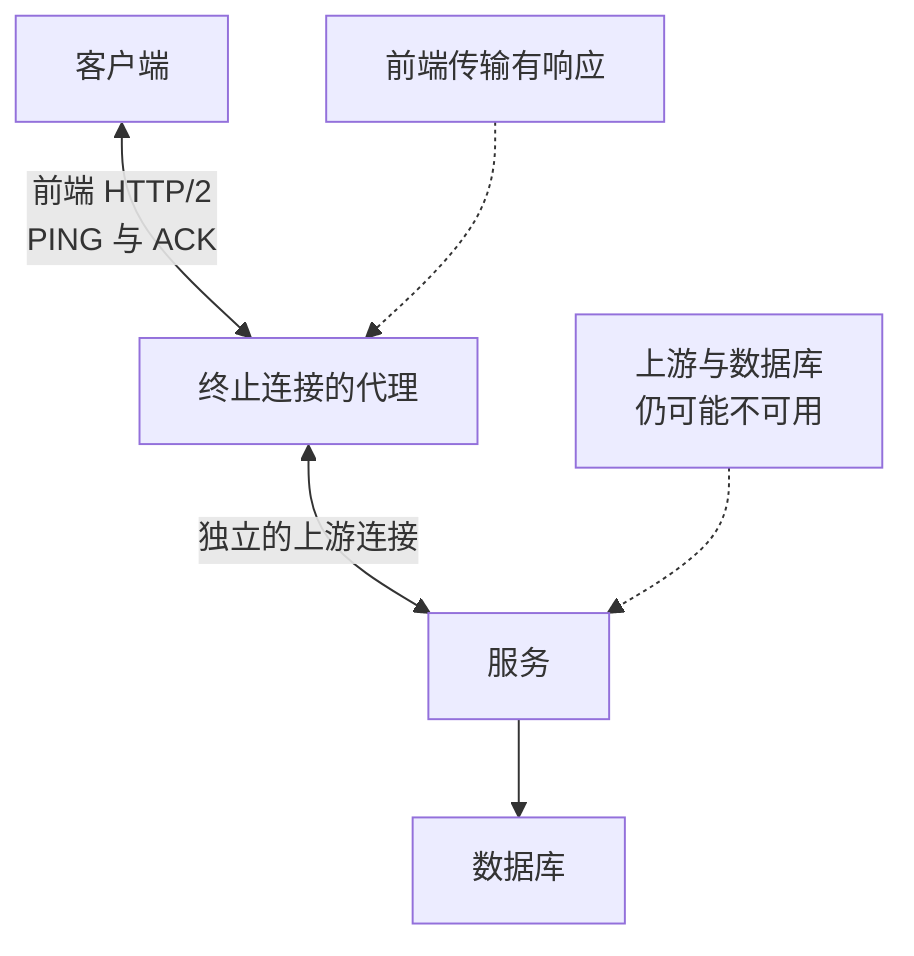
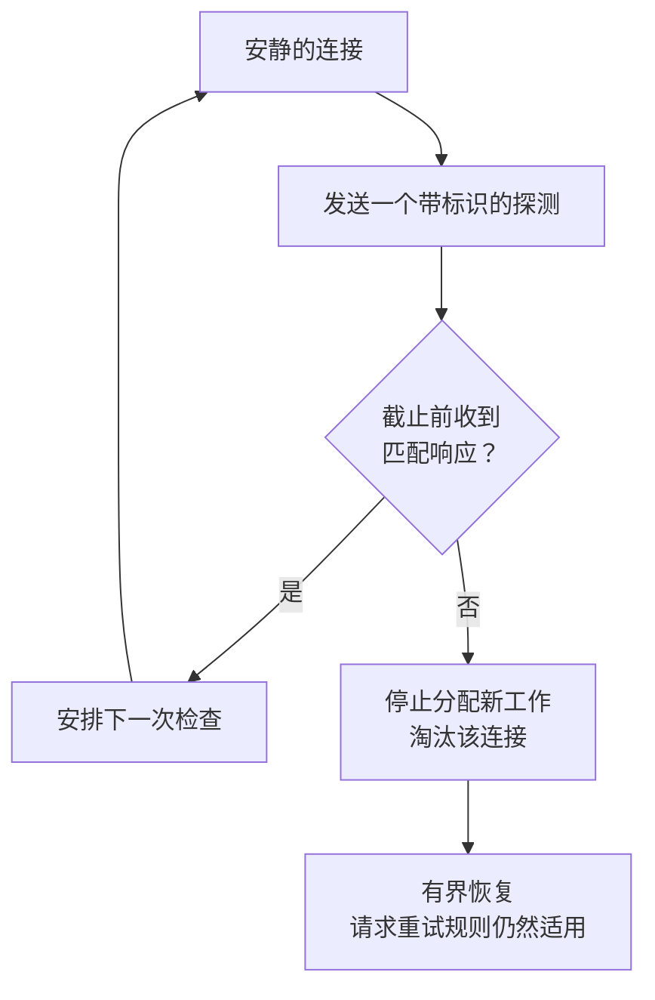

客户端完成一次请求，把连接放回池中，然后等待。五分钟后，下一个请求卡住了。操作系统仍然报告套接字已经建立，但路径上的某台设备已经删除了连接状态。另一个客户端频繁发送 PING，也一直收到响应，业务请求却在无限等待数据库。

两组工程师都启用了某种叫作 keep-alive 的功能。它们解决的是不同问题，也都没有单独构成完整的故障处理策略。

保持连接可用，涉及三个决定：是否复用、安静期间收集什么证据，以及何时退出。本文把这些决定放到 HTTP、TCP、应用协议、代理和连接池中分别解释。数字示例用于容量推理，不是产品实测结果或建议直接采用的默认值。

## 复用从重复建连的成本说起

最直接的客户端每次操作都打开一条连接，完成交互后关闭。所有权简单，结束后也很少保留空闲应用状态。请求量低时，这样做可以满足需要。

随着流量增长，重复建立连接的成本会显现。TCP 同步传输状态，TLS 建立加密状态，有些应用协议还要进行会话认证。复用把这些工作分摊到多个请求上。假设服务每秒接收 20,000 个请求，每条连接平均完成一百个请求，在没有建连失败的稳态下，新建连接速率约为每秒两百条。如果每个请求都新建，就需要每秒两万条。

[连接成本一文](/field-notes/tcp-connection-costs/)进一步说明了这些预算。这里接着讨论两次使用之间的安静时段。保留连接，也会保留内存、文件描述符、路由选择，有时还包括中间设备映射。本地句柄可能比远端进程或流表记录存在得更久。因此，复用策略还需要过期与恢复行为。

## 几种机制共用同一个名字

<div class="table-scroll" role="region" aria-label="Keep-Alive 机制及其提供的证据" tabindex="0">

| 机制 | 做什么 | 成功能说明什么 |
| --- | --- | --- |
| HTTP 持久连接 | 在已有连接上承载后续交互 | 对于已经完成的那次交互，这条连接可以复用 |
| TCP keepalive | 探测没有正常流量的传输连接，并检查响应 | 当时对端 TCP 端点与路径作出了响应 |
| HTTP/2 PING | 交换连接级控制帧及确认 | HTTP/2 对端处理了这次控制交互 |
| 应用心跳 | 执行协议定义的操作 | 仅能说明响应约定中包含的应用工作 |
| 就绪或健康检查 | 报告服务是否应该接收工作 | 在该次观察的有效时间内，检查所覆盖的健康条件成立 |

</div>

HTTP 持久连接本身不会定时发包。TCP keepalive 不会询问数据库能否提交事务。独立控制线程处理的心跳，可能在请求工作线程已经耗尽时仍然成功。应根据需要的证据选择机制。

空闲超时是另一项决定：某种活动缺失一段时间后，释放资源。最大连接年龄限制驻留时间，即使流量持续存在。请求截止时间限制一次操作还有多久使用价值。这三项可以与 keepalive 探测同时存在，但计时起点和重置事件可能各不相同。

## HTTP 持久连接依赖清楚的消息边界

HTTP/1.1 通常允许持久连接，除非连接选项或消息定界方式要求关闭。客户端不必给每个 HTTP/1.1 请求都添加 `Connection: keep-alive`。HTTP/1.0 的持久连接行为不同，这也解释了为什么一些旧客户端示例仍有这类写法。

复用需要知道一条消息在哪里结束。具有独立边界的响应，可以在适用情况下使用有效的 Content-Length 或分块编码。如果响应只能靠关闭连接来表示结束，就无法把这条连接留给下一个响应。正常复用 HTTP/1.1 连接之前，客户端必须消费完整响应体；服务端也必须读完请求体，否则就要关闭。[RFC 9112](https://www.rfc-editor.org/rfc/rfc9112.html#section-9.3)规定了这些规则。



*图 1：HTTP 持久连接允许在完整交互之间复用，它本身不会在安静期间安排探测。*

响应体泄漏，可能让连接一直被占用而无法归还池中，即使套接字本身健康。反过来，丢弃未读完的 HTTP/1.1 响应体后立即归还套接字，可能使下一次解析读到上一个响应残留的字节。应遵循客户端库关于关闭、读尽和取消的约定。HTTP/2 通常可以终止单个流而保留传输连接，但需要按相应协议处理。

HTTP 的 `Connection` 字段控制当前这一跳。[RFC 9110](https://www.rfc-editor.org/rfc/rfc9110.html#section-7.6.1)要求中间代理在转发之前处理连接专属字段。一个 `Keep-Alive` 头无法替整条路径上的所有代理预留连接。HTTP/2 禁止 `Connection` 和 `Keep-Alive` 这类连接专属字段，连接使用由它自己的帧和流规则管理。把旧 HTTP/1.x 头复制到 HTTP/2，并不能产生心跳。

## TCP 探测检查传输端点

没有流量的 TCP 连接可以一直保持已建立状态。如果一台机器突然断电，对端可能收不到 FIN 或 RST。TCP 无法立即区分这种沉默，与一个健康但暂时没有数据要发送的应用。

TCP keepalive 增加了传输层检查。安静达到一定时间后，端点发送一个探测报文，触发对端 TCP 协议栈返回确认。经典探测使用略早于接收方所期望下一个位置的序列号。对端仍保留连接状态时会响应；如果状态已经丢失，可能返回重置；路径黑洞则可能毫无响应。这个过程不要求业务处理器运行。



*图 2：TCP 确认提供的是传输状态证据，不能证明请求处理器或其依赖已经就绪。*

[RFC 1122](https://www.rfc-editor.org/rfc/rfc1122.html#section-4.2.3.6)要求 keepalive 能按连接选择启停、默认关闭，并容忍探测响应丢失。它规定的默认空闲间隔至少为两小时。若要求几十秒内发现安静连接已经断开，这种保守默认值就不适用。

在 Linux 上，`SO_KEEPALIVE` 用来启用机制；受支持时，`TCP_KEEPIDLE`、`TCP_KEEPINTVL` 和 `TCP_KEEPCNT` 分别控制空闲间隔、重试间隔和探测次数。系统默认值影响已经启用探测的套接字，单独看到某个 sysctl 值，不能证明客户端库对这条连接开启了探测。[内核参数文档](https://docs.kernel.org/networking/ip-sysctl.html)列出了默认值与控制项。其他操作系统和托管运行时提供的选项可能不同。

存在未完成传输时，还要考虑重传和其他传输定时器。Linux 的 `TCP_USER_TIMEOUT` 限制已发送数据可持续未确认的时间，或因零窗口而无法发送的缓冲数据可以等待多久。与 `SO_KEEPALIVE` 一起使用时，它也影响 keepalive 失败后的关闭判定。它不会安排探测，更不会创建业务请求截止时间。[Linux TCP 手册](https://man7.org/linux/man-pages/man7/tcp.7.html)说明了这些区别。

## 协议心跳可以到达不同层次

HTTP/2 PING 是连接级帧，流 ID 为零，载荷为八个不透明字节。确认返回相同载荷，可用于匹配请求和响应。它不关联某个具体请求流是否成功。帧头和载荷合计十七字节，尚未计入 TLS、传输层和网络层开销。[RFC 9113](https://www.rfc-editor.org/rfc/rfc9113.html#section-6.7)定义了这一交互。

PING 与其他 HTTP/2 流量走同一条有序 TCP 连接。提高处理优先级，也无法让它的字节绕过缺失的 TCP 报文段。本地写队列和事件循环调度同样影响观察到的 PING 延迟，因此过短超时可能把拥塞或暂停误判成对端失败。

gRPC 使用 HTTP/2 PING 实现连接 keepalive。客户端与服务端需要对允许的频率、没有活跃调用时能否发送探测达成一致。不被接受的策略，可能导致带 `too_many_pings` 信息的 GOAWAY。[gRPC 指南](https://grpc.io/docs/guides/keepalive/)提醒谨慎启用没有调用时的空闲探测，并避免把客户端间隔设得远低于一分钟。具体选项与约束取决于实现，不能只把一种语言的 channel 参数复制到另一种语言。

对于长时间存在的流，发现传输失效可以释放卡住的资源并开始恢复，但不能恢复应用在流中的处理位置。需要重放时，应保存游标或序列确认，用有界退避重连，并明确哪些内容可以重新发送。

应用心跳可以包含更强检查，例如进入与普通操作相同的事件循环或工作队列。结果仍然只覆盖这项检查。如果每次心跳都写一次数据库，就可能把便宜的连接检查变成新的负载来源。gRPC 的[健康检查协议](https://grpc.io/docs/guides/health-checking/)另行报告服务状态，服务如何根据依赖和过载更新这个状态，需要明确策略。

## 跟踪每个终止连接代理的两侧



*图 3：终止连接的代理为自己的前端连接作答。上游传输和业务依赖需要各自的观察与预算。*

选择间隔之前，先画出路径。客户端可能经过有状态防火墙连接代理，代理再通过负载均衡器连接服务。传输探测到达该段链路的 TCP 端点；应用协议 PING 到达相应协议连接的端点。转发设备可以维护状态，却不一定成为其中任何一种端点。

随后记录每个定时器的归属、起点、重置事件和关闭行为。线路上的字节可能刷新按流计算的定时器，却不影响按请求计算的定时器。Envoy 根据没有活跃请求的时段，定义 HTTP 连接空闲超时，所以 HTTP/2 PING 不能阻止这种空闲关闭。它的协议选项同时独立提供 PING 设置。[Envoy 文档](https://www.envoyproxy.io/docs/envoy/latest/api-v3/config/core/v3/protocol.proto.html)明确区分了两者。

AWS Application Load Balancer 文档说明，HTTP/2 PING 帧不会重置它的空闲超时。因此，不能假设本地有效的 gRPC PING 策略能保住 ALB 连接。应检查实际协议和部署路径，使用受支持的策略，不要仅为了绕过有意设置的空闲清理就制造应用流量。[ALB 属性文档](https://docs.aws.amazon.com/elasticloadbalancing/latest/application/edit-load-balancer-attributes.html)描述了这一行为。

## 按含义协调定时器

没有一套超时大小顺序能适用于所有链路和事件定义。先确定在管理哪个空闲对象的所有权，再协调能够让它退出的双方。

客户端池从会关闭不活跃连接的服务端借用连接时，提前淘汰本地空闲项，可以减少复用已关闭套接字的机会。如果双方从同一段安静时间开始计算，示例中的连接池空闲限制为四十五秒、服务端为空闲六十秒，就留下十五秒余量。调度、最后使用时间的口径和关闭竞态仍然有影响，这并不保证每次借用都成功。

如果代理拥有上游连接池，就协调该池的退出时间与后端空闲策略。后端保留时间长于代理准备继续复用的时间，可以减少这一段链路的竞态。这里讨论的是代理到后端，并不表示外部客户端池应该比代理前端限制保留得更久。

如果产品要求空闲会话跨过流超时仍然存在，就需要让符合要求的流量，在超时之前到达，并给延迟留余量。设 `I` 为配置间隔，`J` 为最大附加随机偏移，`D` 为允许的调度和投递余量，`T` 为相关流空闲超时的最小值，可以使用以下规划条件：

```math
I + J + D < T
```

这条条件假设所选数据包会重置正在考虑的每个定时器。它无法维持一个忽略该探测、按请求计算的空闲策略；无界丢包或调度暂停，也会使延迟余量假设失效。即使持续有流量，最大连接年龄仍然可以按设计触发关闭。

<div class="table-scroll" role="region" aria-label="彼此独立的连接与请求定时器" tabindex="0">

| 定时器 | 大致从何时开始或重置 | 预期动作 |
| --- | --- | --- |
| 连接池空闲限制 | 客户端库定义的最后归还或活动时刻 | 移除未使用的可复用项 |
| TCP keepalive 空闲间隔 | 协议栈定义的传输活动 | 开始探测没有正常流量的连接 |
| 协议 PING 超时 | 一次尚未完成的协议探测 | 停止依赖无响应的协议连接 |
| 请求截止时间 | 操作创建或准入约定 | 停止等待该操作，并传播取消 |
| 流空闲限制 | 为该流定义的活动 | 结束进展不足的流 |
| 最大连接年龄 | 建立连接时刻 | 排空或淘汰过旧连接 |

</div>

长时间运行的 RPC 可以使 HTTP 连接始终不算空闲，却没有有效进展，PING 也可能一直有响应。因此，还要保留请求或流进展预算。短的一元 RPC，通常会先达到自身截止时间，后台 keepalive 周期还来不及发挥作用。

## 把心跳超时作为有明确范围的失败判断

没有响应，可能表示对端已停止、数据包丢失、路径拥塞、进程暂停，也可能是本地调度器没有运行。更短的间隔与超时可以缩短检测时间，但会增加误判和重连工作。任何心跳都无法区分所有网络分区与机器故障。

以每隔 `I` 秒发送、超时为 `H` 的应用心跳为例。假设黑洞在相邻探测之间的随机时刻开始，只允许一个未完成探测，也没有其他流量。那么检测耗时大约是距离下次探测的等待时间加 `H`，范围为 `H` 到 `I + H`。取 `I = 30 s`、`H = 5 s`，约为 5–35 秒；如果发生时刻均匀分布，平均为二十秒。这个模型不等于 Linux TCP 重试时序，也不是对某个 gRPC 运行时的承诺。



*图 4：探测超时使我们不再信任某条连接。恢复是独立策略，仍受准入、截止时间和重放约束。*

用单调时钟测量间隔，把响应与当前探测及连接代数关联，连接退出时取消定时器。旧连接迟到的响应，不能把替代连接标记为健康。不要堆积无界的未完成探测队列。协议状态机应交给成熟协议库管理。

淘汰套接字，不会撤销远端进程提交写入的权限。领导权、锁和排他所有权，需要独立租约或隔离令牌协议。同样，响应丢失不能说明支付或任务提交是否已经执行。重试应依据应用幂等性与持久化回执，并设置有限尝试预算。

## PING 成功后仍然可能发生的故障

<div class="table-scroll" role="region" aria-label="Keep-Alive 故障场景与恢复限制" tabindex="0">

| 情况 | 可观察行为 | 有用的处理方式 |
| --- | --- | --- |
| 主机断电或路径黑洞 | 本地安静套接字可能仍显示已建立 | 传输或协议检测，加上操作截止时间 |
| 进程崩溃，协议栈关闭套接字 | FIN 或 RST 可能早于探测到达 | 及时观察关闭事件，移除池中记录 |
| 代理健康，上游卡住 | 前端探测成功，请求却没有进展 | 分开管理上游健康、准入与请求截止时间 |
| 运行时暂停或本地 CPU 饱和 | 响应或定时器回调迟到 | 观察调度延迟，保留经过测试的余量，限制重连 |
| 中间设备忘记空闲流 | 下次复用失败或卡住 | 提前淘汰；必须保持空闲连接时，使用符合要求的探测 |
| 服务端拒绝过密的 gRPC PING | GOAWAY 或反复重连 channel | 对齐客户端策略与服务端限制 |
| 响应体读取慢，长期占用池资源 | 即使探测成功，连接池等待仍增长 | 修复响应生命周期、并发限制和慢消费者处理 |
| 一个区域故障 | 大量连接同时失败 | 为存活区域准备握手能力，并限制恢复流量 |

</div>

健康检查也可能在普通过载期间失败。这时如果所有会话都重连，就会向已经饱和的系统增加 TCP、TLS、认证和订阅恢复工作。应使用随机退避、并发上限和恢复准入。不要仅因为一个依赖连接失败，就重启整个健康进程。

连接复用还存在预检查无法消除的异步关闭竞态：检查成功后，对端可能立即关闭。因此，即使空闲探测刚成功，也要保留正常错误处理。安全清理与重放规则，比不断提高检查频率更能妥善处理这种竞态。

## 扩大规模时，也要核算探测成本

一百万条没有其他流量的连接，每三十秒探测一次，就会产生约**每秒 33,333 次探测**；健康时还会有大致同样数量的响应。如果双方都以这个频率独立发起，这两项总量约翻倍。有正常流量时的探测抑制，以及具体实现策略，可能降低数量。

假设测得每次探测加响应，线路合计消耗二百字节，那么仅一方发起探测，就约需 **6.67 MB/s**，持续一天约 **576 GB**。二百字节是示例假设，实际流量取决于 TLS 记录、包头、确认、合并和分包。小消息的主要成本可能在数据包处理和唤醒，而不是载荷带宽。

定时器也需要状态。应使用事件循环调度或合适的定时器设施，而不是每个套接字配一个休眠线程。定时器堆的调度操作通常为对数复杂度；在时间精度合适时，时间轮可以降低摊销管理开销，但大量定时器落在同一到期桶里，仍然会形成突发。在有界策略内随机化初始相位与后续调度，并把最长间隔纳入空闲超时预算。

小规模系统可能只需要共享的可复用客户端和有界连接池。扩大到服务集群时，要盘点每个连接池的持有者、代理链路和服务端策略。扩大到全球时，要计入区域撤离期间的重连能力。减少多路复用传输连接，可以减少探测数量，但每条失败连接会同时影响更多流。

移动设备上，频繁的小包可能反复唤醒无线模块、消耗电池。如果产品不需要始终就绪的会话，可以允许空闲关闭，并在有需求时重连。为了下一次操作的最低延迟，可能要在连续数小时没有操作时持续支付后台成本。

## 排空连接与维持存活分开处理

部署需要主动退出健康连接的办法。停止向连接分配新工作，允许符合条件的在途工作完成，并设置排空截止时间。HTTP/1.1 可以在交互中发出关闭信号，HTTP/2 可以发送 GOAWAY。探测成功或持续有请求，都不应该阻止有意安排的连接退出。

长连接保留着之前的路由选择。增加实例或改变 DNS，主要影响新连接，已有会话仍可能集中在旧目标上。有界最大年龄可以逐步刷新分布，代价是增加建连。应给年龄上限加入随机偏移，并预热替代连接，避免同步重连。

正在排空的连接与替代连接可能同时存在。应核算重叠容量、TLS CPU 和应用重放。流式会话需要保存足够的应用状态以便续接，或者明确报告中断。重新建立 TCP 无法重建应用从未持久化确认的事件。

## 近几年的变化让生命周期控制更明确

2022 年 6 月的 HTTP 规范区分了 HTTP/1.1 持久连接、HTTP/2 控制帧和 HTTP/3 的传输行为。[HTTP/3](https://www.rfc-editor.org/rfc/rfc9114.html)使用 QUIC，因此 TCP keepalive 选项不控制它的连接。

QUIC 有自己的协商空闲超时，以及会触发确认的 PING 帧。双方通告的非零空闲值中，较小者决定有效值，协议规则同时考虑探测超时。传输流量可以推迟过期，但中间设备可能更早过期。[QUIC 规范](https://www.rfc-editor.org/rfc/rfc9000.html#section-10.1)描述了这些规则。独立的流交付改变了传输行为，但确认依然不能代表业务就绪。QUIC 连接迁移也不会把应用所有权转交给替代服务端进程。

**2024 年 3 月**，AWS 为 ALB 增加可配置的 HTTP 客户端 keepalive 时长。它独立于空闲超时，控制客户端连接年龄。达到年龄后，ALB 再接受一个请求，再通过 HTTP/1.x 关闭信号或 HTTP/2 GOAWAY 优雅关闭。已有连接保留建立时分配的时长。[发布公告](https://aws.amazon.com/about-aws/whats-new/2024/03/application-load-balancer-http-keepalive-duration/)将这项控制与部署、可用区撤离联系起来，[配置文档](https://docs.aws.amazon.com/elasticloadbalancing/latest/application/edit-load-balancer-attributes.html)区分了两个时钟。

**2024 年 9 月**，AWS 增加可配置的 NLB TCP 空闲超时，范围为 60 至 6,000 秒，变更只作用于新连接。[工程说明](https://aws.amazon.com/blogs/networking-and-content-delivery/introducing-nlb-tcp-configurable-idle-timeout/)解释了保留流与占满跟踪表之间的取舍。[当前监听器文档](https://docs.aws.amazon.com/elasticloadbalancing/latest/network/update-idle-timeout.html)区分 TCP 与 TLS 监听器，并提醒目标接口还有独立的跟踪超时。提高一个限制，不会延长路径上所有状态持有者的生命周期。

当前 Envoy 协议选项包括周期 PING、随机偏移，以及在空闲连接创建新流之前先探测。这些是需要对照已部署版本验证的实现选择，不是 HTTP 的新保证。它们体现了一种有用的方向：分别配置复用、观察和退出，再测量组合效果。

## 根据产品需要决定保留多少空闲状态

<div class="table-scroll" role="region" aria-label="空闲连接策略及其取舍" tabindex="0">

| 策略 | 适用情况 | 成本或剩余限制 |
| --- | --- | --- |
| 每次操作后关闭 | 操作稀少，希望所有权简单 | 重复建立与退出清理工作 |
| 复用，并限制空闲保留 | 请求频繁，可以接受首次复用失败后的恢复 | 状态仍然存在，关闭竞态也仍然存在 |
| 使用探测保留安静会话 | 长会话需要及时发现传输失效 | 数据包、定时器、电量和误判成本 |
| 安静后先探测再复用 | 昂贵操作需要较新的路径检查 | 首次使用增加延迟，检查与使用竞态仍在 |
| 检查应用进展 | 正确性取决于传输对端之外的工作 | 检查更贵，需要范围明确的成功约定 |

</div>

更严格的检测要求，可以支持缩短间隔，但前提是服务端允许、整个集群也负担得起。更长空闲驻留，应该有足够的复用收益支撑，且保留状态符合资源预算。对于很少发生的操作，重新连接可能比无限期维护大量安静连接更便宜。

启用 HTTP 持久连接，不会自动启用 TCP 探测；Keep-Alive 头不能协商每一跳的存活时间；PING 确认不能证明数据库健康；统一提高所有超时，可能延长卡顿并保留多余状态。每项配置都应该说清归属、触发事件、证据和恢复动作。

## 按可观察的阶段运行这套策略

记录建连与复用、连接池等待、存活与空闲数量、活跃流、空闲淘汰、最大年龄排空、关闭原因和重连尝试。握手延迟与 CPU，要和操作延迟分开测量。按路径和目的端跟踪 PING RTT、探测超时、服务端限制错误，以及本地事件循环延迟。

检查生效配置，不能只看源配置。Linux 上，`ss -to` 等套接字诊断可以显示活跃定时器信息，`ss -tinm` 提供传输与内存细节。应在相关网络命名空间执行。抓包或受控丢包测试，可以确认探测是否发出、由哪个对端作答；检查敏感流量时，遵守所在环境的访问规则。

上线前测试四种不同情况：安静且健康的连接、传输黑洞、代理有响应但上游阻塞，以及部署排空。再加入运行时暂停和客户端与服务端 PING 策略冲突，验证截止时间、恢复限制、池清理和流续接行为。这些测试比仪表盘只显示“连接已建立”提供更多依据。

先在少量流量上修改一层。既观察省掉的握手，也观察保留内存、包速率、空闲失败和重试。有些策略只对新连接生效，因此发布期间混合存在新旧配置是正常情况。逐步替换，不要为了立即收敛而断开整个集群。

## 评估所有权与故障边界

实现评审可以检查套接字选项或 channel 参数是否正确设置。更大范围的设计评审，会追踪这个设置到达哪里：内核、HTTP 对端、代理、请求工作线程还是依赖。还要确定数千连接同时被判定不可用时，由哪个系统承担成本。

例如，把探测移到代理，可以集中管理策略、减少应用配置，但也可能让应用在上游事故期间继续信任健康的本地代理。更快的故障检测，可以改善流恢复，却增加调度暂停时的连接变动。最大年龄可以改善流量重新分配，同时增加身份认证与握手需求。

为每项策略保留三份记录：**复用**说明哪些工作可以共享连接，**观察**说明什么响应能构成证据、证据有效多久，**退出**说明谁停止使用连接，以及未完成工作如何恢复。完整策略应把这些记录与请求截止时间、应用重放约定连接起来。

## 延伸阅读

- [RFC 9112 的 HTTP/1.1 持久连接部分](https://www.rfc-editor.org/rfc/rfc9112.html#section-9.3)解释消息边界、复用和异步关闭竞态。
- [RFC 1122 的 TCP keepalive 部分](https://www.rfc-editor.org/rfc/rfc1122.html#section-4.2.3.6)定义保守默认值，以及容忍探测响应丢失的要求。
- [Linux TCP 手册](https://man7.org/linux/man-pages/man7/tcp.7.html)和[内核 IP 参数](https://docs.kernel.org/networking/ip-sysctl.html)解释每套接字控制、系统默认值和 user timeout 行为。
- [RFC 9113 的 HTTP/2 PING 部分](https://www.rfc-editor.org/rfc/rfc9113.html#section-6.7)定义连接级探测及其确认格式。
- [gRPC keepalive 指南](https://grpc.io/docs/guides/keepalive/)解释客户端与服务端协调、策略限制，以及连接失败对长调用的影响。
- [gRPC 健康检查](https://grpc.io/docs/guides/health-checking/)介绍区别于连接探测的服务可用性信号。
- [Envoy 协议选项](https://www.envoyproxy.io/docs/envoy/latest/api-v3/config/core/v3/protocol.proto.html)区分按请求定义的空闲超时、连接年龄和 PING 调度。
- [ALB 连接属性](https://docs.aws.amazon.com/elasticloadbalancing/latest/application/edit-load-balancer-attributes.html)区分空闲超时与客户端连接年龄，并说明 HTTP/2 PING 行为。
- [2024 年 3 月的 ALB 公告](https://aws.amazon.com/about-aws/whats-new/2024/03/application-load-balancer-http-keepalive-duration/)解释可配置客户端连接时长的运维动机。
- [2024 年 9 月的 NLB 工程说明](https://aws.amazon.com/blogs/networking-and-content-delivery/introducing-nlb-tcp-configurable-idle-timeout/)把流保留与跟踪容量联系起来；[监听器配置](https://docs.aws.amazon.com/elasticloadbalancing/latest/network/update-idle-timeout.html)说明当前适用范围。
- [RFC 9000 的 QUIC 空闲超时部分](https://www.rfc-editor.org/rfc/rfc9000.html#section-10.1)解释 UDP 上的传输存活检查与空闲过期推迟机制。
- [HTTP/3 规范 RFC 9114](https://www.rfc-editor.org/rfc/rfc9114.html)说明 HTTP 连接管理如何映射到 QUIC。
