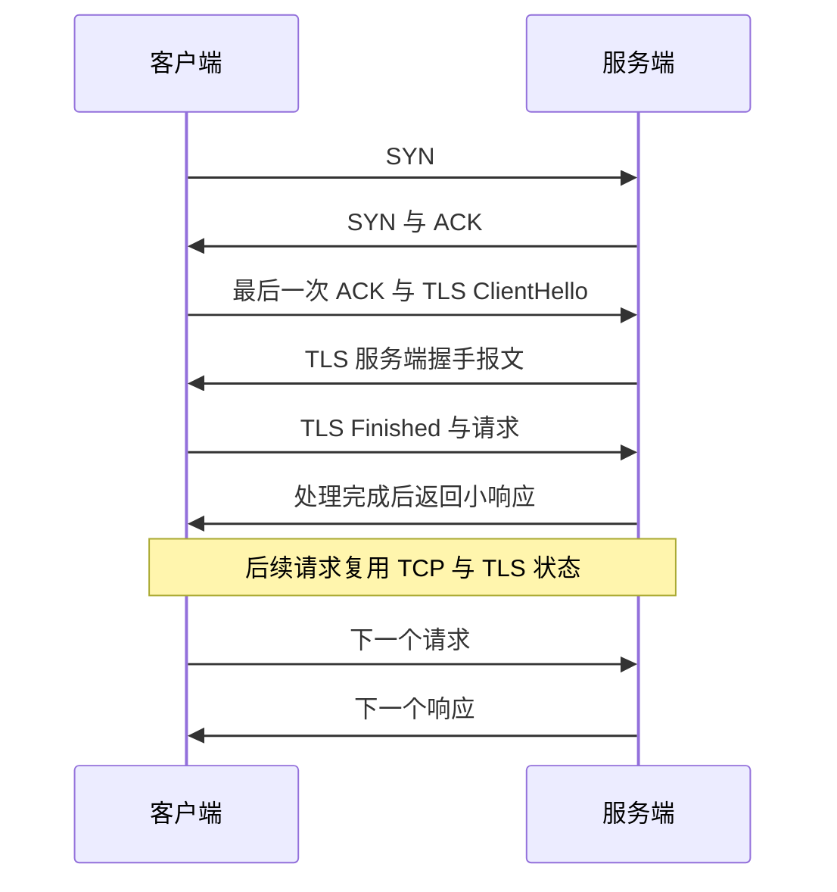
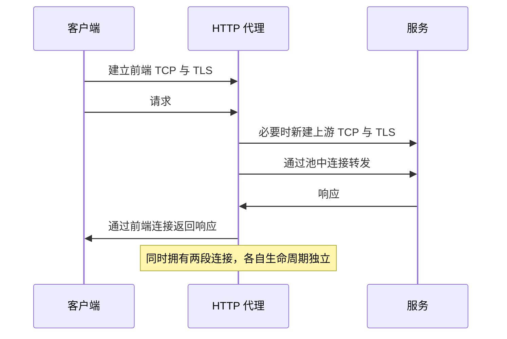
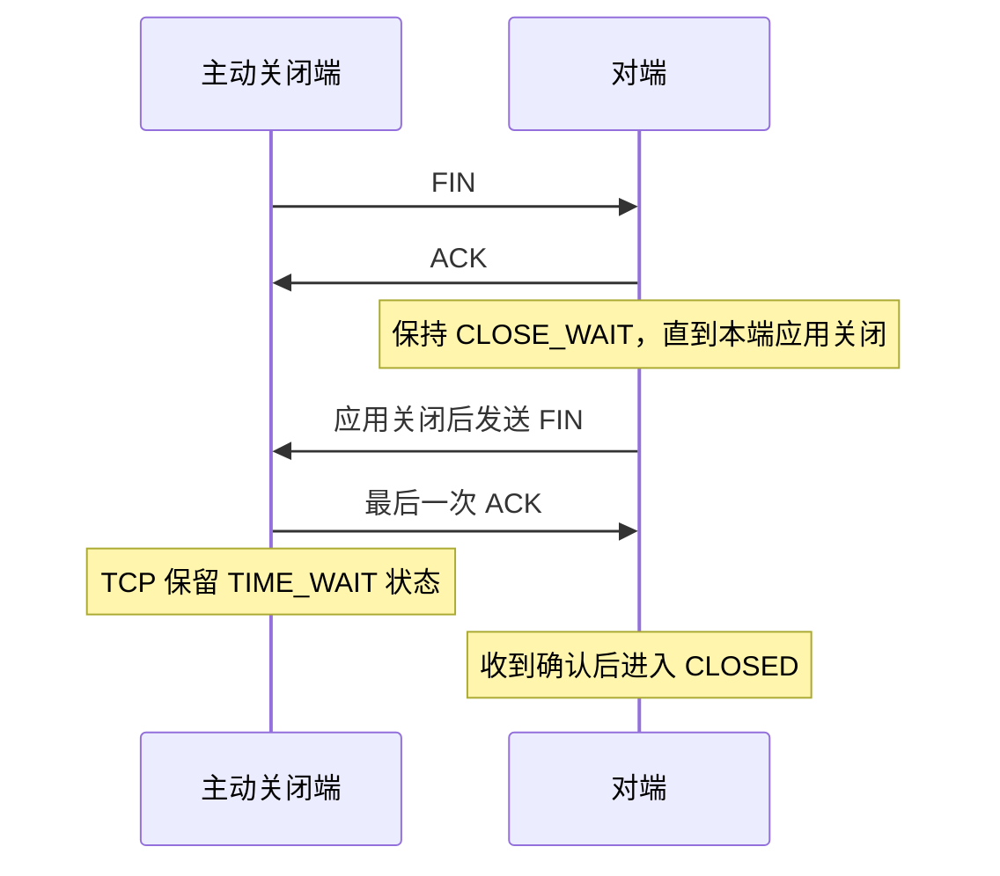
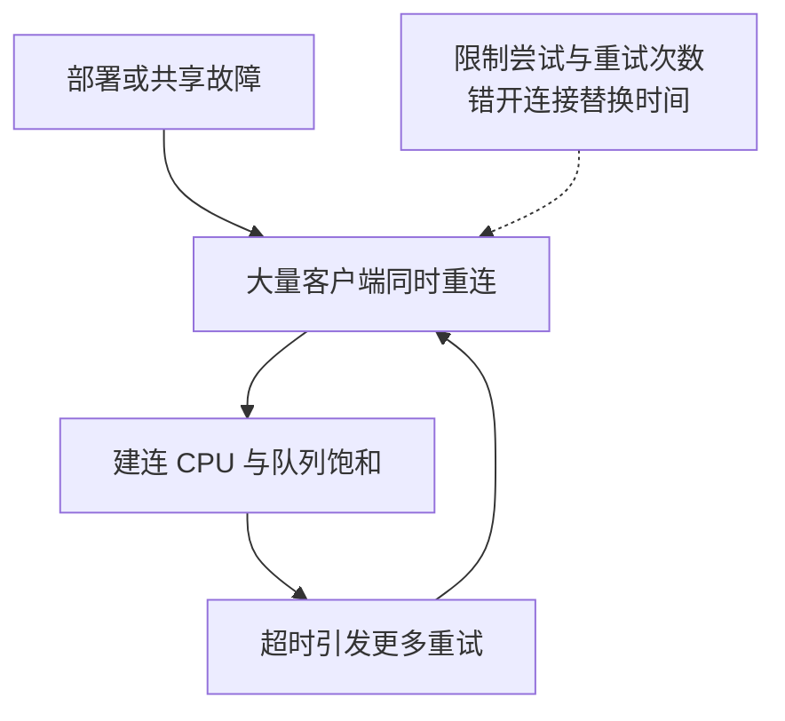

一个服务只需五毫秒就能完成请求处理。调用方与它之间的网络往返时延是五十毫秒。调用方建立连接、协商 TLS、发送一个小请求、读完响应，然后关闭连接。为了得到这五毫秒的处理结果，调用方要先完成多次网络往返。如果每秒有四万个请求，基础设施也就需要每秒建立并关闭四万条连接，还要处理关闭后留存的状态。

复用连接能够大幅减少这部分成本，同时也会让套接字、缓冲区、凭证和路由选择在请求之间继续存在。节省握手 CPU 的连接池，可能耗尽下游的连接配额；大量空闲套接字也可能仍然留在本机，而路径上的防火墙早已删除了对应的流记录。

核算时，应当覆盖连接的整个生命周期：建立连接、维持可用状态，以及清理退出后的状态。请求速率、同时存在的连接数、新建连接速率是三项独立指标。下文的数字用于演示计算，不是基准测试结果，也不是建议直接采用的默认配置。

## 从一条连接上的一次请求说起

TCP 在两个端点之间提供有序字节流，并通过相应机制恢复丢失的数据。两个端点各自记录这条字节流的传输进度。网络不会为这段通信预留专用线路或固定带宽。应用程序持有的套接字句柄指向本地状态；服务端接收新连接时，会使用区别于监听套接字的独立套接字。[Linux TCP 接口](https://man7.org/linux/man-pages/man7/tcp.7.html)向应用程序提供了这些操作。

每个请求单独建立连接，容易理解和管理。不需要共享连接池，每个调用方独立拥有自己的连接，关闭连接就结束了这次对传输通道的使用。对于偶尔执行的管理命令或请求量很低的系统集成，这样做可以满足需要。

当建立连接的工作比实际业务处理重复得更频繁时，成本就会显现。新建 TCP 连接需要同步两端状态，TLS 随后建立加密上下文，数据库或消息协议还可能继续进行身份认证、能力协商或会话初始化。如果把这些工作全部称为“TCP 开销”，就看不出某项优化究竟能省掉哪一部分。

考虑普通 TCP 连接、一次完整的 TLS 1.3 握手，以及一个小请求和小响应。假设 DNS 已缓存，没有丢包，加密计算与排队耗时可忽略，而且报文大小允许它们按预期批次完成传输。网络往返时延为 `R` 时，客户端大约先等待一个 `R` 完成 TCP 建立，再等待一个 `R` 完成 TLS，最后用一个 `R` 完成应用请求与响应。复用已有连接时，只剩最后一次应用交互。

取 `R = 50 ms`，加上服务端五毫秒的处理时间，**新建连接的一次交互约为 155 ms，复用连接约为 55 ms**。这只是简化估算。丢包、较大的握手报文、证书检查、额外代理和调度都会改变结果。



*图 1：一次普通的新建连接交互，以及随后的连接复用。TCP 确认和 TLS 记录可以放进同一个数据包，图中表示逻辑传输批次，不规定固定的数据包数量。*

TLS 会话恢复可以节省证书处理和密钥建立的部分工作，但仍然可能需要建立新的 TCP 连接。未使用提前数据的普通 TLS 1.3 会话恢复，也仍需一次 TLS 往返。可选的 0-RTT 数据具有较弱的重放防护，应用必须明确哪些操作允许重复执行。不能仅仅因为延迟曲线更好看，就打开这项功能。[RFC 8446](https://www.rfc-editor.org/rfc/rfc8446.html#section-2)分别定义了这些交互方式。

[TCP 三次握手一文](/field-notes/tcp-three-way-handshake/)解释了状态同步本身。本文关注系统多久支付一次这笔成本，以及交互结束后还保留着哪些资源。

## 增加容量之前，先分清各项预算

在单个端点上，建立连接需要 CPU 处理数据包、创建套接字、完成协议协商，以及在本端执行的 TLS 工作。连接保持打开时，会占用内核和应用状态。连接上的流量还会产生加密、复制、调度和数据包处理等额外工作。

有些成本随连接数量变化，有些随字节数或数据包数量变化，还有些随请求量变化。扩大连接池无法解决业务计算造成的 CPU 瓶颈。减少握手次数，也不会消除对同样一份应用数据进行加密的成本。

<div class="table-scroll" role="region" aria-label="连接资源预算及其核算范围" tabindex="0">

| 预算 | 主要影响因素 | 需要采集的依据 |
| --- | --- | --- |
| 建立连接的 CPU | 新建连接尝试、TLS 模式、身份认证 | 每秒尝试次数、握手 CPU、完整 TLS 握手与会话恢复次数 |
| 端点内存 | 存活套接字、排队字节、TLS 与应用缓冲区 | 代表性负载下的套接字内存、内核内存统计、进程内存 |
| 文件描述符 | 应用持有的套接字句柄及其他已打开资源 | 进程描述符数量、上限、分配失败情况 |
| 源地址端口组合与中间设备状态 | 目的端集中程度、流数量、状态保留时间 | 端口分配错误、跟踪流数量、NAT 分配与拒绝指标 |
| 应用并发 | 活跃请求或流的数量及持续时间 | 正在执行的工作、连接池等待、待处理请求、截止时间耗尽 |
| 退出清理能力 | 关闭速率、排空时长、保留的 TCP 状态 | 主动关闭次数、正在排空的套接字、CLOSE_WAIT 与 TIME_WAIT 数量 |

</div>

还要明确核算边界。NAT 保存映射和跟踪状态。终止 TCP 连接的 HTTP 代理，在面向客户端和面向上游的两段链路上都拥有传输状态，也可能在两段链路上都终止 TLS。数千条前端连接可以共享数量更少的上游连接，因此两侧的连接数未必相同。



*图 2：终止连接的代理形成了两套独立的连接预算。位于任意一段链路上的 NAT 或转发设备，可以额外保留流状态，但不一定成为 TCP 端点。*

一个业务请求可能跨过多个这样的边界。存在连接终止时，就要核算对应链路，但不能假定每个负载均衡器都会建立新的 TCP 连接。[端口与套接字一文](/field-notes/ports-sockets-connections-and-capacity/)和 [NAT 一文](/field-notes/nat-addresses-ports-and-connection-state/)进一步解释了这些区别。

## 新建连接速率决定了多少 CPU 开销

设 `k` 为一条已建立连接平均完成的请求数。对于稳定、且没有建连失败的负载，用请求速率除以 `k`，可以估算所需的新建连接速率。再乘以实测的单次建连 CPU 时间，就能估算建立连接本身需要的 CPU：

```math
\begin{aligned}
\lambda_{\mathrm{open}} &\approx \frac{\lambda_{\mathrm{request}}}{k} \\
\mathrm{CPU}_{\mathrm{setup}} &\approx \lambda_{\mathrm{open}}\,c_{\mathrm{open}}
\end{aligned}
```

每秒四万个请求，如果每个请求都新建连接，就需要每秒建立四万条连接。如果每条连接平均处理两百个请求，新建连接速率就降为每秒两百条。

假设对端点单独测量后，发现每次建立连接平均消耗两毫秒 CPU 时间，其中包括本端的 TLS 工作。那么，第一种设计需要**每秒 80 个 CPU 秒**，第二种只需**每秒 0.4 个 CPU 秒**。在这些假设下，它们分别对应这部分工作所需的 CPU 核心数量。这里没有计入应用数据加密、请求处理、失败尝试，以及同机其他服务的开销。CPU 时间也不同于握手过程中等待网络的实际经过时间。

实际尝试次数还包括失败建连、重试，以及同时尝试多个候选地址的情况。应把这些尝试与成功建立的连接分开统计。否则，仪表盘可能显示成功请求的复用率很好，而一个不可用的目的端却消耗了大部分连接尝试配额。

新连接的初始拥塞窗口也有限。TCP 起初只允许一定数量的数据处于传输途中，再根据确认和拥塞信号调整。慢启动期间，随着确认返回，这个额度可以迅速增长。因此，即使连接已经建立，较大的响应仍可能需要多个网络往返，才能达到较高的传输速率。接收端通告的窗口还会独立限制它能接受的数据量。

复用可以保留有用的传输历史，但这些历史不能保证连接始终具有相同的吞吐能力。空闲连接可能缩小发送额度，路径条件也可能发生变化。[RFC 5681](https://www.rfc-editor.org/rfc/rfc5681.html#section-4.1)讨论了空闲后的重新发送；[TCP 传输机制一文](/field-notes/tcp-reliable-bytes-congestion-and-failure/)进一步解释了相关控制。

## 空闲套接字需要内存，但不必独占线程

TCP 端点保留序列进度、确认信息、定时器、窗口等协议状态，也拥有发送和接收队列。应用运行时还可能维护连接对象、TLS 缓冲区、解析器和会话数据。

队列中的数据不能忽略。读取较慢时，接收缓冲区可能增长；应用持续写入时，尚未发出或尚未确认的数据也可能积累，直到达到限制或受到流量控制。只测量几乎没有数据的空闲套接字，会低估下游变慢时的内存占用。

TCP 在数据被确认之前，需要保留重传所需的数据。因此，应用写入成功可能只是增加了队列中的工作，并不证明对端应用已经消费了这些数据。即使对端 TCP 协议栈已经确认接收，也不能证明应用事务已经提交。传输缓冲区与应用完成状态需要分别核算。

配置的套接字缓冲区上限，不等于实际驻留的字节数。Linux 可以调节缓冲区；内存报告也会区分已分配数据、排队数据、核算上限和缓存分配。[`ss` 手册](https://man7.org/linux/man-pages/man8/ss.8.html)说明了这些字段。内核套接字内存不会等额体现在应用进程的 RSS 中，所以只看进程内存还不够。

以一个端点预算为例，假设在计划承载的负载下，每条连接带来的内核、TLS 和应用状态增量，平均合计为 24 KiB，共有 200,000 条存活连接。它们就需要约 **4.58 GiB**，还没有计入无关的进程内存和额外余量。这里假设的是示例中的实测合计成本，不是通用的单个套接字大小。还应在实际传输和对端变慢时重新测量分布，不能把配置的接收上限乘以连接数，就当成实际消耗。

大量连接并不必然要求每条连接配一个操作系统线程。事件驱动的服务可以等待就绪通知，用较少线程处理大量主要处于空闲状态的套接字。Linux [`epoll`](https://man7.org/linux/man-pages/man7/epoll.7.html)维护关注的事件和就绪信息。它改变了应用等待工作的方式，套接字状态、数据包处理和 TLS 分配仍然需要资源。

## 服务端套接字尚有余量，源端口可能已经耗尽

在相应的网络上下文中，一条 TCP 连接由本地与远端的地址和端口共同区分。服务端监听 443 端口，可以接受大量连接。监听端口本身不会给这个服务端施加 65,535 条连接的上限。

出站客户端面对的是另一种限制。只有一个源地址，且目标地址和端口固定时，可用的临时源端口数量限制了同时存在的不同连接组合。连接不同目标时，同一个源端口有时可以共享，因为完整组合仍然不同。创建套接字所用的 API，会影响这种共享是否可行。

Cloudflare 在 **2022 年 2 月**发表的生产案例中，描述了先用 `bind()` 选择源地址、再调用 `connect()`，如何加剧端口耗尽。过早保留本地地址和端口，阻止了不同目的端之间的源端口共享。在 Linux 上，先设置 `IP_BIND_ADDRESS_NO_PORT`，再以端口零绑定源 IPv4 地址，可以把端口保留推迟到 `connect()`。这个选项早于该文章，2022 年是生产案例的发表时间。处理这类问题时，应先检查实际分配行为，再判断本地端口范围是否构成限制。[Cloudflare 的端口耗尽分析](https://blog.cloudflare.com/how-to-stop-running-out-of-ephemeral-ports-and-start-to-love-long-lived-connections/)解释了机制与适用范围。

共享出口还会形成新的集中点。AWS 文档规定，NAT 网关的**每个已分配 IPv4 地址，面向每个唯一目的端，最多支持 55,000 条并发连接**。这里的目的端包含地址、端口和协议。增加同一出口地址后面的应用实例，可能进一步挤占这项预算。这是特定托管 NAT 的限制，与主机的临时端口范围是两回事。[NAT 网关基础文档](https://docs.aws.amazon.com/vpc/latest/userguide/nat-gateway-basics.html)给出了定义。

增加机器之前，先确定耗尽的资源属于调用方、代理、出口路径还是目的端。只有新增实例改变了受限资源，或减少了对它的需求，扩容调用方才会有效。

## 关闭应用句柄，不会终止所有状态的生命周期

TCP 的两个传输方向分别关闭。在通常的有序关闭过程中，主动关闭的一端确认对端 FIN 后，会保留 TIME_WAIT 状态，以处理延迟到达的数据，以及必要时重传最后一次确认。双方同时关闭时，两端都可能进入 TIME_WAIT。[RFC 9293](https://www.rfc-editor.org/rfc/rfc9293.html#section-3.6.1)规定了状态机与相应的生命周期规则。



*图 3：一种常见的关闭过程。对端可以把 ACK 和 FIN 合并发送。TIME_WAIT 可以在应用文件描述符释放后继续存在；CLOSE_WAIT 表示接收 FIN 的应用仍需关闭本端。*

不同状态需要不同处理方式。CLOSE_WAIT 持续增长，可能说明应用在读到 EOF 后没有关闭连接。TIME_WAIT 增长则可能是成功主动关闭的正常结果。它保留的状态，也不等同于一条仍然活跃、带有全部缓冲区和 TLS 对象的应用连接。

主动关闭速率稳定时，保留的 TIME_WAIT 记录数量大约为：

```math
N_{\mathrm{TIME\_WAIT}} \approx \lambda_{\mathrm{active\ close}}\,T_{\mathrm{hold}}
```

计算时，应使用对应平台实际观察到的状态保留与复用行为。假设某个端点每秒主动关闭四万条连接，每条记录保留六十秒，则需要容纳 **240 万条记录**。每秒关闭两百条时，则为 **12,000 条**。这是假设成立时的资源需求，并不表示单个源地址面对任意目的端都能持续承载这两种流量。

例如，假设可分配范围有两万个端口，全部连接同一个固定对端，每个已关闭的连接组合六十秒内不可再次使用，且没有更早的安全复用机制。那么，新建连接速率的乐观上限约为**每秒 333 条**。存活连接还要额外占用这些组合。每秒新建四万条连接的设计，无法装进这个单地址预算，会在达到前述假想稳态数量之前就失败。

不要把不相关的超时值代入计算。Linux 的 `tcp_fin_timeout` 针对处于 FIN_WAIT_2 的孤儿连接，不是控制 TIME_WAIT 时长的参数。`tcp_tw_reuse` 有协议安全条件和具体实现范围，不能让频繁建连与关闭变得没有成本。[内核参数文档](https://docs.kernel.org/networking/ip-sysctl.html)区分了这些设置。

## 连接池把重复建立连接变成有边界的调度问题

可复用的客户端通常从池中获取连接、发送任务，按客户端库的约定读完或关闭响应，再释放资源。每个请求都创建全新的客户端对象和私有连接池，会使这种设计失去作用。即使服务端健康，未正确释放的响应体也可能一直占着池中资源。

对于不使用流水线的 HTTP/1.1，一条连接通常同时只承载一次活跃交互。并发请求因此需要多条连接，或者等待空闲连接。连接池需要连接数量上限、有界等待队列、获取连接的截止时间，以及清理空闲或过旧连接的规则。

HTTP/2 引入流，让多个交互共享一条 TCP 连接。它节省重复的传输和 TLS 建立过程，同时增加流状态，并让这些流共享拥塞与流量控制约束。TCP 提供有序字节流，某个报文段缺失时，仍可能阻碍其他 HTTP 流的接收进度，[RFC 9113](https://www.rfc-editor.org/rfc/rfc9113.html#section-1)解释了这一点。底层连接被重置时，也可能同时影响多个请求。

因此，连接池也是调度边界，需要测量在此等待的工作。TCP 建连成功，并不表示请求已经拿到流名额，或到达应用处理器。

在一个稳定区间内，令 `lambda` 表示每秒获准执行的请求数，`W` 表示每个请求占用上游处理名额的平均时间，不包含等待连接池的时间。根据利特尔定律，可以得到平均占用名额数；再除以每条连接实际可用的并发流数量 `S`，得到理想化的连接数量下界：

```math
\begin{aligned}
L_{\mathrm{request}} &= \lambda_{\mathrm{admitted}}\,W_{\mathrm{occupied}} \\
C_{\mathrm{ideal}} &\geq \left\lceil \frac{L_{\mathrm{request}}}{S} \right\rceil
\end{aligned}
```

每秒获准执行 20,000 个请求，平均占用时间为 60 ms，则平均有 **1,200 个正在执行的请求**。如果每条 HTTP/1.1 连接只能承载一个请求，平均就需要占用 1,200 条连接。在这些假设下，把容量设为 1,600，意味着平均占用率为 75%，但不能据此保证 P99 延迟。流量突发、路由不均和服务时间波动仍然会造成排队。

如果某个多路复用协议能有效使用每条连接上的五十个流，计算得出的连接数量下界就是二十四条。这个数字不等于连接池配置建议：端点、工作线程、对端限制、共享带宽和故障隔离，都可能要求不同的安排。如果在相同准入速率下，平均占用时间上升到 500 ms，平均未完成请求就会达到 **10,000 个**。维持较小上限，就意味着必须降低准入速率，或让调用方等待。扩池以接纳这些请求，则可能进一步压垮已经过载的下游。

预算的作用范围还会放大总容量。考虑一种客户端实现：每个进程工作单元、每个目的端都有独立的连接池，每池最多四条连接。对于 120 个实例、每实例八个工作单元、十个目的端，潜在上限就是 **38,400 条连接**。按需建立连接时，实际分配量可以更低；配置最小空闲连接数或主动预热，则会使它更接近上限。

Envoy 文档中的连接池，按上游主机、工作线程和其他兼容属性划分。它的 HTTP/1.1 连接池与多路复用连接池，因此也具有不同的行为。[Envoy 连接池文档](https://www.envoyproxy.io/docs/envoy/latest/intro/arch_overview/upstream/connection_pooling)展示了这些实现问题。前面的乘法示例假设每池上限独立，不能直接套到 Envoy 的集群熔断器上，后者的作用范围不同，也有文档明确说明的例外。

## 故障使连接策略成为可用性决策

中间设备删除流记录后，端点上的空闲连接仍可能保持 ESTABLISHED。对池中连接做健康检查，也无法消除检查与实际使用之间的竞态。下一个请求失败后，恢复过程既需要新建连接，也需要判断重试业务操作是否安全。

AWS 文档给出的 NAT 网关空闲超时为 350 秒。连接过期后，当网关后面的资源再次尝试继续使用该连接时，网关会发送重置。应用连接池设置更长的存活时间，并不能保住 NAT 映射。[NAT 故障排查指南](https://docs.aws.amazon.com/vpc/latest/userguide/nat-gateway-troubleshooting.html#nat-gateway-troubleshooting-timeout)描述了这一行为。

HTTP 长连接复用、TCP keepalive 探测和 HTTP/2 PING 是不同机制。一次探测可以刷新某个设备的传输空闲计时器，却不一定刷新 HTTP 代理按请求活动计算的空闲计时器。探测成功也不表示远端处理器有能力处理业务请求。比较超时数值之前，应先对齐各个计时器的含义。

<div class="table-scroll" role="region" aria-label="连接故障表现及相应处理的适用范围" tabindex="0">

| 故障 | 增长的成本 | 处理方式与限制 |
| --- | --- | --- |
| SYN 丢失或监听端过载 | 正在建连的状态、重试、建立延迟 | 限制建连时长与待完成尝试数量；排查丢包和监听队列 |
| NAT 或防火墙流记录过期 | 池中的失效套接字与重连 | 提前淘汰空闲项或使用合适探测；仍需遵守安全的请求重试规则 |
| 下游或读取方变慢 | 已占名额、排队字节、连接池等待 | 限制准入工作和缓冲量；增加连接可能加重下游压力 |
| 应用在 EOF 后没有关闭 | 描述符与 CLOSE_WAIT 套接字 | 修复响应和套接字生命周期；无关的 TCP 超时调整无法修复泄漏 |
| 代理或端点崩溃 | 共享连接上的大量请求失败 | 隔离故障、限制重试、错开替换；旧 TCP 状态不能迁移到新进程 |
| 部署时大量连接池关闭 | 集中出现的 TCP、TLS 与身份认证工作 | 逐步排空、保留替换容量，并为重连时间与最大连接年龄加入随机偏移 |

</div>

在调用方的整体截止时间内，应分别给连接池获取、TCP 建立、TLS 协商和应用完成设置时间预算。只设置连接超时，仍可能让后续阶段无限等待。某次尝试的结果已没有使用价值时，应取消并关闭它。

没有收到响应，不能证明操作在执行之前就已失败。重新连接并再次发送写操作，可能造成重复效果。传输重试必须同时考虑应用幂等性、剩余截止时间和有限的重试预算。



*图 4：重连风暴形成反馈循环。只有业务请求处理能力充足，并不能保护建立连接的路径。*

## 在整个实例集群中管理生命周期

小服务可以先使用共享客户端、规模适中的有界连接池和请求截止时间。随着调用方与依赖增加，需要计算集群总量，在请求堆积到无界队列之前实施准入控制。

Envoy 分别限制连接、等待请求、未完成请求、重试和连接池数量。这些控制管理不同资源；对于多路复用流量，只限制连接数量并不足够。其[熔断文档](https://www.envoyproxy.io/docs/envoy/latest/intro/arch_overview/upstream/circuit_breaking)也说明了连接上限的例外，因此配置阈值不能当作精确的物理描述符数量。这些是具体实现的准入规则，不是统一协调的集群全局配额。

下游出故障时，调用方自动扩容可能增加上游连接总量。规划时，要计入终止连接的代理、工作单元数量、依赖主机，以及新旧实例重叠的时段。共享代理连接池可以减少冗余连接，但也引入了新的进程和调度边界，它自身同样需要资源限制和故障余量。

长连接还会保留原有路由选择。增加后端实例或改变 DNS，可能只影响新连接，已有流量仍然集中在较早选中的目标上。设置最大连接年龄，可以逐步刷新这种分布。但所有连接在完全相同的年龄退出，会让下一波建连同步发生，因此应配合随机偏移和受控预热。

部署期间，先停止向即将退出的连接分配新工作，让符合条件的现有工作完成，并设置有限的排空截止时间。HTTP/2 GOAWAY 能帮助对端停止在排空中的连接上创建新流，但不会让任意业务操作自动变得可以安全重放。旧连接与替换连接可能同时存在，因此需要核算重叠阶段的峰值，不能只看稳态连接数。

扩大到区域级故障时，把新客户端路由到存活区域，并不会恢复已经失败的 TCP 或 TLS 会话。目的端除了稳定请求负载，还要承接重连、握手 CPU、凭证检查和应用恢复。故障切换演练也应覆盖这种集中到达的流量。

## 2022 至 2026 年间的相关变化

2022 年 6 月的 HTTP 规范明确了一个有用的传输对照：HTTP/2 仍然在一条有序 TCP 字节流上进行多路复用；[RFC 9114](https://www.rfc-editor.org/rfc/rfc9114.html)定义的 HTTP/3，则把请求映射到接收进度相互独立的 QUIC 流。一个流发生丢包，不必阻碍无关流的数据交付，但它们仍共享拥塞容量和部分协议依赖。

QUIC 把传输建立与 TLS 协商结合起来，并能在恢复连接时支持提前数据。它仍然保留连接、加密、流量控制和重传状态。使用 UDP 不会消除 NAT 跟踪，也不会取消应用截止时间。地址验证与 Retry 还可能影响完整握手的延迟。QUIC 是可以在实际路径上进行比较的标准化方案，但采用它，并不意味着 CPU 或内存开销必然下降。如果只把代理前端改为 HTTP/3，终止连接代理的 TCP 上游链路不会随之改变，上游需要单独迁移。部署支持与实现性能也要单独测量。

2023 年 10 月，Cloudflare 记录了 **HTTP/2 Rapid Reset**：快速创建流再取消，可以在不超出同时活跃流数量限制的情况下，给服务端制造大量工作。对应措施包括识别异常重置行为，以及改进帧处理、分发和取消。它对连接预算的启示很具体：除了同时存在的套接字和流，还需要限制工作到达速率以及保留的请求状态。[Cloudflare 的技术说明](https://blog.cloudflare.com/technical-breakdown-http2-rapid-reset-ddos-attack/)解释了这一区别。多路复用已经广泛使用，具体是否受影响、如何缓解，要看实现和补丁情况。

2024 年 9 月，AWS 为 NLB 的 TCP 监听器引入可配置的空闲超时，范围为 60 至 6,000 秒，新设置对新连接生效。延长保留时间可以减少不必要的重连，同时也会让跟踪容量被占用更久。[发布说明](https://aws.amazon.com/blogs/networking-and-content-delivery/introducing-nlb-tcp-configurable-idle-timeout/)把这项取舍与流表容量联系起来。

[当前配置文档](https://docs.aws.amazon.com/elasticloadbalancing/latest/network/update-idle-timeout.html)区分了 TCP 监听器与 TLS 监听器，并提醒目标网络接口也有自己的跟踪超时。提高一台设备的超时，不会延长路径上所有状态持有者的生命周期。这些变化增加了可配置的生命周期控制，底层资源取舍依然存在。

## 根据负载选择连接复用的边界

<div class="table-scroll" role="region" aria-label="连接复用方案与仍需承担的成本" tabindex="0">

| 方案 | 节省或简化了什么 | 剩余成本或约束 |
| --- | --- | --- |
| 每次操作新建 TCP 连接 | 所有权独立，清理逻辑简单 | 重复建立连接、频繁占用与释放源地址端口组合、关闭后保留状态 |
| 有界 HTTP/1.1 长连接池 | 分摊 TCP、TLS 与会话建立成本 | 不使用流水线时每条连接只能有一次活跃交互；存在获取队列与失效连接 |
| 连接池中的 HTTP/2 over TCP | 多个流共享建立成本与传输状态 | 共享有序交付、每流处理工作、对端限制，以及连接故障造成的共同影响 |
| HTTP/3 over QUIC | 结合连接建立过程，各流可独立交付数据 | 加密与传输状态、UDP 路径支持，以及取决于具体实现的资源成本 |

</div>

即使使用同一种协议，连接也不一定可以互换。事务可能绑定数据库会话；身份认证或传输选项也可能要求划分不同连接池。在错误的身份或会话上下文之间复用连接，可能破坏正确性。提高复用率之前，先定义哪些调用方可以安全共享。

这些相互竞争的目标都可以测量。下游尚有容量时，更多连接可以改善隔离、减少等待；更少连接可以减少建立过程与空闲状态，却让故障更加集中。更长的生命周期可以分摊建立成本，并维持原有路由选择；更短的生命周期能够释放状态、刷新路由选择，同时增加连接变动频率。合适的设计，应让成本高昂的资源保持在饱和点以下，并将等待控制在请求预算内。

## 分阶段测量，每次调整一项预算

需要时，分别测量 DNS、连接池等待、TCP 建连、TLS 完成、响应首字节和应用完整完成的时间。按目的端和请求路径比较 P50、P95 与 P99。连接尝试、成功建立、活跃连接、空闲连接、流数量和关闭原因，应使用独立的计数器或瞬时指标。

容量分析应结合建连 CPU 剖析、握手与恢复速率、进程描述符、套接字内存、排队字节，以及中间设备分配失败情况。按目的端采样关闭状态。复用率正常时 TIME_WAIT 上升，可能与 CLOSE_WAIT 上升或等待队列增长具有不同原因。

在 Linux 上，可以从以下只读命令开始。在相关的网络命名空间中执行，并结合已安装工具与内核版本解释各字段：

```bash
# Overall socket counts and separate lifecycle states.
ss -s
ss -tan state established
ss -tan state time-wait
ss -tan state close-wait

# TCP internals and memory accounting for established sockets.
ss -tinm state established

# Local source allocation range and aggregate socket accounting.
cat /proc/sys/net/ipv4/ip_local_port_range
cat /proc/net/sockstat
```

`ss` 的内存上限字段与已分配字节字段，含义不同。应结合主机或容器的内核内存统计与应用分配分析，不要把有重叠的计数器直接相加。规模很大时，收集汇总和样本即可，不要反复导出所有套接字。托管 NAT 与负载均衡器还需要各自的监控，进程套接字列表不能反映它们的完整状态。

发布调整前，先建立基线，再在少量流量上改变一项生命周期或容量控制。同时观察节省的资源与转移后的成本：握手减少，可能意味着保留更多内存；连接池缩小，可能意味着增加排队。扩大变更范围前，演练下游变慢、空闲路径状态过期和受控重启。还应保留回退策略的办法，避免回退本身迫使整个集群同时重连。

## Senior 与 Staff 工程师怎样考虑这项决策

局部实现评审会检查套接字是否关闭、连接池是否复用。更大范围的评审，会沿着进程和网络设备追踪状态归属，再计算故障期间由谁承担成本。握手速率降低或复用率提高，单独看都不足以证明系统变得更好。

例如，把连接池移到共享代理，可以减少重复的上游会话，却可能把下一次集中重连压到这个代理上。增加调用方副本，可以降低本地 CPU 利用率，却可能超过目的端的连接配额。引入多路复用，可以减少套接字内存，却也让更多请求依赖同一条可能失败的传输连接。

评估时，应看扩容单位、故障边界，以及运维人员观察和排空它们的能力。当更复杂的连接管理器能解决已经测量到的建立、保留、调度或恢复限制时，额外复杂度才有依据。如果这些限制都不突出，一个有边界的客户端连接池仍然可以满足需要。

## 分别记录三笔账

**建立**记录尝试次数，以及带来的 CPU 消耗和网络等待。**驻留**记录存活状态、排队字节，以及竞争使用这些资源的工作。**退出**记录排空过程，还有有效工作结束后仍被协议或中间设备保留的状态。

复用通过延长驻留时间，降低建立频率。连接池与流上限决定工作在哪里等待，排空与重试策略决定故障之后是有序替换，还是又一次集中冲击。只有覆盖了服务必须承受的故障下这三个阶段，连接预算才算完整。

## 延伸阅读

- [TCP 规范 RFC 9293](https://www.rfc-editor.org/rfc/rfc9293.html)。整合后的 TCP 规范定义了端点状态与有序关闭过程。
- [TLS 1.3 规范 RFC 8446](https://www.rfc-editor.org/rfc/rfc8446.html)。其中的握手图区分了完整建立、会话恢复和提前数据的安全属性。
- [Linux IP 网络参数](https://docs.kernel.org/networking/ip-sysctl.html)。实现文档区分了套接字内存控制、keepalive 设置与关闭状态参数。
- [ss 手册](https://man7.org/linux/man-pages/man8/ss.8.html)。字段定义有助于区分排队或已分配内存，以及核算上限。
- [Cloudflare 关于临时端口耗尽的分析](https://blog.cloudflare.com/how-to-stop-running-out-of-ephemeral-ports-and-start-to-love-long-lived-connections/)。2022 年 2 月的生产案例说明了套接字分配 API 如何限制源端口共享。
- [Envoy 连接池](https://www.envoyproxy.io/docs/envoy/latest/intro/arch_overview/upstream/connection_pooling)。解释不同协议的调度方式，以及工作线程和兼容属性为何形成独立连接池。
- [Envoy 熔断机制](https://www.envoyproxy.io/docs/envoy/latest/intro/arch_overview/upstream/circuit_breaking)。分别限制请求、重试、连接池和连接，展示了针对不同资源的准入控制。
- [AWS NAT 网关特性](https://docs.aws.amazon.com/vpc/latest/userguide/nat-gateway-basics.html)。规定了出口规划中按地址与目的端计算的连接限制。
- [AWS NAT 网关超时排查](https://docs.aws.amazon.com/vpc/latest/userguide/nat-gateway-troubleshooting.html)。空闲流案例解释了中间设备丢弃状态后，端点为何仍可能保留套接字。
- [AWS NLB 可配置的 TCP 空闲超时](https://aws.amazon.com/blogs/networking-and-content-delivery/introducing-nlb-tcp-configurable-idle-timeout/)。2024 年 9 月的说明将延长连接保留时间与流表容量、监听器作用范围联系起来。
- [Cloudflare 关于 HTTP/2 Rapid Reset 的分析](https://blog.cloudflare.com/technical-breakdown-http2-rapid-reset-ddos-attack/)。解释了为什么同时存在的流数量，不能限制流创建与取消带来的工作。
- [HTTP/3 规范 RFC 9114](https://www.rfc-editor.org/rfc/rfc9114.html)。其中的流模型，可以用来比较 QUIC 与 TCP 多路复用的数据交付行为。
