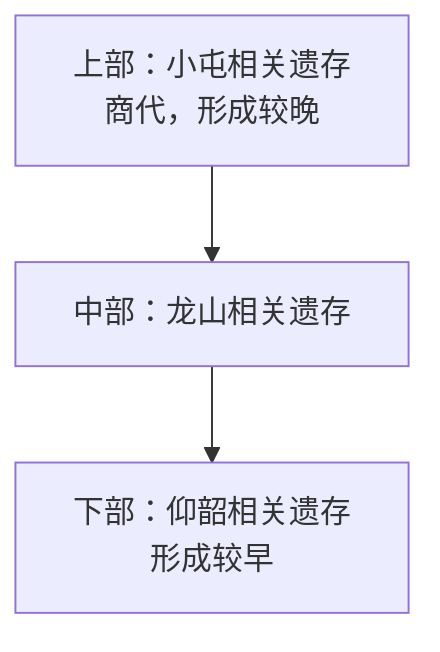
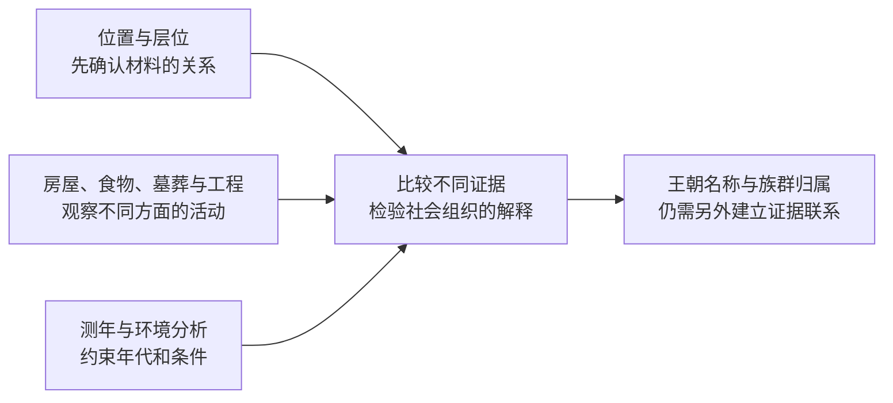

中国境内史前遗址的发现，改变了历史能够从哪里写起。史书没有留下姓名的人，也开始通过房屋、食物、墓葬和器物进入历史。让这些材料具有解释力的，是出土位置、先后关系和可以核对的研究记录。

1921年，河南渑池仰韶村的发掘使一批彩陶、石器和居住遗存进入学术讨论。它们没有告诉研究者村民如何称呼自己，更没有附上一份王朝年表。陶器与石器的组合、遗址所在的环境，却足以要求人们重新考虑文字记载以前的社会生活。

此后，周口店把研究的时间尺度推向数十万年前，后冈地层帮助排列不同遗存的先后，河姆渡与良渚又让稻作、聚落和大型工程成为理解早期社会的重要材料。每次发现都会带来新的判断，也会暴露旧判断的局限。把这些发现连起来，才能看清史前史的重建过程：材料被保存下来，研究者记录它们的关系，再用不同方法检验解释。

这里所说的“中国境内”是今天的地理研究范围。史前人群并不生活在现代国界和民族分类之中。本篇讨论的是这些地方留下的历史，以及近代以来人们如何认识它。

本期标题备选

<ol>
<li>中国史前遗址的发现与考古学研究</li>
<li>没有文字的年代，历史从哪里开始？</li>
<li>一片陶片进入历史之后</li>
<li>从仰韶到良渚：中国史前史怎样被重建</li>
<li>地层、年代与聚落：中国史前研究的证据</li>
</ol>

## 古书之外，还有多长的过去

很长时间里，人们主要依靠传世文献认识中国上古。《史记》从五帝讲起，把不同来源的古老记忆整理进一部通史。它留下了极其重要的历史认识，却不能为远古村落逐一提供同时代记录。司马迁与传说所指的人物相隔久远，后人还必须分辨文本成书、材料流传和事件发生这几层时间。

传统学问并非完全忽视实物。金石学长期搜集、著录青铜器和碑刻，通过铭文考订名物、制度与人物。这种积累使器物能够进入历史讨论。不过，一件离开出土地的古器，即使铭文保存完整，也未必能够说明它与附近房屋、墓葬和其他遗物的关系。到了缺少可释读文字的年代，原来的材料基础更显不足。

史前研究需要面对一类不同的问题。没有姓名和纪年，也要辨认人群曾经怎样居住，依靠什么食物，如何处理死者，以及不同聚落之间怎样发生联系。材料往往零散，保存条件又不相同。木器腐烂之后，石器留下来了；聚落被洪水冲走之后，洞穴中的堆积可能还在。今天能够看到的遗存，首先经过了自然保存过程的筛选。

因此，遗址分布图也不能直接当作古代人口地图。调查多的地方可能发现得多，黄土台地上的陶片容易露出地面，深埋在冲积平原下的聚落却未必容易找到。研究者必须同时考虑古人的活动和遗址后来经历的侵蚀、覆盖、搬运与破坏。

近代地质学带来了一种有用的时间认识。地层有形成过程，地表可以反复变化，人类活动只是其中一部分。欧洲在十九世纪逐渐建立起史前考古的研究方法，中国的相关研究则在地质调查、大学教育、博物馆与学术机构的发展中获得条件。方法的传播与本地材料结合，才使原来难以归入文献年代的发现得到持续研究。

## 地质调查把研究者带到了仰韶村

二十世纪初，中国的地质调查与矿产、地形和化石研究密切相关。调查人员需要走进村落，辨认地层，访问熟悉山川的当地人，并把采集物运回机构比较。这样的工作网络，使某些散落的石器和陶片有机会进入专业研究。

安特生是一位受聘于中国政府的瑞典地质学者。袁复礼接受过地质学训练，也具备测量和野外观察的经验。1921年，两人参与仰韶村的发掘。村庄位于豫西地区，黄土覆盖的台地、沟谷和水源，为考察遗址所在环境提供了条件。这里的陶片和石器不是在一张地图上自动显现的，地方居民的认识、调查线索与机构支持都参与了发现过程。[清华大学的袁复礼资料](https://www.tsinghua.edu.cn/info/1925/75835.htm)保存了他参与这项工作的记录。

仰韶发现的重要性，在于一处史前生活地点成为可以反复讨论的对象。人们看到的材料包括不同用途的陶器、石器及其他遗存。它们共同指向一套过去的生活方式，不能只按古董的精美程度取舍。日常使用、破碎后被丢弃的东西，也能够说明人的活动。

“仰韶文化”这个名称，后来成为考古学的分类名称。这里的文化，是研究者根据一定时空范围内反复出现的器物组合、制作习惯和遗迹特征建立的分析单位。它并不直接等于一个有明确国名的政权，也不能凭名称就认定属于某个古代民族。

这种分类首先解决材料之间如何比较的问题。不同遗址出现相近的陶器组合，研究者便能够讨论它们的联系；如果组合存在稳定差别，也需要解释差别来自年代、地域、功能还是不同的社会关系。只有相似的花纹，尚不足以证明一整个人群沿着某条路线迁来。

当时，军政局势不稳，调查、经费、人员训练和标本保存都不容易。发掘能够开展，需要在具体条件下组织合作。把仰韶发现归结为一个人的眼光，会漏掉支撑研究的地方知识、技术人员和制度安排；把它说成偶然捡到陶片，也解释不了为什么线索最终能够形成学术问题。

<figure>
  
  <figcaption>图1：发掘记录把器物与周围环境联系起来。此图为 AI 生成的现代考古工作示意插画，不对应某一遗址或真实发掘现场。</figcaption>
</figure>

## 西阴村与一门学科的工作条件

李济把田野发掘带进了中国学者主持的研究实践。他受过人类学训练，在清华学校国学研究院任教。1926年，他与袁复礼参与山西夏县西阴村的调查和发掘。西阴村与仰韶村同处黄河流域，却有自己的地理位置与材料组合。新发现使比较不再局限于一处遗址。

西阴村发掘还留下了关于合作方式的具体材料。项目获得清华与美国弗利尔艺术馆的合作支持，相关安排涉及经费、报告出版和出土物保管。有关研究记载，双方约定报告分别以中文、英文出版，所得古物留存中国的博物馆系统。这些细节说明，学术研究需要同时处理谁出资、谁记录、谁发表以及谁保存材料的问题。[中国科学院自然科学史研究所网站所收的西阴村研究](https://agri-history.ihns.ac.cn/scholars/weisi/weisi41.htm)介绍了这次合作。

记录与发表决定一处遗址能否超出发掘者个人的经验。没有图、标本编号和位置记录，后来的人只能接受现场人员的判断。保存这些材料之后，研究者便有机会重新检查分类，比较器物，甚至指出原解释的问题。发掘会移走原有堆积，记录承担了保留关系的责任。

1928年成立的中央研究院历史语言研究所，为这种工作提供了更持续的组织。傅斯年参与创办并主持研究所，李济、梁思永等人在相关田野研究中发挥重要作用。大学、研究所和博物馆逐步形成了调查、发掘、整理与出版之间的联系。史语所的[机构沿革](https://www1.ihp.sinica.edu.tw/AboutIHP/History)说明了它的成立背景。

这种联系并不意味着经费从此充足、研究从此顺利。战争和迁徙会打断工作，人员与材料也可能分离。但一旦报告、图纸和标本形成可传递的记录，知识便不必随着一位研究者离开而全部消失。中国史前研究能够延续，依靠的是这种逐渐建立起来的工作条件。

## 周口店把尺度推向了数十万年

仰韶和西阴村主要打开了新石器时代聚落的研究。北京西南的周口店则把人的过去放进更深的地质时间。在山前洞穴与裂隙形成的堆积中，人类化石、石制品和动物化石能够共同进入研究，但这些堆积也可能受到水流、动物活动与洞穴变化的影响。

1929年，新生代研究室在北京成立，周口店发掘是它的重要工作。同年12月，裴文中发现了第一件北京人头盖骨。裴文中具有地质学背景，贾兰坡后来也在长期田野工作中成长为重要研究者。化石的发现、清理、修复和比较需要多人协作，不能只用发现头骨的一个瞬间概括。[中国科学院古脊椎动物与古人类研究所的历史沿革](https://ivpp.cas.cn/jggk/lsyg/)记载了这个机构及相关工作。

头骨使人类化石研究与石器研究可以结合。石器能够说明制作与使用活动，化石提供了另一类观察对象，动物与沉积材料又帮助理解环境。不同证据各有条件：动物骨骼上的痕迹需要辨认成因，同一地点发现的材料，也要先确定是否处于可以比较的层位。

周口店还说明，熟悉的遗址并不会因此拥有永远不变的年代。2009年发表的一项研究，利用石英中宇宙成因核素的埋藏测年，把第一地点部分下部地层的年龄估计到约77万年前。这个数字对应被测地层及其研究范围，不能套给周口店所有地点、所有化石。[该研究的论文信息与摘要](https://www.nature.com/articles/nature07741)说明了测量对象。

这里尤其要分清地名、年代和人群。周口店包含不同时期的地点，北京人与山顶洞人的研究对象不能混写。直立人化石的发现，也不能直接变成现代民族谱系的证明。年代距离越大，需要建立的证据联系越多。

1937年战争爆发后，相关工作遭受中断，部分研究人员转移到西南。学科的发展受到现实条件约束，保管、修复与记录因此具有直接后果。一个标本能够继续被研究，往往还依赖那些不容易出现在发现故事中的技术工作。

## 后冈的土层，怎样排出了先后

发现不同面貌的遗址之后，研究者仍要解决先后问题。彩陶和黑陶存在差异，不能仅凭颜色决定谁早谁晚。制作工艺可能变化，不同地区也可能同时使用不同器物。把差异变成年代顺序，需要另一种证据。

1928年，吴金鼎在山东章丘发现城子崖遗址，后来这里成为龙山文化研究的重要起点。1930年、1931年的发掘，使黑陶等材料得到进一步认识。但新材料越多，越需要确定它们与已经知道的仰韶遗存是什么关系。[山东地方史志资料](https://shandong-chorography.org/database/f063/section/31/article/95/)记载了城子崖的发现与发掘。

梁思永在这个问题上发挥了重要作用。他是梁启超之子，在哈佛接受过考古学训练，回国后进入史语所工作。他所掌握的田野方法，能够把器物比较放回具体的地层关系中。

1931年春，河南安阳后冈的工作已经提供线索；同年秋季的发掘，清楚辨认出上下叠压的遗存：上部是小屯即商代相关遗存，中部是龙山相关遗存，下部是仰韶相关遗存。后冈的关键，是在同一地点找到了能够约束先后的堆积关系。[史语所历史文物陈列馆对后冈三叠层的介绍](https://museum.sinica.edu.tw/en/knowledge-base/item/92/)明确区分了春季线索和秋季确认的过程。

地层关系之所以有效，是因为后形成的堆积通常覆盖先形成的堆积。不过，这个判断有条件。后人挖坑，会切穿早期土层；早期陶片也可能被带进晚期填土。因此，发掘者要辨认土质、土色、边界和切破关系，判断哪些材料仍保有原来的位置。只看离地面多深，可能把后挖的坑底误当成最早的遗存。

后冈提供的是当地明确的相对顺序。研究者再把有可靠层位的器物组合与其他地点比较，逐步建立更大范围的关系。这个过程不允许把全国遗址都塞进相同的三层图，也不能认为每个地区都必须经历完全一样的变化。相对年代的力量，来自具体关系的反复核对。

图2：后冈三叠层所确立的局部先后关系。此图只表示上下顺序，不是原始剖面图，也不代表中国各地都有相同的三层堆积。

## 从“谁在前面”到“距今多久”

相对顺序建立之后，仍然不能自动得到公历年份。一件器物早于另一件，与它距今六千年还是五千年，是两个层次的问题。过去依靠器物与文献的联系推定年代，在缺乏文字的时期常常受到限制。实验室测年为这类研究增加了独立的时间尺度。

1949年，詹姆斯·阿诺德与威拉德·利比发表利用放射性碳含量测定已知年代样品的研究。这项方法利用生物死亡后放射性碳逐渐衰变的过程，估算适用样品的年龄。它测量的是含碳材料，不能把一块石器放进去，就直接得到打制石器的时间。[论文的出版记录](https://pubmed.ncbi.nlm.nih.gov/15407879/)保留了这项早期验证工作的资料。

测年首先要问样品与事件是什么关系。木炭可能来自生长很久的树木，测到的碳年龄会早于木材被燃烧的时刻。附近的一粒种子，也必须确认属于所研究的活动层，而非后来落入的材料。相对短寿命的植物遗存通常有助于缩小这类差距，但样品仍可能受到污染或搬运。[Historic England 的测年指南](https://historicengland.org.uk/images-books/publications/radiocarbon-dating-chronological-modelling/the-bayesian-process/)解释了样品与事件的关系。

读年代时，还要认识“校正”。过去大气中的放射性碳比例有变化，实验室给出的常规碳十四年龄，需要与校正曲线比较，才能转换为公历年代范围。曲线和测量都存在不确定性，所以结果常以一个或几个可能的时间区间表示。[牛津大学放射性碳加速器研究室的说明](https://c14.arch.ox.ac.uk/calibration.html)解释了这种转换。

文献中的 BP 通常以公元1950年为起点，不是以读者打开网页的年份为起点；cal BP 表示校正后的距今年代，cal BCE 则表示校正后的公元前年代。把未经校正的数字直接从某一年减去，会得到貌似精确、实际含义错误的年份。2020年发表的 [IntCal20 北半球校正曲线](https://www.cambridge.org/core/journals/radiocarbon/article/intcal20-northern-hemisphere-radiocarbon-age-calibration-curve-055-cal-kbp/83257B63DC3AF9CFA6243F59D7503EFF)，也是研究者不断整理不同年代证据的一部分。

年代还会改变我们对生活变化的排列。江西仙人洞的研究在2012年把相关早期陶器的年代估计到约两万年前。这个例子提示，制陶、种植作物和长期定居之间，不能预先规定一套处处适用的顺序。陶器需要结合使用痕迹、动植物遗存和环境一起解释。[相关论文摘要](https://pubmed.ncbi.nlm.nih.gov/22745428/)介绍了测年依据。

## 河姆渡让食物和环境进入叙事

1973年发现并开始发掘的河姆渡，位于今天浙江余姚一带。长江下游的湿润低地，与豫西黄土台地的保存条件不同。水湿环境中，一些在其他地点容易腐烂的木构件和植物遗存得以保存。研究者因此能够把房屋结构、植物利用和生产工具放在一起讨论。[中国国家博物馆对河姆渡稻谷遗存的介绍](https://www.chnmuseum.cn/zp/zpml/kgfjp/202008/t20200824_247227.shtml)列举了稻谷、木构建筑和骨制工具等材料。

这里的地理条件同时影响生活与今天的知识。低地居民需要应对积水和潮湿，建筑方式与之有关；水湿堆积又使后来的研究者看见更多有机材料。一个地区留下木器，另一个地区主要留下石器，不能据此判定后者从来不会使用木材。保存差异必须先从历史差异中分辨出来。

稻谷的发现也需要分层解释。有人利用稻，不等于已经长期种植；种植不等于作物所有性状都已经完成驯化；发现稻谷，也不能单凭数量就推算它在日常食物中占了多少。每一步判断都要增加相应材料，不能让一把稻谷承担全部结论。

例如，野生稻成熟后容易自然落粒，受到持续选择的稻，其相关特征会逐渐变化。研究者观察考古稻的小穗基部等部位，可以讨论落粒特征与人工选择。2016年发表的长江下游研究，正是通过这类材料讨论稻作驯化的长期过程。[论文摘要与研究信息](https://pubmed.ncbi.nlm.nih.gov/27324699/)没有把它缩成一个突然完成的时刻。

取样方法会进一步改变所能看见的生活。细小的炭化种子容易在普通清理中被忽略，浮选利用水分离土样中的轻质材料，再进行筛选与鉴定。这样得到的材料，需要连同取样地点、土量和处理方法一起保存。否则，一处遗址样品多、一处样品少，可能只是工作方式不同。[Historic England 的植物考古介绍](https://historicengland.org.uk/research/methods/archaeology/archaeobotany/)说明了这些研究对象与处理设施。

植物微体遗存也能提供线索，例如植硅体，是植物组织中形成并可能留在土里的微小硅质结构。不过，不同方法各有辨认和保存条件。能否认定某种植物，能否讨论它的生长环境，又能否推断人们如何使用它，需要分别说明。河姆渡及其周边研究的意义，也在于它们不断促使考古人员更细致地采集这些容易错过的材料。[中国社会科学网所载的相关考古介绍](https://www.cssn.cn/kgxc/kgxc_kgsb/202207/t20220728_5431157.shtml)讨论了这一带丰富的动植物证据。

<figure>
  
  <figcaption>图3：细小的植物遗存也能进入历史解释。此图为 AI 生成的植物考古工作示意插画，不是河姆渡现场照片，也不用于鉴定具体物种或展示研究数据。</figcaption>
</figure>

## 良渚的城与水，让问题转向社会组织

1936年，在西湖博物馆工作的施昕更开始对良渚一带进行调查发掘。今天浙江杭州附近的这片地区，后来不断提供新的遗址材料。到了2007年，良渚古城的发现与确认，使研究进一步面向城址整体。[2007年的同期报道](https://zjrb.zjol.com.cn/html/2007-11/30/content_486849.htm)记录了这个转折。

良渚相关遗存通常置于约公元前3300年至公元前2300年的范围。这里地处长江下游低地，山地、河流和平原相接。水提供资源和交通条件，也带来需要管理的问题。讨论这个地区的社会，因而不能只盯住一件玉器，还要看聚落与水系之间的空间关系。[联合国教科文组织的良渚古城遗址介绍](https://whc.unesco.org/en/list/1592/)列出了城址、水利系统和墓地等相互关联的证据。

大型工程需要持续投入劳动，还要处理工程位置、施工顺序、材料和维护。它们使研究者能够讨论超出单个家庭的组织能力。墓葬规模与随葬品分布不均，又为社会差异提供另一类材料。把这些现象放在同一个年代与空间范围中比较，比单凭器物华美判断“文明程度”更有解释力。

不过，工程存在并不能直接复原行政机构的名称。多人协作的方式可能不同，墓葬中的差异也要结合年龄、性别、使用年代和葬俗理解。相关研究把良渚讨论为具有复杂组织的早期区域性社会或国家时，依据的是一组材料的联系；由此仍然无法写出统治者姓名、官员名单或一套完整法令。

这也影响我们怎样解释变化。低地的水环境很重要，不能因此把遗址衰落直接写成一次洪水摧毁一切。环境记录、聚落年代和人群活动是否对应，需要分别检验。地理条件会限制人的选择，具体社会怎样安排生产、工程和分配，则要继续从材料中寻找答案。

2019年，良渚古城遗址列入《世界遗产名录》。对通史写作而言，更需要留下的是研究上的变化：视野从出土器物扩大到整座聚落，再扩大到它依赖的资源、工程和周边地区。社会组织由此成为可以讨论、也必须接受检验的历史问题。

图4：关于社会的判断，需要多种证据共同约束。从聚落形态到具体王朝或族群的名称，还存在需要单独证明的联系。

## 遗址能够回答到哪里

1959年，徐旭生在豫西调查中发现二里头遗址。后续工作揭示了大型建筑、道路、作坊和高等级遗存，使早期都邑研究拥有更丰富的材料。但辨认一座具有中心地位的聚落，与确认它对应哪一个传世王朝，仍然是两项不同的判断。[有关二里头发现六十周年的研究介绍](https://cssn.cn/kgxc/kgxc_kgsb/202207/t20220728_5431258.shtml)呈现了这些发现与讨论。

**【史料存在争议】** 二里头遗存如何与文献中的夏、商对应，涉及年代、地望、文化分期及文献解释。将二里头主体与夏联系起来，是有影响的研究判断，但不能写成遗址已经出土了可以直接确认这一王朝名称的同时代文字。指出这一点，也不等于否认已经发现的大型聚落与社会组织。争议针对的是材料与历史名称之间如何建立联系。[相关学者访谈](https://m.thepaper.cn/yidian_promDetail.jsp?contid=5218758&from=yidian)可以帮助分清这些问题。

通史叙事容易把所有遗存排成一条必然走向后世王朝的道路。这样写虽显得整齐，却会删去当时人群面对的不同生活条件。河谷居民与沿海居民能够取得的资源不同；同一类技术的传播，也可能来自交换、学习、婚姻联系或人口移动。材料尚不能区分这些过程时，就应当保留解释的边界。

仰韶、周口店、后冈、河姆渡和良渚，改变了中国历史中“可以知道什么”的范围。没有文字的年代，日常生活也可以得到有根据的描述。这个范围依靠每一次可靠记录逐步扩大，新的测量和新的发现还会改变其中的年代与解释。

读者在博物馆看见一片陶片时，展柜往往先告诉他年代与名称。田野记录则保存了另一部分内容：它原来在哪里，与什么东西一起埋藏，周围的土经历过什么。只要这些关系仍然可以核对，后人便有机会重新理解留下它的人。

## 发现与研究时间线

以下列的是近现代发现与研究的年份，不是遗址本身的生活年代。

1. 公元1921年：仰韶村发掘开展，史前聚落材料进入持续研究。
2. 公元1926年：李济、袁复礼调查并发掘西阴村遗址。
3. 公元1928年：吴金鼎发现城子崖；中央研究院历史语言研究所成立。
4. 公元1929年：新生代研究室成立；裴文中于12月发现第一件北京人头盖骨。
5. 公元1931年：后冈秋季发掘清楚确认仰韶、龙山、小屯相关遗存的叠压顺序。
6. 公元1936年：施昕更开始良渚一带的调查发掘。
7. 公元1949年：阿诺德与利比发表以已知年代样品检验放射性碳测年的论文。
8. 公元1959年：徐旭生调查发现二里头遗址。
9. 公元1973年：河姆渡遗址被发现并开始发掘。
10. 公元2007年：良渚古城的发现与确认受到集中公布和讨论。
11. 公元2009年：周口店第一地点部分下部地层的埋藏测年研究发表。
12. 公元2012年：仙人洞早期陶器测年研究发表。
13. 公元2019年：良渚古城遗址列入《世界遗产名录》。
14. 公元2020年：IntCal20 北半球放射性碳年龄校正曲线发表。

## 人物与机构关系速览

以下箭头表示工作联系，不全部表示上下级或师生关系。

* 地质调查工作 → 安特生、袁复礼 → 仰韶村调查与发掘。
* 清华学校国学研究院、弗利尔艺术馆的合作 → 李济、袁复礼 → 西阴村发掘、测绘与报告。
* 中央研究院历史语言研究所 → 傅斯年参与创办并主持；李济、梁思永等开展田野研究。
* 梁思永 → 参与后冈研究 → 以地层关系约束文化先后。
* 新生代研究室 → 裴文中、贾兰坡等 → 周口店发掘与化石研究。
* 西湖博物馆 → 施昕更 → 良渚早期调查与发掘。
* 徐旭生 → 豫西调查 → 二里头遗址的发现。

## 延伸阅读

正文中的链接对应各项发现和方法说明。继续阅读时，可以先看[后冈三叠层的机构介绍](https://museum.sinica.edu.tw/en/knowledge-base/item/92/)，再看[牛津大学关于放射性碳校正的解释](https://c14.arch.ox.ac.uk/calibration.html)，比较相对顺序与公历年代各自解决什么问题。[良渚古城的世界遗产资料](https://whc.unesco.org/en/list/1592/)适合用来观察城址、工程与墓地如何被放进同一项论证。
