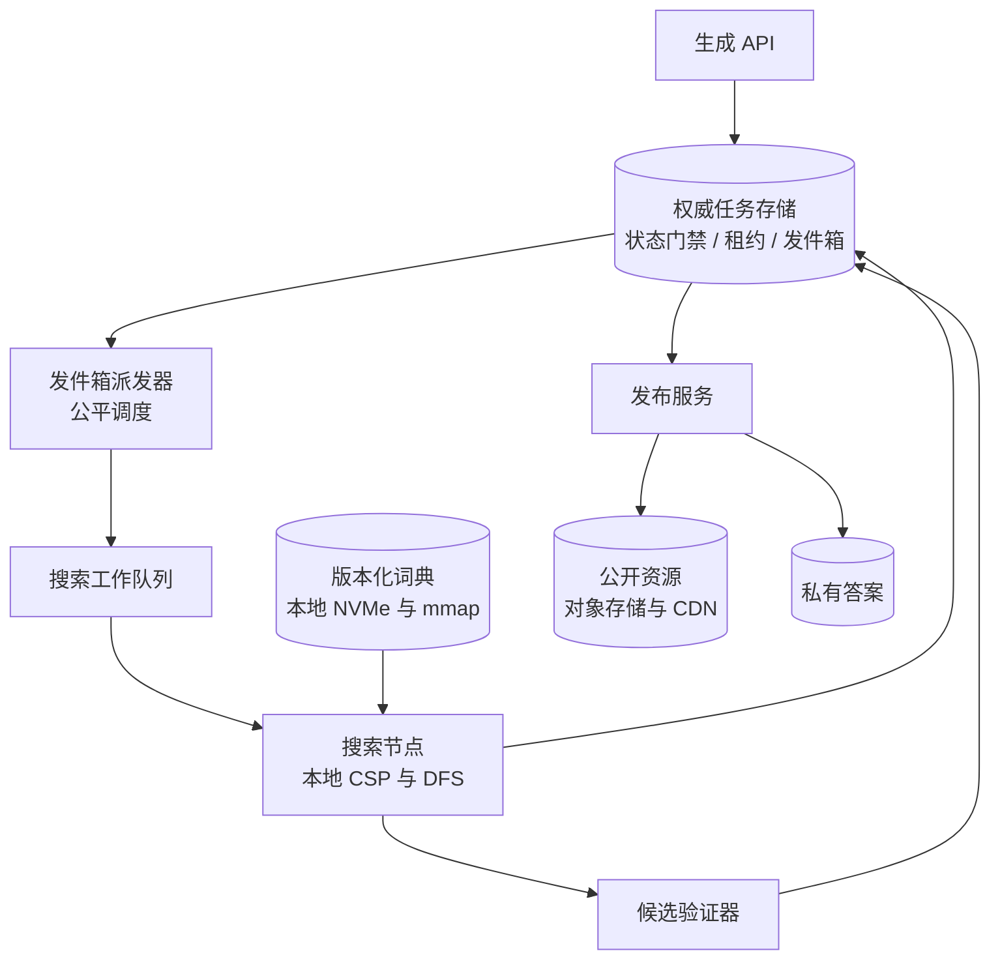
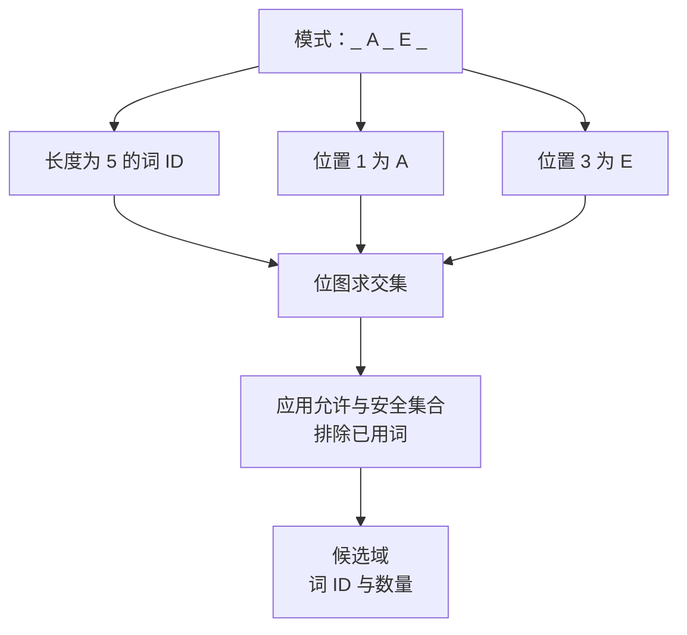
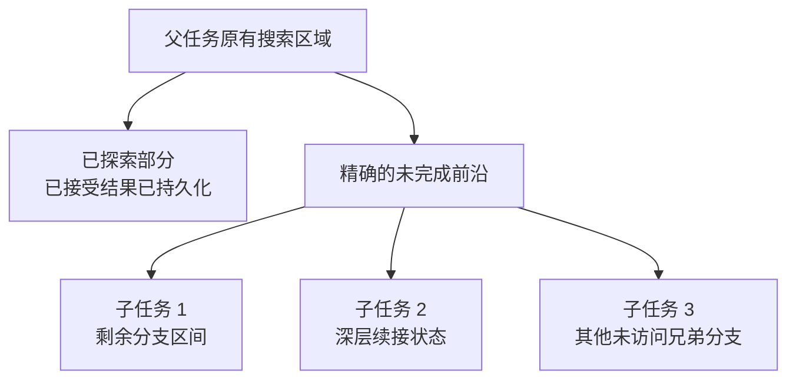
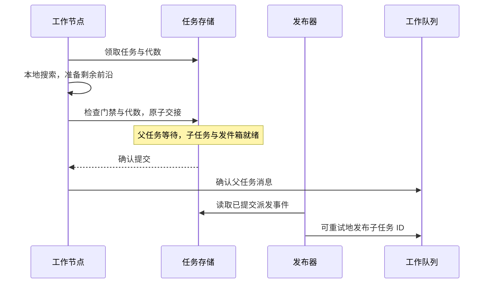
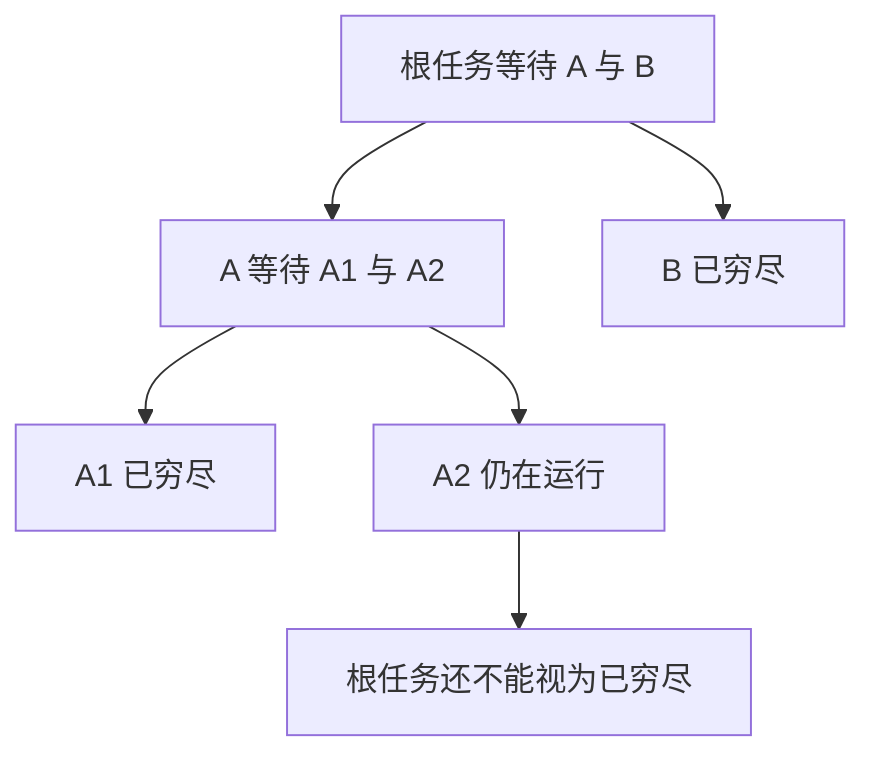

一位编辑提交了部分填好的盘面，希望在三十秒内得到五个合法填法。大多数分支很快就走到了死路，其中一个分支却在其他工作节点结束后仍然搜索。一个节点在把剩余搜索交给其他机器时崩溃，编辑又恰好在完整填法返回的瞬间取消了任务。

平台必须保住尚未探索的搜索空间，拒绝过期工作，并且准确报告已经得到的结论。截止时间前没有找到答案，不能证明这个盘面无解。

本文集中讨论给定盘面的单词填充生成，将本地约束求解与持久化的分布式任务所有权结合起来。容量数字和时间预算都是规划假设，不是某个现有填字游戏服务的实测数据。

## 1. 明确生成任务的约定

请求包含盘面行列数、黑格、固定字母、语言地区、允许的词典、必选词与禁用词、结果数量上限、搜索模式和截止时间。尺寸与限制都是输入。例如，15 × 15 的英文盘面、五个候选填法、三十秒期限，只是一组配置。

把可填格编译成横向与纵向的**词槽**。每个词槽有长度，以及每个位置对应哪个格子的映射。接受任务前，检查盘面规则、固定字母是否冲突、支持的长度、请求大小和单词规范化方式。还要定义与语言有关的填格单位：一个显示格不一定对应一个 Unicode 码点。本文最初的英文示例中，每格放一个大写拉丁字母。

每个被接受的填法必须使用允许的词、在交叉点上字母一致、遵守固定字母、避免不允许的重复，并满足全部必选词约束。必选词需要跟踪是否已被放入盘面，仅仅把它加入可用词典不能确保它出现。安全限制属于硬过滤条件，常用词偏好和主题契合度等则可以计入独立的质量评分。

生成采用持久化的异步任务。用户可以查看状态、获取已接受的候选、取消任务，并明确选择一个候选发布。生成计算饱和时，玩家读取谜题仍应可用。玩家进度同步有价值，但与搜索引擎分开设计。先做好固定盘面的填词系统，再扩展自动放置黑格和生成提示语。

将 **first-K** 与 **best-K** 定义为不同约定。first-K 找到足够多的不同合法填法就停止；best-K 寻找得分最高的填法，还要报告是否已经证明最优。硬截止时间限制投入，不能保证所有输入都能在这段时间内求解。区域内谜题读取 P99 低于 100 ms、普通生成任务在三十秒内完成，可以作为示例产品目标，但仍需用实际负载验证。

## 2. 小任务量背后的计算放大

假设每天有五百万局游戏和两万个生成任务，每局平均保存二十次进度。词典估算采用十进制字节单位。

<div class="table-scroll" role="region" aria-label="填字游戏平台容量假设" tabindex="0">

| 维度 | 示例计算 | 对设计的影响 |
| --- | --- | --- |
| 游戏开始次数 | 五百万 / 86,400 ≈ 每秒 58 次；十倍峰值约每秒 580 次 | 不可变的公开资源适合通过 CDN 分发 |
| 进度保存 | 每天一亿次 ≈ 每秒 1,157 次；十倍峰值约每秒 11,600 次 | 进度存储独立扩容 |
| 生成任务到达 | 20,000 / 86,400 ≈ 每秒 0.23 个 | API QPS 无法反映生成成本 |
| 子树任务派发 | 每个任务拆成 2,000 个子树，全天平均约每秒 463 次 | 难题和同时到达的任务会形成更大突发 |
| 搜索 CPU | 每任务 2,000 个子树 × 每子树 1 个 CPU 秒 × 每天 20,000 个任务 | 约需 463 个持续满载的核心，尚未计入重试和额外开销 |
| 规范化词典 | 五千万个词条 × 40–60 字节 | 索引和更丰富元数据之前，约为 2–3 GB |

</div>

五千万个词条表示大型聚合词汇库，可能包含专业词汇、词形变化和变体，并不是对常见英文填字答案数量的估计。允许使用的集合仍然必须符合编辑质量要求。20–40 GB 的完整索引包只是待测量的容量假设；位图密度、元数据和规范化方式，都可能显著改变大小。

一个难题可能消耗十万个子树任务，一个简单题则可能在本地就完成。因此，每秒两万次派发是单独设定的压力场景，不能从每日平均值直接推导出来。应根据 CPU 秒、可用核心容量、内存带宽和截止时间规划计算资源。增加排队任务不能凭空增加处理能力。

## 3. 整体架构



*图 1：API 持久化接受工作后立即返回。搜索节点在本地执行循环，任务所有权、交接和结果接受由持久化状态转换决定。公开谜题分发有独立的容量预算。*

协调器负责初始化任务、观察状态、执行截止时间和确定最终结果。根部搜索展开由已经加载词典的工作节点执行。协调器不参与每一步递归，也不应该仅仅为了创建搜索前沿就加载整份大词典。

使用支持确认和可见性延期的工作队列，例如 SQS，完成任务投递。任务存储是权威，队列深度只是运行指标。一个就绪任务可能还没发布消息，一个正在执行的任务也可能已经从队列中暂时不可见。[SQS 可见性文档](https://docs.aws.amazon.com/AWSSimpleQueueService/latest/SQSDeveloperGuide/sqs-visibility-timeout.html)明确允许重复投递，包括在可见性超时尚未结束时。

在这套方案中，生成任务门禁、搜索任务记录、候选接受标记和发件箱记录，共享同一个区域内的事务存储，例如 DynamoDB。PostgreSQL 可以保存便于查询的生成任务和候选投影视图。SQL 视图不能独立批准取消或接受结果。明确权威来源，就不必假设 SQL 与另一套任务数据库之间存在原子事务。

## 4. 只接受一次任务，并固定输入版本

`POST /v1/generation-jobs` 接收 `Idempotency-Key`，其作用域为已认证租户。持久化保存请求指纹和对应的任务 ID。相同键与等价的规范化输入重试时，返回同一个任务；请求内容冲突则拒绝。映射至少保留到对外约定的重试窗口结束。

```json
{
  "gridSpecUri": "grids/editor-42/template-v7.json",
  "locale": "en-US",
  "requiredWords": ["WATER"],
  "forbiddenWords": [],
  "maxSolutions": 5,
  "searchMode": "FIRST_K",
  "deadlineMs": 30000
}
```

确定不可变盘面对象和词典版本后，在一次事务中写入幂等映射、任务门禁、初始根任务和派发发件箱记录。提交完成后，返回带任务 ID 的 `202 Accepted`。在队列发布之前崩溃，发件箱中仍有可恢复的工作。准入策略允许生成任务运行之前，根任务不能被领取执行。

固定 `dictionary_version`、`algorithm_version`、规范化规则、评分版本、随机种子和盘面内容哈希。稳定的候选顺序与同分规则，有助于重放某个子树。仅凭随机种子，无法在调度不同的情况下复现并行结果到达顺序、实际时间截断点或 first-K 结果。确定性重放还需要记录逻辑调度，或者采用固定探索策略。

<div class="table-scroll" role="region" aria-label="填字系统数据归属" tabindex="0">

| 记录 | 重要字段 | 权威与用途 |
| --- | --- | --- |
| 生成任务门禁 | 任务 ID、租户、状态、epoch、版本、截止时间、根任务 ID、已接受数量 | 当前 epoch 内全部状态转换的事务权威 |
| 搜索任务 | 任务 ID、父任务、状态、剩余搜索描述、租约代数、租约持有者、到期时间 | 分布式执行与完成责任 |
| 已接受候选 | 生成任务与 epoch、规范化解哈希、得分、私有对象 URI | 持久化去重与验证后接受 |
| 发件箱 | 稳定事件 ID、内容引用、投递状态 | 可重试的派发与投影更新 |
| 已发布谜题 | 谜题 ID、版本、来源候选、公开与私有 URI | 发布元数据，以及不可变版本资源 |
| 玩家进度 | 用户 ID、谜题 ID 与版本、已填格、已用时间、修订号 | 使用乐观并发控制的玩家独立可变状态 |

</div>

通过任务 ID 哈希把记录分散到存储分区。不要把一百万条搜索任务放进同一个物理生成任务分区。任务身份应包含生成任务、epoch、父任务和规范化的剩余搜索描述，并与存储描述比对以检测哈希冲突。紧凑的辅助索引或清单可以支持修复扫描，无需把热点执行记录放在一起。

通过 `GET /v1/generation-jobs/{id}` 和 `/candidates` 提供状态及候选。取消使用 `POST /v1/generation-jobs/{id}/cancel`，发布使用 `POST /v1/candidates/{id}/publish`。每个操作都要认证并检查归属。可以报告已探索节点、已接受候选、经过时间和已消耗预算，但指数级搜索无法支持凭空给出“已完成 73%”。

## 5. 根据任意位置查询大词典

词槽模式 `_ A _ E _` 要求长度为五，第二格为 A，第四格为 E。CATER、LATER 和 WAVES 都符合这个模式，其他交叉点和生成策略仍可能将它们排除。

在每个语言和长度范围内，为词典版本中的词分配稳定 ID。建立长度位图，以及使用零基位置的 `B[length][position][tile]` 位置位图。安全标记、词汇类别、词频分数和提示语引用单独保存。一次查询对有选择性的约束求交集，再排除当前填法已经使用的词：

```text
base = Length[5] AND B[5][1]['A'] AND B[5][3]['E']
eligible = base AND AllowedWords AND HardPolicyFilters
candidates = eligible AND NOT UsedWords
```



*图 2：位置索引直接处理单词内部的字母约束。交集的元素数量，也能作为搜索启发式所需的候选域大小。*

Roaring 等压缩位图支持交集、差集和元素计数。[CRoaring API](https://roaringbitmap.github.io/CRoaring/dc/d56/roaring_8h.html)说明了这些基础操作。成本取决于访问的容器和机器字数量，不是所有情况都能在常数时间内完成。对于覆盖 `D` 个词 ID 的未压缩位集，机器字宽为 `w`，对 `p` 个约束求交集，在枚举结果前大约扫描 `O(pD/w)` 个机器字。数据分布合适时，压缩布局可以减少工作量。

Trie 或 DAWG 适合紧凑存储和前缀查询，也可以通过通配符遍历查询任意模式，但前缀约束较弱时可能需要广泛遍历。对重复发生的内部字母约束，位置索引提供了直接的查询方式。应使用实际词汇库比较空间和查询成本。

在对象存储中构建不可变词典包。工作节点将所需语言和长度分片下载到本地 NVMe，验证清单校验和后，再映射到内存。同一主机上的进程可以共享操作系统页缓存。缺页和冷读仍有成本，`mmap` 不会消除存储延迟。把任务路由到新版本前，先准备好兼容且完成预热的工作节点池。

## 6. 在本地将每个子树作为约束问题求解

将词槽视为变量、合法单词视为候选域、交叉位置相同字母的要求视为二元约束。再加入全局不重复规则和必选词放置责任。只有全部约束通过，完整盘面才合法。

优先选择**剩余候选最少**的未赋值词槽，即 MRV。一个只有八个候选的词槽，通常比有两千个候选的词槽更容易暴露矛盾，但这不保证搜索树最小。候选词顺序可以优先选择高分词，或者对相邻词槽选择空间影响较小的值。[伯克利的 CSP 排序材料](https://inst.eecs.berkeley.edu/~cs188/textbook/csp/ordering.html)解释了这些启发式。

赋值后，传播新的交叉字母，并从其他适用的候选域中移除已用词。**前向检查**在某个剩余候选域为空时立即排除分支。它不仅要覆盖直接交叉，也要覆盖重复词规则，同时跟踪必选词是否仍有可能放入。更强的传播可以移除在交叉点找不到兼容候选的词，反复执行直到稳定。当节省的后续搜索足够多时，这部分额外工作就有价值。

例如，CAT、CAR、BAT 的位置一都是 A。如果它们与一个三格词槽的位置零相交，AXE 有兼容支持，DOG 则没有。移除 DOG 后，又可能使另一个相邻词槽中的候选失去支持。弧一致性会继续传播这类变化，但它本身不能解决所有全局约束。

```text
search(state):
    if all slots are assigned:
        verify all final constraints and submit a complete fill
        return
    slot = choose an unassigned slot with minimum domain size
    for word in stable candidate order for slot:
        mark = trail.size
        assign word and propagate affected constraints
        if no domain is empty and required words remain feasible:
            search(state)
        undo trail entries back to mark
```

在本地维护可变状态，并用回滚日志记录字母、候选域变化、已用 ID 和候选数量。每个节点都深拷贝盘面及全部候选域，会增加分配和内存流量。可以使用有界模式缓存，键包含词典版本、语言、长度、模式和策略，缓存由词典推导的候选域。随后再应用随当前搜索变化的已用词与全局约束，不能把另一个部分填法中的最终候选域直接当成当前结果。

若有 `S` 个词槽，每槽最多 `D` 个候选，不剪枝时粗略上界为 `O(D^S)` 个搜索节点，还需乘上每节点传播成本。并行与启发式可以缩短某些输入的实际耗时，但不会消除最坏情况下的指数级复杂度。每个节点还需要词典页面、当前候选域和回滚日志。导出任务时不应序列化全部候选域。

## 7. 用有界前沿调度子树

一个分布式任务拥有搜索树中的一片区域。它可以在本地执行数十万次决策后，才与控制面交互。每次递归都发一条队列消息，会把队列、存储和网络延迟放进最热的循环。

任务描述包含固定版本、部分赋值、不能直接推导时所需的已用词 ID、相关固定字母，以及精确的剩余分支描述。开始执行时，根据本地索引重建候选域。这样以本地位图计算，换取更小的持久化记录和传输量。

如果节点已经搜索过部分兄弟分支，单独保存部分盘面就不够。还要保存剩余分支范围或续接栈帧，并明确稳定的候选顺序和使用过的上界假设。否则迁移后可能重复访问已完成区域，或漏掉未完成区域。通过合法剪枝排除的区域，如果以后用于证明最优，也需要保留持久化依据。

维护**全局**就绪积压目标，以及独立的每任务前沿和运行数量上限。对于一千个执行名额，可以先实验让全部生成任务合计保留五千至两万个就绪子树。这不是每个生成任务的目标。每任务额度应由公平性和成本策略决定。拿不到拆分许可时，节点继续本地搜索，同时遵守取消检查和预算限制。

根据实测开销选择执行时间片。如果派发与持久化交接需要 10 ms，有效本地搜索只有 1 ms，大部分耗时就花在管理上。数百毫秒至数秒的 CPU 时间片，可以作为初始实验范围。时间片过长会影响负载均衡和故障恢复，过短则会增加协调成本。考虑截止时间的准入策略，可以拒绝那些来不及开始有效执行的任务。

## 8. 精确拆分尚未完成的工作

搜索树并不均匀。两个任务可能五十毫秒就完成，另一个却持续数分钟。动态拆分将重任务的剩余前沿暴露给其他工作节点。

在安全点停止本地探索，确保候选提交已有持久化结果，再把所有未完成续接帧划分为数量有界、互不重叠的子任务描述。一个子任务可以表示多个分支区间的并集。子任务并集必须恰好等于父任务尚未完成的搜索空间，已经穷尽的分支应排除；当前正在深入的分支，以及祖先层尚未访问的兄弟分支，都必须被覆盖。



*图 3：拆分转移每个未完成分支的搜索责任。子任务覆盖互不重叠的区域，它们的合计责任替代父任务剩余的本地工作。*

根据生成任务 epoch、父任务身份和规范化子任务描述生成子任务 ID。重试已经提交的交接，会看到相同子任务。如果先前尝试尚未提交，新租约可以选择另一种合法划分，但第一套子任务已持久化之后，就不能再安装第二套。

限制子任务数量、序列化大小和发件箱记录数，让一次交接放进一个事务。[DynamoDB 事务限制](https://docs.aws.amazon.com/amazondynamodb/latest/developerguide/Constraints.html)包括最多一百个不同条目和 4 MB 数据。即使只拆成八个子任务，也要为父任务、门禁检查、派发记录和额度核算留空间。更大的前沿必须分组或递归拆分，不能只提交一部分。

## 9. 让每次执行的权限可以被撤销

收到队列消息不等于获得所有权。工作节点通过条件写领取 PENDING 任务，或重新领取符合租约过期条件的 RUNNING 任务。任务存储记录持有者、租约到期时间，以及单调递增的 `lease_generation`。条件写将领取操作串行化。

需要两个不同的隔离值。`search_epoch` 隔离整次生成运行，覆盖取消与重启；`lease_generation` 隔离某个搜索任务的一次执行。即使生成任务 epoch 相同，租约第八代安装后，第七代节点也必须被拒绝。

计算期间，为任务租约发送心跳，并延长消息可见性。采用一致的时间策略，在判断过期时考虑时钟误差。租约时长影响恢复速度，租约代数检查才是阻止旧尝试提交的关键。如果队列消息丢失或进入死信队列，修复进程可以重新派发持久化的就绪任务与过期租约。

每次改变执行权限的写入，都要**在同一个存储事务内**检查当前生成任务门禁和搜索任务租约代数。先检查缓存 epoch、再无条件写入，会留下取消竞态。最终候选接受事务也必须遵守同样边界。工作节点轮询取消状态能减少浪费的 CPU，但不能授权提交。

## 10. 将拆分作为原子交接



*图 4：先持久化交接，再确认队列消息。崩溃可能导致重复发布或重复计算，但不会留下父任务已经完成、子任务却不存在的空洞。*

事务把当前 RUNNING 父任务改为 WAIT_CHILDREN，安装不可变子任务集合和待完成子任务数，并创建子任务及派发发件箱记录。它检查生成任务的 RUNNING 状态与 epoch、搜索任务的持有者和租约代数，以及此前不存在已提交拆分。提交前，通过幂等准入协议预留拆分额度；被放弃的预留需要到期回收和对账。

提交后，父任务节点不再探索已交出的剩余区域。如果消息确认丢失，再次投递会发现 WAIT_CHILDREN，不会重新领取它进行计算。发件箱发布可以重复，因为发送成功后仍可能丢失确认。子任务的条件领取负责处理这些重复。

在 DynamoDB 实现中，直接把条件附在父任务更新上。它不允许在一个事务中，对同一条记录分别执行 `ConditionCheck` 和 `Update`。相关的不同条目，则可以在同一个区域事务中检查或写入。[事务 API 文档](https://docs.aws.amazon.com/amazondynamodb/latest/developerguide/transaction-apis.html)定义了这些边界。换用其他数据库时，也必须提供等价原子行为；选择 Cassandra 不会自动获得这种事务。

## 11. 用持久化责任判断搜索完成

对于规模适中的生成任务，未完成任务计数器可行，但每次状态转换都必须事务性地更新它。拆成 `m` 个子任务，计数变化为 `m - 1`；搜索穷尽，计数减一。崩溃或重复完成不能让同一变化执行两次。

大任务可以使用分层完成树，避免更新一个全局计数器。每个搜索任务要么完成本地责任，要么成为等待固定子任务集合的父任务。叶子只有在候选提交都有持久化结果之后，才能成为 EXHAUSTED。



*图 5：完成状态沿剩余工作的责任关系传播。投递队列为空，不能替代 A2 尚未提供的完成确认。*

完成中继在一次事务中，将终态子任务的父级完成确认标记为已送达，并减少父任务的剩余子任务数。重复中继看到持久化标记后，不能再次减数。计数归零时，通过条件状态转换关闭父任务，并发出它自己的完成事件。可恢复发件箱继续向上传递确认。有界分支数限制了各父任务的争用，根任务只接收直接子任务的完成确认。

保留区域关闭的原因：EXHAUSTED 表示已经充分探索，BOUND_CLOSED 则附带有效的质量剪枝证明。向上汇总时也要保留这些原因。通过上界关闭的搜索树，可以不枚举全部填法就证明 best-K，但不能称为穷举了全部结果。

存在未解决错误的子树不算穷尽。可以重试、使生成任务失败，或带着明确失败原因返回部分候选。恢复时，根据持久化记录重放尚未送达的完成确认。只有根任务穷尽、全部结果提交已解决，并通过有效的门禁转换，才能宣称穷尽搜索完成。

活跃任务、完成标记和尚未送达的发件箱记录，必须保留到相应责任解决。进入终态且约定的重放窗口结束后，才能垃圾回收。过早清理等待中的父任务或去重标记，可能丢失工作或重复计入完成。已发布候选的引用，应独立于可清理的搜索历史保存。

分片计数器同样需要谨慎。对几个变化中的计数器分别做强一致读取，不自动构成一致快照，尤其是在拆分会跨分片转移责任时。如果选择这种设计，就要使用事务快照，或经过证明的静止检测协议。仪表盘上的求和不足以支持 NO_SOLUTION。

## 12. 区分取消、截止时间与无解证明

取消通过条件写把权威门禁改为 CANCELLED，并推进 epoch。逻辑取消持久化后，接口返回 `202`，实际工作节点异步停止。最终完成与取消竞争同一个门禁。取消前已接受的结果保留为历史候选，取消之后才尝试接受的结果会被拒绝。重启创建新 epoch 和新的根责任，旧回执不属于新一轮运行。

工作节点按有界的节点数或时间间隔检查截止时间与取消。使用服务控制的时钟停止准入，并触发截止时间门禁转换。应把请求的截止时间定义为停止目标，同时明确执行延迟：与该目标竞争的候选，只有在受保护的提交先于终态门禁转换时才被接受。工作节点声称“更早就找到了”，不能绕过已经关闭的门禁。比较客户端提交的时间戳，不是原子的数据库时钟条件。更严格的时间要求，需要限制时钟误差、定时器与提交延迟，并在边界附近保守准入。对外报告实际停止时间和预算超出量。

<div class="table-scroll" role="region" aria-label="填字生成任务终态含义" tabindex="0">

| 结果 | 必要依据 | 客户端可以推断什么 |
| --- | --- | --- |
| SUCCEEDED，FIRST_K | 已接受足够多的不同、已验证候选 | 找到了请求数量，质量最优性可能未知 |
| SUCCEEDED，EXHAUSTED | 根任务穷尽，且至少接受一个填法 | 已探索全部合法填法，即使实际数量少于请求数量 |
| SUCCEEDED，BOUND_PROVEN | 有 K 个已验证填法，剩余区域均穷尽或有合法上界关闭证明 | 在固定评分与同分规则下，已经证明 best-K |
| NO_SOLUTION | 穷尽搜索完成，且接受数量为零 | 固定输入与硬约束下不存在填法 |
| PARTIAL | 到达截止时间、CPU 预算或不可恢复故障时，已有候选 | 有可用结果，但数量或质量搜索尚未完成 |
| TIMED_OUT | 时间或投入预算结束，尚无已接受填法 | 未探索区域仍然可能包含答案 |
| CANCELLED | 用户取消赢得门禁转换 | 执行正在停止，之前保留的候选会明确列出 |
| FAILED | 系统故障阻止完成，且没有可用填法 | 重试或人工处理可能有效，不表示问题无解 |

</div>

除了状态，还应返回 `stopReason`、`searchExhausted`、`optimalityProven`、固定版本和已接受数量。first-K 和上界证明完成的 best-K，都可以在没有穷举全部填法时成功。协调器写入最终结果并派发停止通知，结果由持久化状态决定，不由通知是否送达决定。

## 13. 先验证完整填法，再使用它的得分

独立验证器根据固定词典和策略，重新检查每个完整盘面，包括全部词槽、交叉点、固定格、重复词规则和必选词。重新计算规范化解哈希和分数，工作节点报告的分数不能作为权威。

先私有保存不可变答案，再在当前生成任务 epoch 和搜索任务租约代数保护下，事务性写入接受标记与投影发件箱。使用唯一的 `(job, epoch, solution_hash)` 身份合并重复计算。没有被引用的已上传对象，之后由垃圾回收清理。任务记录穷尽或交接之前，必须解决候选提交；接受确认丢失时，通过持久化身份对账。

已接受数量和有界结果集，仍以任务存储为权威。SQL 和搜索视图可以滞后。状态接口不能因为投影暂时为空就推断结果为零，也不能在已接受结果还无法通过权威引用读取时就宣布完成。

对于可分解评分，分支限界可以用当前得分，加上未赋值词槽的乐观最高贡献，估算子树上界。所有奖励都必须纳入，包括词之间的组合奖励；低估可能达到的分数，会错误丢弃更好的填法。如果部分盘面得分为 200，剩余十个词槽每个最多贡献 20，上界就是 400。当前已经验证的第 K 名为 450 时，这片区域就无法竞争。

同一轮运行中过期但偏低的第 K 名阈值，只会减少剪枝。来自其他 epoch、评分版本或未验证候选的阈值，则可能不安全。在凑齐 K 个不同合法候选之前，不能使用第 K 名阈值。如果承诺精确排序的 top-K，比较上界时也要处理同分规则。记录剪枝证明和阈值来源，使剩余搜索描述和完成证明之后仍可解释。

first-K 在数量条件提交后终止。best-K 要等全部剩余区域穷尽，或被证明不可能改善当前结果集，才能终止；否则截止时只能返回目前最好的结果，并标记 `optimalityProven: false`。单独一个高分，不能证明全局最优。

## 14. 更新词典，但不改变正在运行的搜索

离线构建器规范化词条、去重、验证标记、构建位置索引，再上传不可变对象与带校验和的清单。只有足够多兼容工作节点准备好后，新版本才能供新任务使用。已有生成任务继续使用固定版本，直到保留与重放要求结束。

按语言和相关词长范围分片，同时确保工作节点能访问分配给它的盘面所需的全部分片。英文 15 × 15 盘面不必映射所有语言。工作集过大，仍会造成页缓存未命中和 NVMe 读取，因此准入需要考虑词典驻留和预热能力。

对于少量自定义词汇，构建每生成任务独立的覆盖层，使用不重叠的词 ID 命名空间和兼容的位置查询。将覆盖层匹配与全局匹配求并集，再对两者应用硬策略和已用词过滤。小规模上传不应触发整个多 GB 全局词典重建。

版本固定保持搜索语义，并不意味着新禁用内容可以永久发布。设置独立的发布安全门禁。如果后来策略禁止了某个词，可以拒绝发布，或要求在新策略下重新生成；不能静默修改运行任务的候选域，却保留旧的完备性声明。

## 15. 公平分配计算资源

使用按租户或服务等级加权的调度、每生成任务运行与前沿上限，以及 CPU 预算。为低优先级类别保留足够服务，避免持续到来的编辑任务让它们长期得不到执行。权重和限制都是配置输入，应由实际需求支持。

独立计量 CPU 秒，不能仅用经过时间或任务数代替。可以向工作节点发放可续租的预算时间片，回收未使用额度，分配过期后停止。通过时间片大小和并发数，限制尚未上报造成的超用量。如果预算只是偶尔更新的仪表盘计数器，就不是硬上限。重试 CPU 也要算真实成本。

词典版本兼容的节点，可以从共享队列领取任务。优先使用本地缓存的版本，能减少冷启动。已经被领取的工作，必须通过同一套拆分或租约协议交出后，才能归其他节点所有。候选域大小提供的成本提示可以辅助调度，但指数级搜索使它始终只是估计。

这类负载经常受 CPU 和内存带宽影响。可以先使用 CPU 节点、足够 RAM 与本地 NVMe，再做性能剖析。专用加速需要明确可批处理的操作与基准测试，单纯分布式化或采购 GPU，都不能证明一定有收益。

## 16. 发布不可变谜题，同时保护答案

发布时，验证所选候选和当前编辑策略，创建谜题版本、写入资源，再通过条件操作发布已经就绪的元数据指针。全部必要资源持久化之前，读者不能看到这个版本。发布重试使用稳定身份。

分开保存三种表示。公开资源包含尺寸、黑格、编号、提示语和显示元数据；私有答案包含正确字母和单词；玩家进度包含该用户已填的格子与修订号。公开 CDN 对象不能嵌入答案，私有答案也不能通过公开存储桶或缓存配置访问。

`GET /v1/puzzles/{id}` 只返回公开数据。经过认证的检查或提交操作，由服务端读取私有答案，并遵循产品速率限制。进度可以使用 `(user_id, puzzle_id)`，带谜题版本和乐观修订检查。过期设备重新获取、按明确冲突策略合并后重试，最终一致复制本身不会解决两次相互冲突的编辑。

自动放置黑格，成为向当前填词引擎提供输入的外层布局搜索，受对称性、连通性和词槽长度规则约束。提示语选择或生成，在填法完成后运行，并经过编辑审核和答案泄露检查。这两项扩展都不必进入每个搜索节点的词典查询循环。

## 17. 验证故障边界

<div class="table-scroll" role="region" aria-label="填字系统恢复场景" tabindex="0">

| 故障 | 持久化恢复规则 |
| --- | --- |
| API 接受任务后崩溃 | 根任务和发件箱与门禁一起提交，派发可以重试 |
| 队列重复投递 | 条件领取只授权一个当前租约代数 |
| 节点暂停，替代节点接管 | 旧代数不能接受结果、完成任务或拆分 |
| 拆分提交前节点崩溃 | 父任务责任仍在，新尝试重建它 |
| 拆分提交后节点崩溃 | 子任务仍是权威，父消息重复不会重新执行交接 |
| 子任务派发或完成中继丢失 | 持久化发件箱与对账恢复投递 |
| 候选投影延迟 | 权威接受记录和私有对象引用仍可读取 |
| 协调器重启 | 恢复门禁和任务树，不能根据队列为空判断完成 |
| 词典校验和失败 | 拒绝该包并取消节点就绪，在有效主机重试 |
| 一个区域不可用 | 隔离旧权威并恢复一致账本后才能继续，否则安全失败 |

</div>

把执行权威放在一个支持事务的区域内，在该区域跨可用区复制。跨区域恢复需要明确的一致性和隔离设计。DynamoDB 的区域事务保证，不会把全局表中部分复制的写入变成原子跨区域交接。初版产品可以先暂停受影响的生成，让公开 CDN 读取继续工作。

用能够完整枚举的小搜索树测试剩余空间划分器：子任务区域必须互不重叠，并覆盖每个未完成叶子。在每个持久化转换前后注入崩溃，重复消息，让取消与接受结果竞争，并丢失完成通知。还应覆盖有解但超时、确实无解、重复必选词，以及失败子树绝不能被算作无解证明的情况。

## 18. 测量搜索引擎与协调成本

跟踪每个已接受填法和每个已发布谜题的 CPU 秒、每秒探索节点数、剪枝比例、候选域查询延迟、任务耗时分位数、拆分速率和每次交接字节数。区分有效搜索与租约过期后的重复工作。任务完成速率上升，也可能只是任务拆得太细。

运行指标包括就绪等待时间、正在执行的责任、租约重新领取、过期写入拒绝、发件箱延迟、尚未送达的完成确认、准入拒绝和每租户 CPU。词典指标包括缺页、NVMe 延迟、词典加载时间、已预热版本覆盖度和模式缓存命中率。公开分发与进度存储保留各自的延迟和可用性目标。

五十分钟面试，可以用约五分钟讲约定、三分钟估算、七分钟讲架构与数据、十分钟讲索引和本地搜索、十三分钟讲拆分与完成、六分钟讲取消和恢复，最后六分钟讲调度、指标与取舍。如果面试官更关注分布式搜索，就压缩玩家功能。

最关键的不变量，是每片未完成区域都有明确责任方。本地传播让区域变小，粗粒度任务让协调成本可承受，原子交接与持久化完成确认，则让重试、崩溃和取消之后的搜索结果仍然能够被准确解释。

## 延伸阅读

- [伯克利 CS 188 的 CSP 排序](https://inst.eecs.berkeley.edu/~cs188/textbook/csp/ordering.html)解释 MRV 和候选值排序启发式；[过滤材料](https://inst.eecs.berkeley.edu/~cs188/textbook/csp/filtering.html)介绍前向检查与一致性传播。
- [CRoaring API 参考](https://roaringbitmap.github.io/CRoaring/dc/d56/roaring_8h.html)说明位置查询所需的位图集合与元素计数操作。
- [SQS 可见性超时](https://docs.aws.amazon.com/AWSSimpleQueueService/latest/SQSDeveloperGuide/sqs-visibility-timeout.html)介绍投递、重试和可见性延期，并不承诺应用层独占所有权。
- [DynamoDB 事务 API](https://docs.aws.amazon.com/amazondynamodb/latest/developerguide/transaction-apis.html)定义多条目条件提交与区域隔离边界。
- [DynamoDB 限制](https://docs.aws.amazon.com/amazondynamodb/latest/developerguide/Constraints.html)列出限制一次子树交接大小的事务上限。
