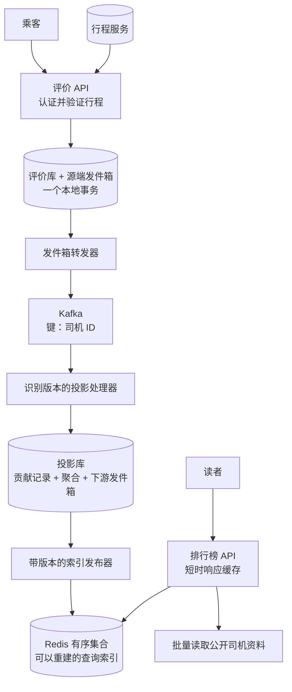
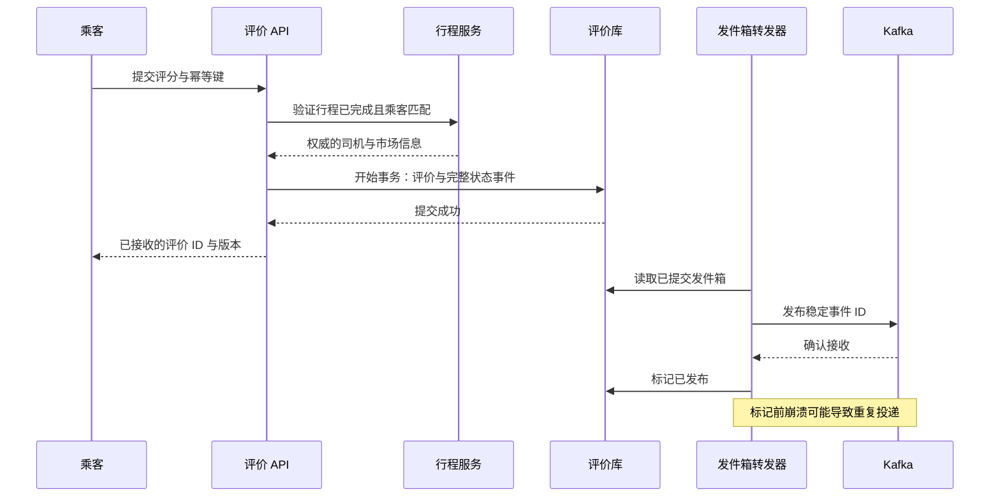
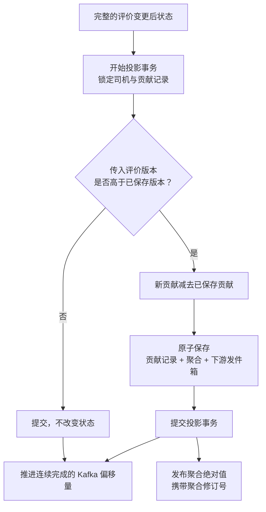
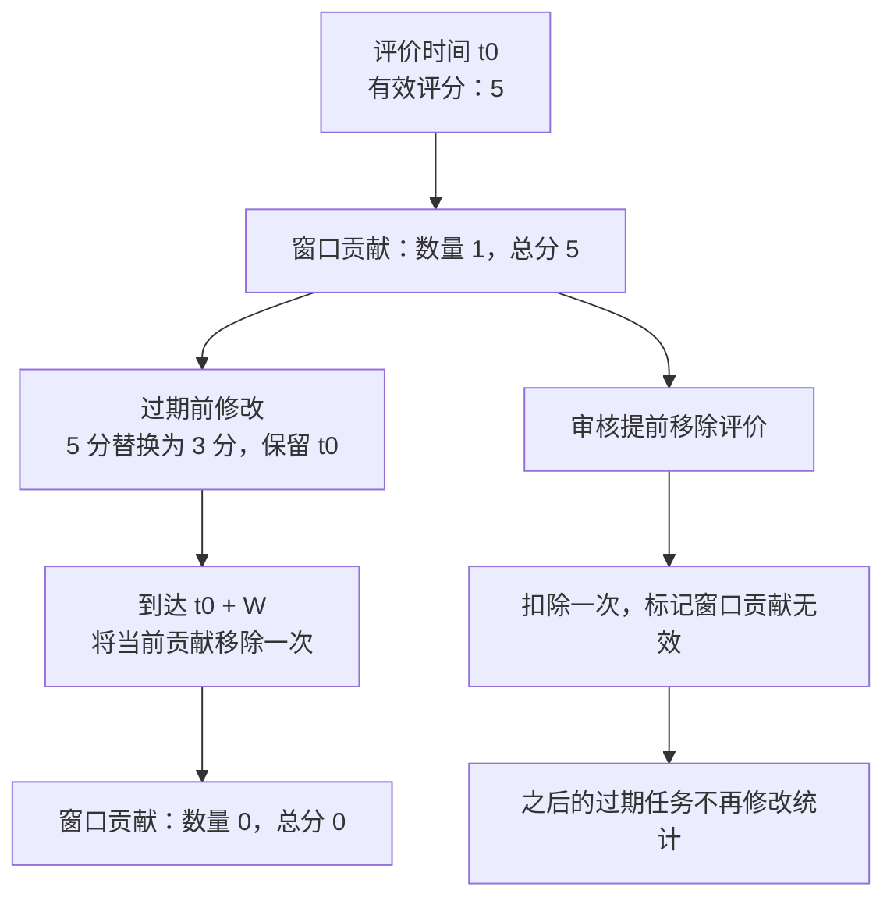
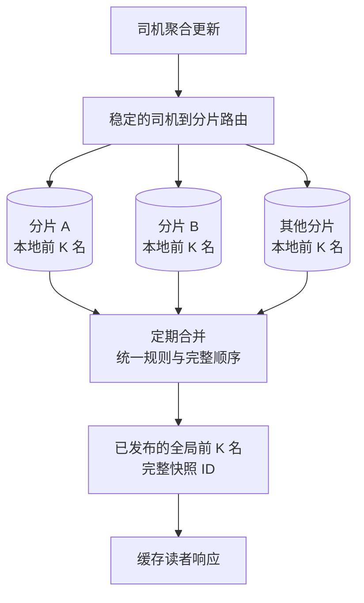
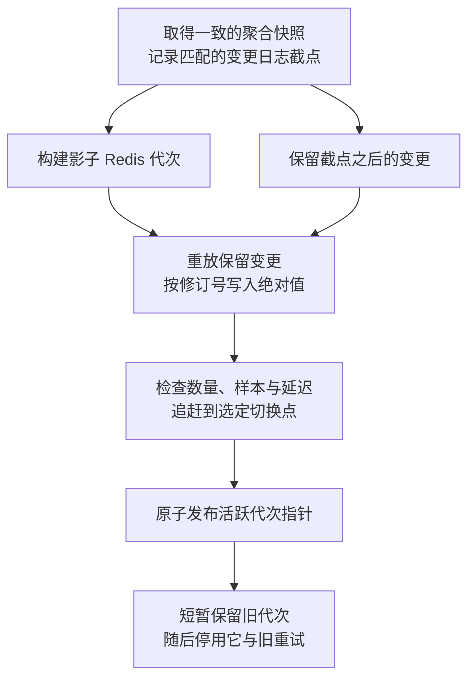

一位司机只有一条五星评价，另一位司机有一万条评价，平均分为 4.99。直接按平均分排序，前者就会排在前面。随后，一位乘客修改了评分，变更事件被投递两次，一条旧更新又在审核移除之后到达。排行榜即使查询很快，也可能给出错误的结果。

设计时需要分别明确三件事：哪些评价有效，如何根据评价计算分数，以及如何根据分数确定名次。**评价作为事务性的事实记录保存，通过带版本的变更维护聚合，再用可以重建的索引提供排名查询。**

本文以网约车服务为背景，按照五十分钟系统设计面试的范围展开。下文的流量、存储和延迟数字都是规划假设。评分规则也只是需要产品验证的示例，不能据此认定司机是否安全，更不能消除评价本身的偏差。

## 1. 明确一个名次代表什么

首先设计按城市或运营市场划分的累计排行榜。乘客可以对已完成行程的司机评价一次，也可以修改或撤回评价。审核系统可以通过同一条写入路径排除或恢复评价。读者可以查看符合条件的前 K 位司机，司机也可以查询自己的当前名次。

服务端根据行程记录确定乘客、司机和所属市场。客户端提交的司机 ID 不能成为评价资格的依据。评价保留行程发生时的市场归属，避免司机后来转到其他市场时，历史统计悄然改变。如果产品只排名当前在当地活跃的司机，就另外管理这项参榜资格，并发布它的变更。

<div class="table-scroll" role="region" aria-label="排行榜产品约定" tabindex="0">

| 决策 | 初始约定 | 后续扩展 |
| --- | --- | --- |
| 有效输入 | 1 至 5 的整数评分，且对应经过验证的已完成行程 | 评价质量信号与申诉 |
| 唯一性 | 每个行程与乘客组合只有一条逻辑评价 | 修改时沿用同一个评价 ID |
| 排名人群 | 行程所属市场内符合资格的司机 | 明确当前市场的参榜资格 |
| 统计依据 | 处于有效状态且未被排除的评价 | 七天与三十天窗口 |
| 新鲜度 | 健康流水线下，目标为 30 至 60 秒 | 已发布的历史快照 |
| 排序 | 量化分数降序，再按稳定司机标识降序 | 另行定义评价数量作为次级排序的规则 |

</div>

响应中返回评分规则版本和观察时间。评价提交成功，表示评价事务已经提交，并不表示新名次已经可见。“未上榜”可能表示评价数量不足、明确不符合参榜资格，或者投影数据尚未就绪，响应中要区分这些原因。

示例目标可以设为：评价提交 P99 小于 300 毫秒，区域排行榜读取 P99 小于 150 毫秒，写入可用性 99.9%，读取可用性 99.99%。还需要明确，带有过期标记的旧榜单是否算作一次可用读取。这些目标需要在故障切换和积压条件下测试，不能从某个组件宣称的可用性直接推导出来。

## 2. 估算变更流量与需要保留的状态

假设有一千万活跃司机，每天完成一亿次行程，其中 40% 会产生评价。那么每天新增四千万条评价，平均每秒约 463 条。十倍峰值约为每秒 4,630 条，可以先按每秒 5,000 条左右规划评价接入能力，再根据实测，为修改和审核变更留出余量。

<div class="table-scroll" role="region" aria-label="流量与存储估算" tabindex="0">

| 数量 | 示例估算 | 对设计的影响 |
| --- | --- | --- |
| 新增评价 | 每天四千万条 | 使用增量处理，避免反复全量扫描 |
| 排行榜读取 | 每天一亿次，平均每秒约 1,157 次 | 缓存热门榜单的完整序列化响应 |
| 读取峰值 | 每秒约一万次 | 批量查询司机资料，并限制 K |
| 结构化评价记录 | 500 字节 | 不含额外开销，每天约 20 GB，每年约 7.3 TB |
| 投影贡献记录 | 每条保留的逻辑评价对应一条 | 去重状态可能比司机聚合状态更大 |
| 司机聚合 | 每个司机、范围和窗口各有一份 | 与原始评价历史分别估算 |

</div>

500 字节的估算不包含较长的评论、索引、副本、历史事件、备份和投影记录。如果事件平均为 1 KB，一天的积压就有约 40 GB 的事件载荷，这还没有计算副本和其他开销。保留时间与追赶处理能力必须覆盖故障修复所需的时间范围。仅仅说 Kafka 吞吐高，或者 Redis 放得下一千万个成员，都算不上容量规划。

## 3. 将评价写入与排行榜查询分开



*图 1：评价接收在源端事务提交时完成。后续跨存储边界的变更，由两个持久化发件箱传递。*

评价库采用 SQL，通过唯一约束和乐观并发控制处理创建与修改。投影库是另一套持久化数据库，其中的贡献记录、聚合记录和下游发件箱必须能够在一个本地事务中原子更新。按司机 ID 分片的关系数据库可以清楚地划出这条边界。如果数据放置、竞争情况和事务限制符合负载要求，支持事务的键值存储也可以采用。

Redis 保存有序的查询视图。即使 Redis 数据丢失，原始评价和持久化聚合也应该保留。规模较小时，可以先在聚合表上建立索引，用 `ORDER BY score LIMIT K` 查询；等实测的读取、更新或名次查询需求证明有必要，再引入 Redis。

## 4. 把每条评价保存为可追溯版本的事实

源端表需要包含 `review_id`、`trip_id`、`rider_id`、`driver_id`、`market_id`、`rating`、`status`、`review_version`、`created_at` 和 `updated_at`。在记录所属的分片上，强制执行 `UNIQUE(trip_id, rider_id)`。如果需要分片，就根据行程 ID 确定路由，使并发创建请求到达同一个唯一约束。仅按随机评价 ID 分片，无法在不同分片之间保证这项唯一性。

源端发件箱保存稳定的事件 ID，以及每次已提交评价修订的**完整变更后状态**，包括无效状态。事件还包含结构版本、评价最初的时间和不可变的归属信息。评论正文不必进入排名事件流。



*图 2：转发器崩溃可能产生重复事件，因此消费者仍然需要幂等的状态转换。*

幂等键按乘客和操作类型限定作用范围，并关联请求指纹。相同键对应不同输入时，返回冲突。即使客户端更换幂等键，数据库的唯一性规则仍然有效。修改和移除请求携带预期评价版本；并发请求使用旧版本时应失败，避免无声覆盖。审核决定也通过同一个版本权威串行提交。

[事务发件箱模式](https://microservices.io/patterns/data/transactional-outbox.html)解决了提交数据库与发布消息之间的空隙，但转发器仍然可能发布两次。源端事务提交前就返回成功，或者认为发件箱保证只投递一次，都会削弱前面的约定。

## 5. 先去重，再改变聚合

向 Redis 写入绝对值，可以防止同一次下游写入重复加分。但如果聚合阶段已经把重复输入累计了两次，绝对值写入无法修正它。这是两个独立的幂等边界。

投影处理器为每条评价保存最后应用的评价版本和贡献值。有效的 r 星评价贡献 `(1, r)`，无效评价贡献 `(0, 0)`。对于最初的累计榜单：

```math
\Delta n = n_{\mathrm{new}} - n_{\mathrm{stored}},\qquad
\Delta s = s_{\mathrm{new}} - s_{\mathrm{stored}}
```

在司机所属的投影分片上，用事务处理事件。锁定司机聚合行与贡献行，或者通过条件更新实现同样的效果；不存在的记录通过唯一性保护创建。如果传入评价版本小于或等于已保存版本，就不改变统计。否则，根据**已经保存的贡献**计算差值，更新数量和评分总和，替换贡献记录，递增聚合修订号，并向下游发件箱插入一份完整聚合快照。这些修改必须一起提交。



*图 3：评价版本保护聚合计算，聚合修订号保护后续的 Redis 投影。*

假设某位司机有 100 条有效评价，评分总和为 480。评价 R 当前是版本 1，贡献五分。版本 2 将它改成三分，版本 3 改成四分，版本 4 则将它移除。

<div class="table-scroll" role="region" aria-label="重复与乱序评价示例" tabindex="0">

| 到达情况 | 处理后的贡献记录 | 司机评价数量 | 司机评分总和 |
| --- | --- | --- | --- |
| 初始状态：R 为版本 1，五分 | 版本 1，`(1, 5)` | 100 | 480 |
| 版本 3 先于版本 2 到达 | 版本 3，`(1, 4)` | 100 | 479 |
| 版本 2 迟到 | 不变 | 100 | 479 |
| 版本 3 再次投递 | 不变 | 100 | 479 |
| 版本 4 排除 R | 版本 4，`(0, 0)` | 99 | 475 |
| 重放旧版本 1 | 不变 | 99 | 475 |

</div>

完整的变更后状态，使版本 3 可以直接替换版本 1。如果把版本 3 原本“三分变四分”的差值，应用到当前保存的五分贡献上，计算就会出错。无效贡献也要保留版本墓碑，防止旧的有效事件将它恢复。清理这些记录时，需要证明旧事件已无法重放，或者用隔离的新一代投影替换旧数据；随意设置一个很短的 TTL 并不充分。

Kafka 记录以司机 ID 为键，既分散工作，也让同一司机的记录进入同一个分区。分区有序描述的是事件进入日志的顺序，不能还原不同转发器之间的源端提交顺序，因此仍然需要版本控制。只有投影事务持久化提交后，才能提交消费者偏移量。如果同一分区并发处理，还只能提交到连续完成的位置。数据库提交之后崩溃，最多造成无害的重复处理。Kafka 的[投递语义说明](https://kafka.apache.org/41/design/design/)也解释了外部存储为什么需要额外协调。

## 6. 让评分反映证据数量的差别

保存整数评分总和与数量，不要只保存平均分。用 n 表示有效评价数，s 表示评分总和，C 表示市场基准分，m 表示相当于多少条评价的先验权重：

```math
\mathrm{score} = \frac{s + mC}{n + m}
= \frac{n}{n+m}\,\bar{r} + \frac{m}{n+m}\,C
```

当 C = 4.7、m = 50 时，一条五星评价得到约 4.705882 分；一万条平均 4.99 分的评价，得到约 4.988557 分。这样，少量样本对名次的影响就会减弱。另外设置至少二十条有效评价才能参榜。二十是产品门槛，五十控制向基准分收缩的强度，两者用途不同。

再看一组例子：二十条五星评价约得 4.785714 分，两百条平均 4.9 分的评价则得 4.86 分。这项规则允许证据更多、原始平均分稍低的司机排在前面。这种取舍需要评估对新司机的影响，以及市场差异和评价者行为。

将 C、m、参榜数量门槛和量化规则固定在一个**评分规则版本**里。如果每新增一条评价，就更新市场基准分，所有成员的分数都会失效。应离线估计新基准，完整构建新规则下的一代榜单，再切换读取。全局榜单要么使用共同的评分规则，要么明确验证不同市场规则下的分数具有可比性。

本文按照明确的十进制舍入规则，把分数量化为百万分之一的整数单位。先比较这个整数，再按固定格式的 ASCII 司机标识做字节序降序比较。标识只负责稳定打破并列，不代表服务质量差别。评价数量作为证据展示，但在这里不参与次级排序。如果产品要求并列时先按数量降序，再按 ID 升序，就需要明确实现完整顺序，不能默默依赖 Redis 的默认行为。

## 7. 发布并读取一致的 Redis 视图

聚合快照包含司机 ID、统计范围、评价数量、评分总和、量化分数、参榜资格、评分规则版本、聚合修订号，以及源端处理进度信息。发布器执行一个简短的 Redis 脚本：拒绝不更新的修订号；否则，一次替换该司机的排名成员、元数据和已保存修订号。不符合资格的司机从有序集合中移除，但仍保留用于阻挡旧写入的修订号。

有序集合、元数据哈希和修订号哈希放在同一个集群槽，例如共享标签 `{SEA:ALL:p3:g8}`，每位司机对应各自的字段。修订号较大时，使用能够保持整数顺序的表示进行比较，例如定长十进制字符串，不要将无界的 64 位修订号转换成浮点 Lua 数字。Redis 实例丢失，或者故障切换后发生数据回退，都需要追赶和对账，才能宣称索引已经更新到当前状态。

Redis 文档说明了[脚本原子执行](https://redis.io/docs/latest/develop/programmability/eval-intro/)和[集群哈希标签](https://redis.io/docs/latest/operate/oss_and_stack/reference/cluster-spec/)。应限制脚本工作量，并在修改前检查键类型与参数。原子执行不意味着脚本报错后会事务回滚。

底层排名操作如下：

```text
ZADD lb:{SEA:ALL:p3:g8}:rank 4860000 D000088
ZRANGE lb:{SEA:ALL:p3:g8}:rank 0 99 REV WITHSCORES
ZREVRANK lb:{SEA:ALL:p3:g8}:rank D000088
```

假设榜单有 D 位司机，单个成员的 [ZADD](https://redis.io/docs/latest/commands/zadd/) 为 O(log D)，读取 K 个结果的 [ZRANGE](https://redis.io/docs/latest/commands/zrange/) 为 O(log D + K)，[ZREVRANK](https://redis.io/docs/latest/commands/zrevrank/) 为 O(log D)。反向范围查询也会反转相同分数成员的字典序，正好符合本文选择的并列规则。展示名次时，将从零开始的位置加一。

为了让每一行数据保持一致，在同一个只读脚本里完成有界的 Top-K 查询和排名元数据读取。分别调用范围查询和元数据查询，可能在并发更新时混入不同修订的数据。随后，用一次批量请求补充公开司机资料。资料的新鲜度与评分的新鲜度是两项不同约定，照片缺失不应该让已上榜的司机悄悄消失。

热门榜单的完整响应可以缓存五至十秒，同时合并相同请求，并限定旧数据可服务的时间。缓存时间也计入新鲜度预算。响应返回 `generated_at`、`policy_version`、`window`、`population` 和流水线延迟信息。响应时间戳很新，并不能证明它依赖的输入事件也是新的。

## 8. 设计简洁 API，明确旧状态如何呈现

```text
POST   /v1/trips/{trip_id}/driver-review
PATCH  /v1/reviews/{review_id}
DELETE /v1/reviews/{review_id}

GET /v1/leaderboards/drivers?market_id=SEA&window=ALL&limit=100
GET /v1/leaderboards/drivers/me?market_id=SEA&window=ALL
```

创建请求携带评分、可选评论和幂等键。修改与删除请求携带预期评价版本。变更响应返回已持久化的评价 ID 和新版本，不承诺名次立刻可见。GET 请求中的数量限制、支持的窗口、市场 ID 和快照游标都需要验证并设定边界。

自己的名次响应包含观察时间、评分规则、评价数量，以及名次或明确的未上榜原因。查询范围限于已认证司机，或者明确允许公开的视图。排行榜 API 不应泄露乘客身份、具体行程信息、反作弊信号或私人资料字段。

## 9. 将滚动窗口建模为会过期的贡献

先选择时间含义，再选择流处理框架。本文以服务端记录的评价首次提交时间 t₀ 决定窗口归属。修改评分不会重置这个时间。在观察时刻 t，长度为 W 的滚动窗口包含满足 `t − W < t₀ ≤ t` 的评价。也可以采用行程完成时间，但需要另外明确这项规则，不能信任客户端任意提交的时钟值。



*图 4：过期时移除当前实际应用的贡献，避免修改或提前移除之后再次扣减。*

精确实现需要保存每条评价的窗口成员状态，并持久化过期任务。事件、修改、移除和定时任务都使用同一个司机事务。过期任务读取当前贡献，检查截止时间和成员状态，扣除一次，再标记无效。不能扣除旧定时任务载荷里保存的历史评分。已经超出窗口的迟到有效事件，只记录修订版本，贡献为零。

即使没有新评价到达，过期任务也必须运行。停机恢复后，应先处理逾期任务，再把榜单标记为新鲜。“精确”描述的是某个明确处理截点上的成员资格；读者看到的仍然是异步投影及其延迟。如果使用事件时间框架，就要交代水位线、空闲分区、允许迟到范围和修正方式，不能认为调用窗口 API 就解决了所有过期语义。

如果产品要求按**自然日**排名，日桶更简单：对指定日期求和，再定期刷新索引。但日桶无法在中午精确实现过去 168 小时的窗口。旧评价被修改或排除时，日桶也需要基于修订版本修正。应根据窗口内的数量和总分重新计算贝叶斯分数，不能对各桶平均分再取平均，也不能直接减去以前计算的排名分。

## 10. 拆分全局排行榜，避免单键热点

不同市场的键可以分散到不同节点，但一个有序集合键仍然属于一个集群槽。把一千万位司机放进 `GLOBAL:ALL`，不会自动把更新分散到整个集群。全局榜单成为热点时，将每位司机分配到 S 个稳定虚拟分片中的一个，各自维护本地有序集合。



*图 5：定期合并各分片的本地前 K 名，再服务已发布结果，避免每次请求都向所有分片查询。*

全局前 K 名一定包含在各分片本地前 K 名的并集中。如果某位司机在自己的分片里排在 K 名之后，那么至少已经有 K 位司机在全局顺序中排在他前面。这项证明要求所有分片使用同一个完整排序规则，且每位司机只属于一个分片。

如果有 64 个分片，K = 100，合并时最多考虑 6,400 个候选。各列表已经排好序时，堆合并输出 K 行的计算量为 O(S + K log S)，传输量最多为 O(SK)，这里从收到列表后开始计算。复杂度不包含分片查询与资料补充。缓存读取仍然需要传输 O(K) 的输出数据，不能说无论响应多大都是常数工作量。

对活跃分片的读取发生在不同时刻。合并结果对于这批采集到的分片视图是精确的，但未必对应整个系统某个共同瞬间的状态。完整的定期快照可以支持稳定分页；如果还要求共同截点快照，就需要协调分区偏移量，或者采用其他一致检查点。应明确产品需要哪一种保证。

查询自己的名次也随之改变。在一个分片上执行 `ZREVRANK`，只能得到本地名次。精确全局名次需要按照完整并列规则，跨分片统计排在目标司机前面的人数，或者另外构建排名快照。仅仅合并 Top-K 无法回答这个问题。如果市场内名次已经满足初始需求，可以推迟实现精确的实时全局名次。

## 11. 用明确的数据代次处理分页与规则变更

不断变化的榜单使用偏移量分页，可能出现重复或遗漏。如果用户只需要前一百名，就直接返回有界的完整列表。需要向后稳定翻页时，发布不可变的有序快照，游标包含快照 ID 和位置。对游标签名或校验，将其绑定到市场、窗口和评分规则，并明确过期行为。

评分规则变更也采用相同的代次机制。按照新基准和评分规则构建所有成员，追赶期间变更，验证后原子切换一个小型的活跃代次指针。一次读取请求始终使用选定的那一代。新的代次名称也能防止旧下游重试污染替代索引。

## 12. 将恢复设计成协议，而不是乐观地扫描一次

重建分为两类。Redis 丢失时，复制持久化聚合，再追赶下游更新。聚合规则出错时，需要从权威评价状态或完整保留的历史重新计算贡献。如果早期事件已经过期，重放一段不完整日志无法重建对应评价。



*图 6：快照需要匹配的变更边界、保留下来的更新，以及受控的数据代次切换。*

通过数据库支持的快照与 CDC 协调，或者等效的隔离过程，将一致数据库快照与变更日志位置一同确定。普通扫描结束后再“消费最新事件”，可能漏掉扫描期间发生的修改。版本检查无法补回根本没有保留下来的事件。

构建期间保留截点之后的所有变更，并应用到影子代次。除了有效分数，还要应用删除和失去资格的墓碑。追赶完成后检查覆盖率与偏差，再切换。宽限期内，如果旧代次仍有正在读取的请求，也要继续向它转发变更。只有追赶到约定的切换点之后，才对外宣称达到可接受的新鲜度。恢复时间取决于成员数、写入速率、网络和积压，需要测量，不能默认几分钟就能完成。

对账时，在匹配的源端与投影截点进行比较。频繁抽样检查司机，并按计划逐步扫描各分区。日桶可以帮助定位问题，但比较两份由同一段错误代码生成的数据，并不是独立证据。还应定期从权威评价中重算样本的总分和数量。修复通过带版本的投影写入或新代次完成；临时直接给 Redis 加减分，会再引入一个没有统一跟踪的写入者。

## 13. 说明故障表现与运行信号

<div class="table-scroll" role="region" aria-label="故障表现与恢复措施" tabindex="0">

| 故障 | 用户看到的影响 | 处理方式 |
| --- | --- | --- |
| 源端数据库不可用 | 评价无法被持久接收 | 如实返回失败，使用相同幂等键重试 |
| API 提交后崩溃 | 客户端不知道是否提交成功 | 查询幂等结果，并依靠评价唯一身份 |
| Kafka 或源端转发器不可用 | 已接收评价等待投影 | 控制发件箱积压，在存储耗尽前告警 |
| 投影库不可用 | 排名开始落后 | 暂停消费，保留并重放输入 |
| 事件重复或乱序 | 不产生额外贡献 | 评价版本事务，再加下游修订号检查 |
| Redis 不可用或发生回退 | 读取失败，或提供标记为过期的数据 | 故障切换、重放保留更新、对账或重建 |
| 评分规则或投影代码出错 | 分数可能系统性错误 | 停止发布，重建并验证新代次 |
| 热门市场或全局分片过载 | 尾延迟和发布积压上升 | 合并读取请求，调整稳定虚拟分片分布 |

</div>

两套持久化存储都需要跨故障区副本和经过验证的备份。每个源端分片只有一个写入权威，以保持评价修订顺序；迁移到另一个区域接收写入前，必须有能隔离旧写入者的故障切换方案。读取可以使用缓存快照维持可用性，但要设定最大过期时间。超过上限后，明确返回不可用，避免把旧名次包装成刚更新的结果。

监控最早未发布发件箱记录的年龄、Kafka 积压、源端到投影的延迟、下游积压年龄、逾期任务数量、对账偏差，以及各类未上榜原因的占比。在各阶段传递不泄露敏感信息的关联 ID。如果上游某个分区卡住，下游最近一次写入成功的时间戳不足以反映这一问题。

通过限流、行程归属验证、受限审计权限和明确的保留策略保护评价。异步反作弊检测发现串通评价后，可以发出审核命令；权威评价产生新修订，再驱动正常投影。最低评价数和收缩评分能够降低小样本波动，但不能证明评价真实，也无法消除人群和市场偏差。如果排名影响奖励或接单机会，还需要提供申诉途径。

## 14. 用面试时间证明关键边界

前五分钟交代有效评价、市场范围、排名规则和新鲜度。随后四分钟估算负载与保留状态，再用八分钟画架构并说明写入事务。为版本化投影、评分和 Redis 发布预留约十五分钟，为窗口和全局排名分配十分钟，再用六分钟说明恢复与故障。最后两分钟，沿完整系统走一遍评价流程。

最后的演示可以从一条经过验证的五星评价开始：提交包含完整状态的发件箱事件，故意投递两次，说明贡献事务为什么只增加一次总分。接着把评价改为三星，再将其排除，然后重放旧事件。继续跟踪聚合绝对值如何进入排名索引，以及 Redis 如何在影子代次中重建。这些状态转换能证明，组件重试、故障或积压时，系统究竟能够保住哪些性质。
