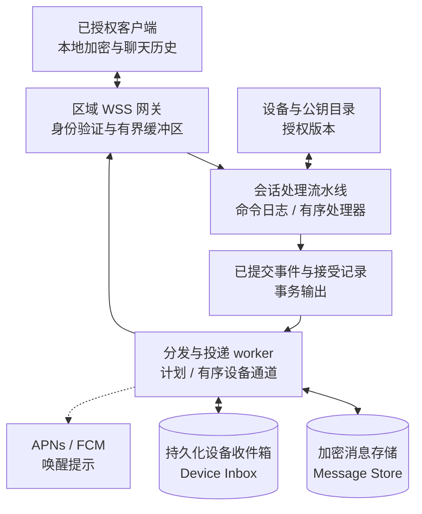
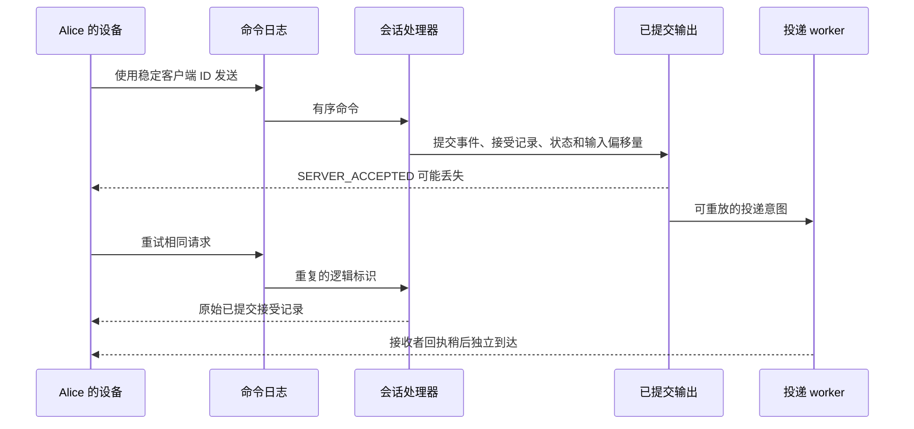
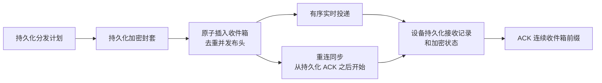
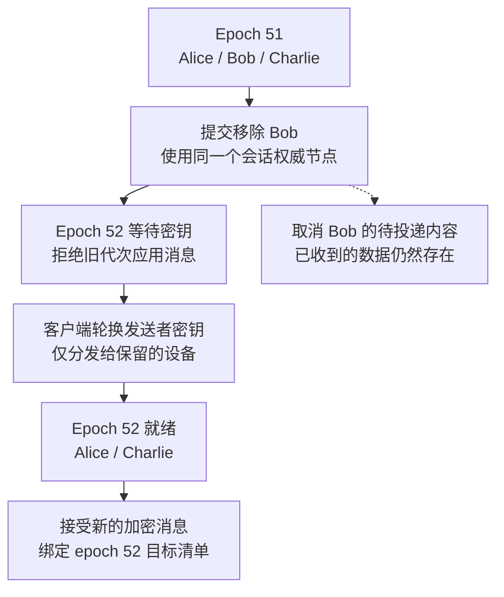
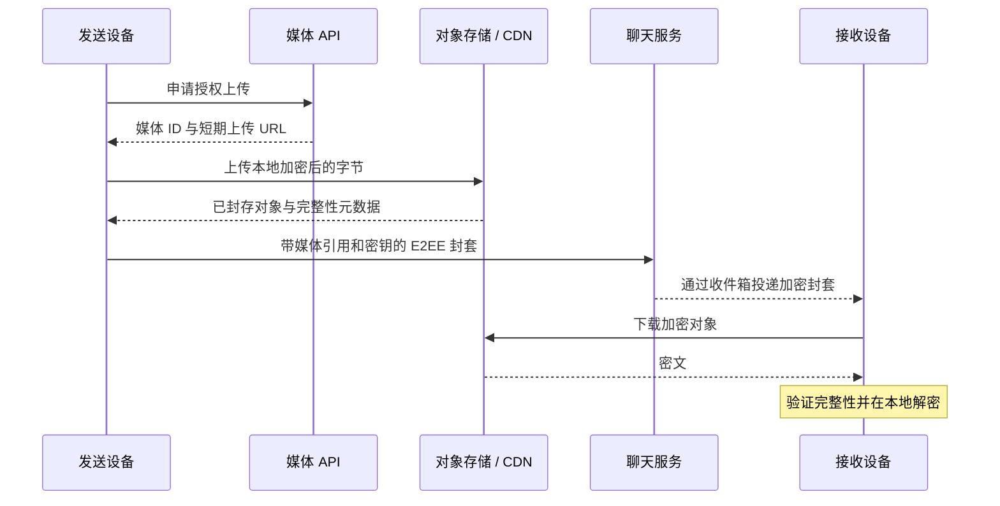

Alice 发出消息时，Bob 的手机离线，笔记本电脑在线。同时，群管理员正在移除另一位成员，而 Alice 还没收到发送确认，连接就断了。系统必须确定：哪条消息已被接受、谁有权接收，以及各台设备稍后如何恢复。

本文提出一套 WhatsApp 类产品的架构，并不描述 WhatsApp 的内部实现。文中的流量、保留期限和延迟目标都是容量规划假设。服务器处理密文与路由元数据；加密和解密都在获得授权的客户端设备上完成。

## 1. 先明确聊天系统的承诺

首先支持一对一文字消息、人数有上限的群聊、同一账号的多台设备、离线投递，以及端到端加密（E2EE）。发送成功表示：获得授权的消息及其恢复所需信息，已经提交到有副本的持久化存储。这不表示所有接收者都在线，也不表示他们已经阅读。

重试可能造成重复的数据包和重复处理。稳定的消息标识、持久化去重状态，以及客户端本地数据库的唯一约束，可以在约定的重试与保留期限内实现只显示一条消息。不要承诺网络恰好投递一次，也不要承诺离线多久都能恢复。

同一个会话里的参与者，应认可同一套已提交事件顺序。不同会话之间不需要统一排序。客户端可以先乐观显示待发送消息，直到服务器返回正式位置。手机时钟不能决定这个位置。

<div class="table-scroll" role="region" aria-label="聊天系统范围与一致性约定" tabindex="0">

| 优先级 | 能力 | 约定 |
| --- | --- | --- |
| P0 | 发送、重试、重连 | 持久化接受、幂等重试、有期限的离线恢复 |
| P0 | 群成员与消息顺序 | 由同一个会话权威节点串行决定 |
| P0 | 设备与加密 | 每台设备独立授权，私钥由客户端持有 |
| P1 | 送达与已读回执 | 本地持久化之后才确认送达，回执最终传播 |
| P1 | 媒体、在线状态、正在输入 | 独立的加密上传、会过期的在线状态、可丢弃的输入事件 |
| P2 | 编辑、回应、历史迁移 | 有序事件，以及经过身份验证的加密迁移 |
| 初期范围之外 | 通话、公开频道、支付 | 分别定义需求与容量模型 |

</div>

可以把区域内发送接受延迟的目标定为 p99 小于 200 ms，在线投递通常小于 500 ms，再单独测量跨区域路径。可用性目标设为 99.99%，同时明确它覆盖哪些故障域。跨区域同步持久化可能超出区域内延迟预算；设定目标无法消除这种取舍。

## 2. 分别估算发送、投递与连接

假设每天有 20 亿活跃用户，每人每天发送 50 条逻辑消息，峰值为平均值的五倍。一条逻辑消息可能产生多次设备投递，包括群成员的设备，以及发送者自己的其他设备。以下 KB、TB、PB 都采用十进制单位。

<div class="table-scroll" role="region" aria-label="加密聊天系统容量假设" tabindex="0">

| 维度 | 计算 | 对设计的影响 |
| --- | --- | --- |
| 逻辑发送 | 20 亿 × 50 = 每天 1,000 亿条 | 平均约 116 万条/s，峰值约 579 万条/s |
| 设备投递 | 1,000 亿 × 2.5 = 每天 2,500 亿次 | 平均约 289 万次/s，峰值约 1,447 万次/s |
| 网关基线 | 5 亿连接 / 每节点 10 万连接 = 5,000 个节点 | 压测后再加入部署与故障余量 |
| 连接内存 | 5 亿 × 10 KB = 5 TB | 仅包含原始连接状态，不含其他进程开销 |
| 加密消息封套 | 1,000 亿 × 1 KB = 每天 100 TB | 完整保留 30 天为 3 PB，尚未计算副本与索引 |
| 加密媒体 | 50 亿个对象 × 300 KB = 每天 1.5 PB | 媒体字节不进入聊天服务和日志 |
| 在线状态刷新 | 5 亿 / 10 秒 = 每秒 5,000 万次 | 在网关本地聚合，并按区域分片 |

</div>

2.5 倍的投递放大系数是平均值，不是上限。一个 1,000 人群里，如果每位成员平均有 1.5 台目标设备，一条消息大约产生 1,500 个投递意图；实际数量还取决于是否排除发送设备。容量规划要考虑少数大规模分发和集中重连，不能让所有队列都只按平均值配置。

一份共享的群消息密文，加上 1,500 个假设为 50 字节的指针，指针载荷约为 75 KB。实际记录还包含主键、索引、副本和设备专属加密元数据。一对一会话可能需要为每台设备准备不同的加密封套，因此不能普遍假设所有接收者共享一份密文。

## 3. 总体架构



*图 1：持久化会话处理与逐设备投递分属不同阶段。媒体走图 5 所示的独立路径。*

网关保存真实的连接状态，包括 socket、已认证会话、心跳和发送缓冲区。消息历史、成员关系和待投递消息的唯一持久副本不能放在网关上。网关崩溃会断开连接；客户端重新连接，再重放持久化收件箱。

命令日志通过明确的分片目录，按 `conversation_id` 路由。会话处理器使用已提交的成员状态验证命令，再生成正式事件。它的输出必须包含足够的加密内容、目标信息和接受记录，以便重建后续投递。

消息存储负责会话与封套查询；收件箱负责记录某台设备还欠哪些投递。Kafka 用于内部处理日志，不需要让数十亿台手机各自成为 Kafka 消费组。

## 4. 明确消息接受事务

Broker 确认一条尚未验证的命令，不足以返回 `SERVER_ACCEPTED`。成员移除命令可能排在它前面，它本身也可能是重试。可以提供 `RECEIVED` 响应，但这只表示请求到达入口，不能在界面上显示为发送成功。

一种具体实现是使用分区化的 Kafka 命令主题，以及具有持久化状态的有序处理器。成员变更命令和消息进入同一个会话分区。处理器在同一个 Kafka 事务中写入：已接受事件、稳定的接受记录、去重状态变更日志、可能发生的成员状态变更，以及已消费输入偏移量。发送接受响应和执行分发的消费者都使用 `read_committed`。Kafka Streams 的[处理保证配置](https://kafka.apache.org/41/configuration/kafka-streams-configs/#processing.guarantee)可以支持这个内部事务边界。

```text
authenticate the sender device and bind its identity to the request
route to the fixed conversation command partition
process the next command in that partition's committed input order
    resolve an existing receipt for the same logical message identity
    reject a conflicting payload or a request outside the retry contract
    validate current membership, group epoch, and device revision policy
    stage event, receipt, target manifest, and recoverable state updates
    commit those outputs and the consumed input offset together
publish SERVER_ACCEPTED from the committed receipt
materialize message storage and device inboxes asynchronously
```

跨三个可用区配置副本，使用 `acks=all`，设置合适的 `min.insync.replicas`，例如两个，并禁止非同步副本被选为 leader。这些设置都有明确的故障边界；仅设置 `acks=all`，并不要求所有已分配副本都健康。参见 Kafka 的[最少同步副本配置](https://kafka.apache.org/41/configuration/topic-configs/#min.insync.replicas)。

处理器重新分配之后，所有权和事务机制必须阻止旧 worker 继续提交。替代 worker 要先恢复已提交状态，再开始接受工作。Kafka 事务不能原子提交任意消息数据库或收件箱写入；这些外部存储仍需要自己的幂等操作。[Kafka 设计文档](https://kafka.apache.org/41/design/design/#message-delivery-semantics)说明了这个边界。

额外的处理阶段会增加延迟。事务批次和排队时间必须控制在发送预算内；当存储或处理积压威胁恢复期限时，应停止接收新工作。规模较小时，也可以用分片式事务 SQL 日志和 outbox，满足相同的消息接受约束。

## 5. 让重试返回同一个已接受结果

逻辑标识的范围由已认证的发送设备和会话共同限定：`(sender_device_id, conversation_id, client_message_id)`。客户端只生成一次最后一个字段，并在网络重试时保留它。服务器为其分配稳定的 `message_id`，并保留第一次接受时的 `order_key`。

接受记录还保存不可变请求的指纹。同一个标识如果携带不同密文或不同目标清单，返回 `ID_CONFLICT`。重新传输密文要复用原字节，不能再推进一次加密棘轮。如果旧的群版本或设备版本在接受之前被拒绝，客户端可以刷新状态后重新加密。遇到结果不明的超时，必须先查询原接受记录，因为原请求可能已经提交。

```json
{
  "type": "SEND_MESSAGE",
  "conversation_id": "C123",
  "client_message_id": "62f0fcdb-215a-4b30-ae4b-10e25eeb9a0c",
  "membership_version": 52,
  "group_key_epoch": 52,
  "target_device_versions": {"bob": 11},
  "encrypted_payload": "<ciphertext and authenticated envelope metadata>"
}
```

这是简化后的群消息示例；发送者身份来自身份验证。设备版本应覆盖目标账号，包括需要同步的关联设备。一对一消息携带对应的逐设备加密封套。服务器根据权威成员关系与授权状态验证接收者，不能直接相信客户端提交的名单。

```json
{
  "type": "SERVER_ACCEPTED",
  "conversation_id": "C123",
  "client_message_id": "62f0fcdb-215a-4b30-ae4b-10e25eeb9a0c",
  "message_id": "M789",
  "order_key": {"epoch": 4, "offset": 918273}
}
```



*图 2：重试查询原来的已接受结果。分发和接收者确认不阻塞发送者的接受响应。*

定义有上限的重试期限，例如七天，并在此期间保留接受记录或墓碑。使用服务器签发的发送代次，或者等效的可由服务器验证的过期机制，防止很久以前的标识在去重状态过期之后被当作新消息。如果约定已经无法解析原结果，返回 `RESULT_EXPIRED`。客户端数据库把 `UNIQUE(message_id)`、接收记录和持久化棘轮状态一起维护，避免重放导致重复显示，或错误地再次应用棘轮状态变更。

## 6. 不依赖墙上时钟进行会话排序

同一个权威节点为每个已接受会话事件分配 `order_key = (conversation_epoch, input_log_offset)`。偏移量取自该消息第一次被接受时，在固定输入分区中的命令位置。被拒绝的命令、重试和其他会话都会造成间隔。`(4, 918273)` 后面接 `(4, 918280)`，不表示缺失了六条消息。

只有同一个会话内的排序键才能互相比较。回执游标、消息 ID 和收件箱序号承担不同职责。客户端时间戳用于显示，不能建立跨设备的全序。

增加主题分区数量后重新对 key 求哈希，可能意外改变会话位置。逻辑分片映射必须保持稳定。计划迁移时，先阻止旧路径接受新写入，排空并封存最后一个已接受位置，迁移成员与去重状态，安装更高的会话代次，再开启新路径。旧节点此后必须无法继续提交。仅增加 epoch 字段，既不能阻止旧写入，也不能恢复丢失的日志尾部。

## 7. 分开保存消息本身与投递状态

<div class="table-scroll" role="region" aria-label="聊天存储记录与负责组件" tabindex="0">

| 记录 | 主键与主要字段 | 负责组件与用途 |
| --- | --- | --- |
| 会话状态 | `conversation_id`；归属、代次、成员版本、密钥代次 | 有序权威节点；成员变更与发送授权 |
| 设备注册表 | `(user_id, device_id)`；状态、公钥、设备列表版本 | 强一致授权服务；不保存解密私钥 |
| 接受记录 | 逻辑标识；指纹、消息 ID、首个排序键、过期时间 | 可恢复的处理器状态；解析重试 |
| 消息封套 | `(conversation_id, time_bucket, order_key)`；密文变体、过期时间 | 可重放的消息存储写入端；范围与封套查询 |
| 分发计划 | `message_id`；不可变目标清单、批次、完成状态 | 持久化 worker；恢复部分分发而不改变接收者 |
| 设备收件箱 | `(device_id, bucket, inbox_seq)`；消息引用、变体、过期时间 | 按设备分片的持久化存储；待投递内容 |
| 收件箱头与 ACK | `device_id`；已发布序号、已确认序号、代次 | 事务设备分区；不跳过尚未发布的记录 |
| 成员回执 | `(conversation_id, user_id, membership_interval)`；送达和已读位置 | 最终一致读模型；汇总用户可见的回执 |
| 连接目录 | `(user_id, device_id)`；网关、连接代次、TTL | 可重建的区域路由缓存 |

</div>

时间分桶用于限制消息与收件箱分区的大小。维护分桶索引或不透明 continuation token，让同步可以遍历旧桶，而不是只读取当前桶。Cassandra、ScyllaDB 或 DynamoDB 风格的存储适合封套访问模式。收件箱需要更具体、更强的原语：在按设备分片的事务存储中，原子插入幂等键、记录及更新后的设备头。最终一致计数器加上另一次独立插入，无法满足这个要求。

先持久化加密封套，再对外发布收件箱引用。写入端只有在必要写入成功，或持久化了后续任务之后，才能提交其源位置。进程崩溃后，重放使用相同消息与目标设备作为键执行条件 upsert。普通的“存在则不插入”，再加上不受保护的头序号递增，仍可能产生重复记录或空洞。

## 8. 离线恢复不能跳过游标空洞

每台设备都有独立递增的 `inbox_seq`，在收件箱记录和头一起提交时分配。同一条消息在不同设备上的序号可以不同。持久化的已发布前缀表示：更早的每个位置，要么是已提交记录，要么是明确的终止标记。更早的插入还未完成时，不能暴露已经预留的更大序号。



*图 3：实时投递与离线恢复使用同一个持久化收件箱。设备确认的是本地持久化，而不是网络字节已经到达。*

读取一页数据时，固定已发布头 `H`，从持久化游标之后读到 `H`，返回有大小上限的批次与 continuation token。读取一致性必须足够，不能因为副本延迟暂时看不到某行，就把游标推进到它之后。接收者先持久化记录和加密状态，再 ACK 最高的连续完成前缀。重试可以安全地重复返回记录。

假设本地已经持久化 501 和 503，但 502 尚未解决，设备就不能 ACK 到 503。如果某个位置已经过期，或者因为撤销授权而取消，应返回明确的终止标记或经过认证的范围过期响应。游标早于保留历史时，返回 `SYNC_RANGE_EXPIRED`，不能返回一个没有解释的空成功结果。完整重同步也只能恢复仍在保留期内的数据，或另行存在的加密备份。

逐设备分配顺序还必须保留同一会话内的已接受顺序。基础方案为会话分发计划设置完成屏障：接收者批次并行执行，但下一条消息的计划不能越过上一条计划尚未完成的收件箱写入。不同会话独立推进。实时投递也走有序设备通道，不能让“仅在线推送”的无序快路径绕过它。流量极高的群可能需要稳定的有序接收者通道，替代这种逐消息屏障。

收件箱 ACK 表示跨会话的传输进度；会话送达和已读游标表示某个成员有效期内应接收消息的进度。会话偏移量不连续，只有服务器投递计划和客户端已持久化前缀共同证明完整性之后，才能推进会话游标。直接取见过的最大排序键并不安全。

## 9. 按固定成员代次分发群消息

对于人数有限的群，选择写时分发：重连时只读一份设备收件箱，无需查询用户参加的每一个群。代价与目标设备数成正比。把大计划拆成幂等批次，并持久化完成状态。重放一个只完成一半的计划时，既不能漏掉批次，也不能根据更新后的成员名单重新计算接收者。

成员命令与消息命令进入同一个会话有序权威节点。移除 Bob 会把成员版本从 51 推进到 52，并关闭 epoch 51 消息的接受入口。在移除命令之后处理的版本 51 发送请求，会在被接受之前遭到拒绝。移除前已经接受的消息仍属于移除前事件；产品必须定义是否取消尚未完成的旧消息投递。本方案在投递时取消移除成员尚未收到的旧消息，但不会声称能撤回已收到的内容。



*图 4：成员移除同时改变路由权限和密码学访问权限。新的应用消息要等待必要的客户端密钥变更。*

把密钥分发和应用密文绑定到经过认证的群代次。采用发送者密钥方案时，每位活跃发送者都必须轮换自己的发送状态，把新密钥材料安全分发给剩余授权设备，然后才能发送下一条应用消息。不能无限期共享一个固定群密钥。[RFC 9420 定义的 MLS](https://www.rfc-editor.org/rfc/rfc9420.html)是另一类可用于群密钥变更的协议，不能把它与自己拼装的发送者密钥方案混为一谈。

服务器可以检查声明的代次和目标授权，却不能从不透明密文中证明授权客户端确实使用了新秘密。这个属性由客户端协议实现保证。留在群里的成员也可以把明文透露给被移除者；E2EE 无法阻止这种行为。

## 10. 为已授权设备加密

每台设备独立持有私有身份密钥和会话密钥。目录发布经过认证的公钥包、预密钥和设备列表版本。异步密钥协商与棘轮机制应使用经过审查的协议实现。Signal 的 [PQXDH 规范](https://signal.org/docs/specifications/pqxdh/)描述异步密钥建立协议，[Sesame 规范](https://signal.org/docs/specifications/sesame/)讨论多设备会话管理。这些是协议参考资料，不表示加上几个数据库字段就能获得相同安全属性。

一对一聊天中，发送客户端为接收者设备以及自己的关联设备准备必要的加密变体，并在适当情况下排除发起发送的设备。保存共同的逻辑消息标识，以及所需的密文变体或加密密钥包装。新设备不会因为多了一条收件箱引用，就自动解开旧密文。历史迁移应采用经过身份验证的设备间传输，或可选的加密备份。

设备列表验证覆盖接收者账号，不能只验证发送者自己的列表。如果 Bob 的设备列表在新消息被接受之前，从版本 10 变成 11，返回 `DEVICE_LIST_CHANGED`，先刷新，再加密。已经按照旧授权快照接受的消息，不会在之后自动新增目标设备。

账号级设备撤销需要会话分区之外的协调。授权服务阻止被撤销设备继续操作，使活跃会话与版本授权失效，并在投递之前再次验证权限。如果 API 承诺撤销已经对所有接收入口生效，就必须等待失效屏障，或者使用等效的版本隔离验证；缓存 TTL 无法提供这个承诺。当权威授权服务不可用时，依赖该判断的新发送或投递应拒绝继续执行。

撤销无法抹除丢失设备上已有的私钥或明文。未来的群访问还需要第 9 节中的群密钥变更。设备身份应通过经过认证的关联流程，以及用户可验证的身份检查或经过审查的密钥透明机制来验证。仅使用 TLS 和服务器磁盘加密，不能构成 E2EE。服务仍能看到路由元数据、时间、近似大小和设备关系，所以这些信息也需要单独保护，并减少保留时间。

## 11. 媒体字节不进入聊天路径

发送者生成随机媒体密钥，在本地使用经过认证的加密方案处理文件。媒体 API 为有大小上限的上传授权，并返回短期对象存储 URL。密文直接上传到对象存储；之后的聊天封套携带媒体引用，以及加密保护的解密材料。



*图 5：解密材料放在 E2EE 消息内部。CDN 缓存密文，不接触明文形式的媒体密钥。*

接受媒体引用之前，先完成对象封存，并验证对象大小与完整性元数据。发送仍在进行时，要为已封存对象保留预约，防止孤儿对象回收；之后根据已提交事件确认消息引用。垃圾回收必须先核对预约和事件日志，再执行删除。否则，“24 小时后删除所有无引用对象”可能与延迟写入的已接受消息发生竞态。

使用经过认证的短期下载授权、配额，以及与引用消息相匹配的保留策略。对象存储 URL 过期，不能撤销已经下载的密文副本或密钥。大文件不进入会话日志、消息处理器或网关发送缓冲区。

## 12. 回执、在线状态与慢客户端

分别跟踪 `SERVER_ACCEPTED`、`DELIVERED` 和 `READ`。定义用户级回执规则：例如，至少一台已授权接收设备持久化消息后算送达，已授权设备报告阅读后算已读。即使界面汇总成用户级状态，清理仍需要逐设备 ACK。已读回执可以作为可关闭的隐私选项。

合并单调递增的回执更新，并异步传播。查询群消息的已读成员时，只检查该群有资格接收消息的成员游标，必要时区分成员有效期。不需要扫描全局消息数据库，也不需要永久为每个“消息 × 接收者”组合保留一行回执。

在线状态和正在输入事件使用区域内的临时存储。网关聚合心跳，定期刷新带 TTL 的在线状态，并发布可丢弃的正在输入事件。心跳间隔、批处理和 TTL 要一起设计；仅延长 TTL，不会减少心跳流量。网关故障后，让在线状态自然过期，避免同步删除风暴。

每条连接都有大小受限的发送队列。队列满时停止实时推送，要求客户端通过持久化收件箱同步。APNs 和 FCM 提供唤醒提示，消息正文的权威来源仍是收件箱。Firebase 的[消息生命周期文档](https://firebase.google.com/docs/cloud-messaging/customize-messages/setting-message-lifespan)描述了延迟与过期，因此推送提交成功不能算聊天消息已经送达。

## 13. 限制保留期限并维持恢复能力

选定服务器绝对过期时间，例如接受后 30 天，并让消息变体、收件箱引用、分发任务和终止标记采用一致规则。离线恢复只在这个窗口内承诺有效，同时受已说明的设备与成员策略约束。长期历史保留在客户端，或放进可选的加密备份。

基础方案中，即使部分设备提前 ACK，封套也保留到承诺窗口结束。只有整个目标计划进入终态，并经过宽限期之后，才允许提前回收。未完成的分发计划仍可能创建引用，因此暂时的零引用计数不足以证明可以删除。

处理日志必须保留恢复已接受事件所需的全部信息，直到所有必要写入端完成提交；否则，需要独立的持久化归档覆盖缺失区间。监控最老的尚未物化接受事件及其年龄，并预测保留期何时耗尽。在安全余量消失之前，就对新发送施加背压；日志无法无限缓冲数据库故障。密码学删除和阅后即焚也无法抹除接收者已经保存的截图或其他副本。

## 14. 跨区域运行与故障恢复

客户端连接最近的区域网关。每个会话有唯一归属权威节点，经由内部网络访问；已提交投递意图再路由到接收者当前所在区域。这样会增加骨干网络延迟，但能避免不同区域独立为同一会话分配互不兼容的顺序。

跨可用区同步副本覆盖所配置的区域故障模型。向备用区域异步复制时，如果整个归属区域被摧毁，可能丢失已经接受的日志尾部。增加会话代次无法恢复这部分数据。如果要求在这种灾难模型下，已接受消息零丢失，就需要在接受之前完成跨区域同步持久化，并承担相应延迟与网络分区可用性成本。

故障切换必须恢复一致的状态集合，包括已接受事件、去重记录、成员状态、分发进度，以及收件箱头。先阻止旧权威节点继续提交，确定可恢复的已提交边界，安装新代次，再从该边界继续。如果所选灾难恢复策略会丢失已经确认的数据，就要明确暴露恢复限制，不能悄悄把旧发送当成一个新标识。

<div class="table-scroll" role="region" aria-label="聊天系统故障处理与恢复边界" tabindex="0">

| 故障 | 必须执行的行为 |
| --- | --- |
| 发送者丢失接受响应 | 使用相同逻辑标识重试，返回原始已提交结果 |
| 网关或连接目录故障 | 重连、认证、重建路由、同步持久化收件箱 |
| 处理器重启或重新分配 | 阻止旧事务提交，恢复已提交状态，重放未提交输入 |
| 分发只完成部分接收者就崩溃 | 恢复不可变计划与幂等批次 |
| 收件箱插入或本地持久化尚未完成 | ACK 停留在未解决前缀之前 |
| 成员移除与发送并发 | 使用会话命令顺序，并执行密钥代次切换 |
| 设备授权服务不可用 | 必要安全判断不能用过期缓存替代 |
| 消息存储不可用 | 保留可重放意图，限制积压，在保留期风险前停止接收 |
| 推送服务不可用 | 保留收件箱投递，推送仍为可选路径 |
| 整个会话归属区域丢失 | 按声明的 RPO 和有隔离机制的切换流程恢复 |

</div>

## 15. 面试时间分配给关键边界

<div class="table-scroll" role="region" aria-label="五十分钟加密聊天系统面试安排" tabindex="0">

| 分钟 | 讨论内容 |
| --- | --- |
| 0–5 | 范围、E2EE、投递承诺、离线保留期限 |
| 5–9 | 逻辑发送、设备分发、长连接 |
| 9–16 | 架构与持久化接受边界 |
| 16–21 | API、消息存储、设备收件箱、独立游标 |
| 21–31 | 重试标识、排序、重放、连续 ACK |
| 31–38 | 群成员、部分分发、热点群 |
| 38–43 | 设备授权、密钥代次、加密历史迁移 |
| 43–47 | 媒体、回执、在线状态、背压 |
| 47–50 | 区域灾难策略、指标、明确的取舍 |

</div>

普通群应限制消息速率、封套大小、设备数量和分发并发度。拥有百万订阅者的频道，需要单独设计广播架构，例如区域分层分发或读时分发。增加同一个热点会话的接收者，并不能取消它的串行化要求。

监控发送接受延迟、提交结果不明的请求、重试冲突、分发年龄、收件箱发布延迟、重连耗时、同步范围过期、慢连接回退，以及旧代次拒绝。演练接受响应丢失、群分发部分完成、重试期间移除成员、设备撤销，以及接近保留期上限的恢复。每次演练都要明确指出：下一进程依靠哪条持久化记录继续执行。

## 参考资料

- [Apache Kafka 设计](https://kafka.apache.org/41/design/design/#message-delivery-semantics)：分区排序、事务范围与外部写入端协作。
- [Kafka 主题配置](https://kafka.apache.org/41/configuration/topic-configs/#min.insync.replicas)：最少同步副本与确认策略。
- [Kafka Streams 配置](https://kafka.apache.org/41/configuration/kafka-streams-configs/#processing.guarantee)：内部处理保证与已提交状态。
- [Signal Sesame](https://signal.org/docs/specifications/sesame/)：异步多设备会话管理。
- [Signal PQXDH](https://signal.org/docs/specifications/pqxdh/)：异步且经过身份验证的密钥建立。
- [RFC 9420：MLS](https://www.rfc-editor.org/rfc/rfc9420.html)：群代次与密码学层面的成员变更。
- [Firebase Cloud Messaging 消息生命周期](https://firebase.google.com/docs/cloud-messaging/customize-messages/setting-message-lifespan)：推送投递的保留期限与过期行为。
